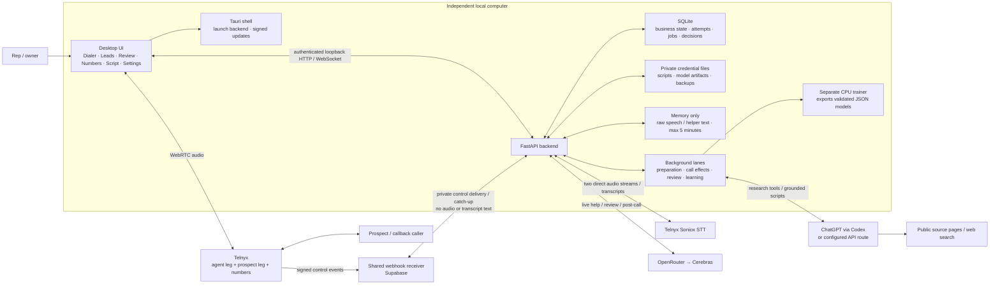
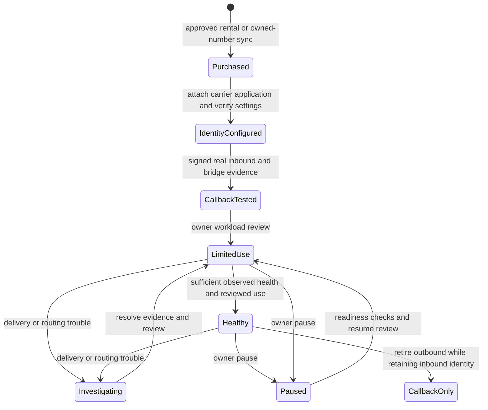
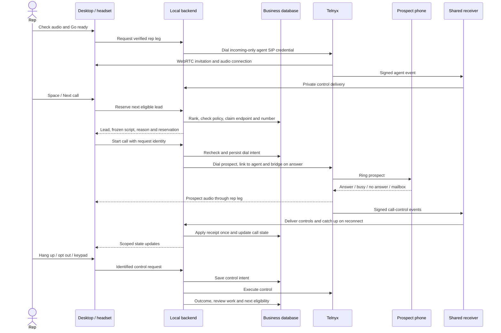
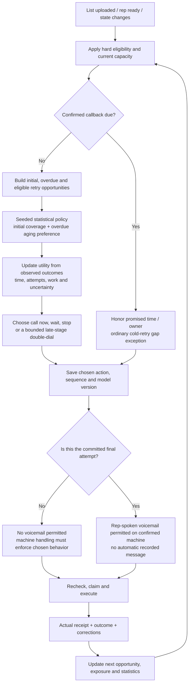
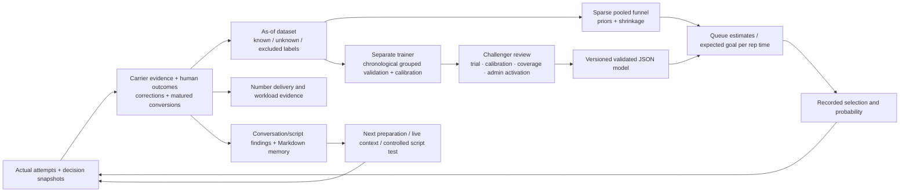

# OpenDialer architecture and calling-policy review

**Review date:** November 1, 2026. **Source reviewed:** `b577ffe`, application version 0.7.1.
The released application is built from `ca6ef1c`; subsequent changes through this snapshot are documentation.
This document describes the implementation and records the owner's new calling requirements. It does not
implement those requirements, register a number, buy anything, or change the installed application's settings.
It sits under [LEAN_PLAN.md](LEAN_PLAN.md); preparation and script learning retain their existing plans.

## 1. Read this first

OpenDialer implements a human-operated calling workspace: importing and researching leads, preparing scripts,
choosing the next eligible lead and caller number, connecting the rep to a prospect through Telnyx, live help,
post-call interpretation, follow-ups, reporting, statistical learning and number-capacity planning.

It does **not** yet implement the complete contact strategy now requested. Adaptive lead ranking exists;
adaptive retry spacing, a late-sequence double-dial policy and a final-attempt-only voicemail rule do not.
Number routing is implemented; business-name and reputation registrations are not automated.

Labels used throughout:

| Label | Meaning |
|---|---|
| **Current** | There is an active implementation in the reviewed source. This alone does not prove a real carrier call. |
| **Partial / defect** | Part exists, but a specific behavior is missing or incorrect. |
| **Required** | The owner has requested this behavior; it must not be presented as shipped. |
| **Proposed** | A concrete design or starting assumption for review, not an existing feature or measured result. |
| **External / unverified** | Requires provider, account, hardware, campaign or real-world evidence. |

The current Mac was previously checked on 0.7.1 with Telnyx, ChatGPT and OpenRouter configured and shared
webhook delivery Connected. A fresh read-only count for this review finds three test leads, zero call attempts,
zero numbers and two playbooks. The three leads use fictional phone numbers. No actual outbound call or
number warmup has happened in this workspace.

## 2. Overall architecture — current

The rep is the speaker. The model does not speak to the prospect. Supabase is a shared control-event delivery
service, not the local business database or an audio proxy. AI providers still receive the bounded context needed
for their requests; "local" does not mean provider-free or that no business context leaves the computer.

Sources: [desktop](../apps/desktop/src/App.tsx), [backend](../services/backend/app/main.py),
[runtime](../services/backend/app/runtime.py), [managed connection](../services/backend/app/managed_webhooks.py),
[direct speech](../services/backend/app/live_transcription.py), [deployment](../deploy/compose.yml).

## 3. Three deployment arrangements, two business-data modes

| Arrangement | Business state and workers | Public webhook / speech | User experience |
|---|---|---|---|
| **Local + shared webhook** | SQLite and jobs on each independent PC. | One common Supabase receiver routes signed controls to the right workspace. Speech goes PC → Telnyx/Soniox. | Import a private per-PC setup profile once; enter provider credentials or connect the computer's Codex login. No personal tunnel. |
| **Direct local** | Same local SQLite backend. | Operator supplies its own reachable HTTPS forwarding path to the local webhook; carrier transcription uses the direct webhook path. | More operator setup. This older option is retained; it is not required for managed local. |
| **Hosted / connected** | Shared PostgreSQL, API and background worker on the server; desktops sign in with roles. | HTTPS/Caddy receives the carrier webhook on the server. The managed-local audio path is not the hosted path. | Shared workspace operations and role scoping; a working server is required. |

Simulation is a development/test provider mode, hidden from normal release entry. It is not proof that Telnyx,
headset audio, purchased numbers or a live campaign work. Local callers have separate business stores; using one
webhook does not merge their leads or automatically distribute leads between them.

### Why background work exists

An imported list can require many web searches, script submissions and quote checks. Call effects must be sent
reliably, webhooks processed, transcripts reviewed and estimates refreshed without blocking the rep's controls.
The existing database-backed queue does this. It is not another SaaS service a local caller must install.

Current lanes: webhook, call control/maintenance, live help, post-call, research, scripts and ML. They use saved job
identities, due times, leases and bounded concurrency. Local jobs live with the local backend; hosted deployment
keeps live work in the API process and heavier research/scripts/ML in a background process. CPU fitting runs in a
separate trainer. Raw conversation content does not travel to that preparation/training worker as a job payload.
The app must remain running and the PC awake for local background work and timely local callback handling.

### Delivery and network boundaries

Managed local uses outgoing authenticated connections from the PC. An exclusive lease (45 seconds), private
channel and fresh probe prevent two independent computers from consuming the same workspace stream; idle
probe/catch-up RPC runs about every 20 seconds. A restart may wait for the prior lease to expire. Calling readiness
requires fresh delivery and drained pending controls, not merely a saved webhook URL. Signed payloads are
deduplicated; acknowledgements clear delivered payloads, while missed/expired events produce an explicit gap.
Pending payload retention is 24 hours and dedupe/routing retention is bounded, with scheduled cleanup.

Supabase egress is controls, probes and catch-up responses. Two audio streams go separately to Telnyx/Soniox;
research pages and bounded AI request/response context are further external traffic. Two-second helper scheduling
does not mean two-second Supabase audio transfers. The architecture reduces relay traffic but does not establish
a measured monthly allowance or guarantee Free-tier uptime/capacity. Monitor actual usage before claiming a free
deployment can sustain a particular number of callers. See [relay operations](../supabase/README.md).

## 4. Where state lives and how it changes

| State | Durable location | Updated by / important limit |
|---|---|---|
| Workspace, users, roles, policies, campaign goal | SQLite locally or PostgreSQL hosted | Setup and versioned owner/admin edits. A local session, provider login and relay session are separate credentials. |
| Leads, full imported row, endpoint and company group | Business database | CSV import, endpoint corrections, preparation, attempts and reviewed outcomes. State/area-code guesses do not establish a reliable timezone. |
| Base Markdown script, versions, option IDs, per-lead picks/written blocks | Business database | Seller edits and validated preparation submissions; call gets a frozen script snapshot. |
| Verified research facts, source URLs and quotes | Business database | Preparation tools and source verification. The source can expire or change. |
| Attempts, carrier references, effects, webhook receipts, reservations | Business database | Calling service and signed receipts. Unknown provider effects stay unknown until reconciled. |
| Transcript segment metadata, counters, structured observations | Business database | Speech ingestion, review and human corrections. Metadata is not a permanent transcript. |
| Raw transcript/helper text and audio buffers | Bounded process memory | Expire within five minutes; an expired segment is unavailable, not reconstructed from labels. No recording feature. |
| Call rundown, scores, commitments, tasks, notes, coaching points | Business database | Validated model outputs and human corrections, with source/review state. Partial analysis is represented explicitly. |
| Statistical selection profile, datasets, trials and decisions | Database; model artifacts in data directory | Optimization refresh, separate training, reviewed activation and rollback. |
| Script memory Markdown | Versioned database records; downloadable `.md` | Learning refresh rewrites the learned part and preserves team notes. It is not a second always-running filesystem agent. |
| Number ownership, routing evidence, callback proof, usage, health | Business database + carrier account | Sync, configure/read-back, real callback receipts and workload review. Local readiness is not proof of reputation registration. |
| Provider keys, personal Codex auth and relay sessions | Encrypted credential files | Settings/auth flows; automatic private desktop key file, no OS credential-store prompt. Hosted API/worker share an explicit key. |
| Pending opt-outs and offline UI copies | Desktop local storage | Opt-outs queue immediately and block further calling until synchronized. Offline copies omit raw speech/helper text. |
| Relay event payloads, routing maps, leases and Auth | Shared Supabase service | Signed receiver, restricted RPC/private delivery and retention jobs; no lead lists, scripts, model training or speech. |
| Provider usage and bill reconciliation | Usage ledger + imported carrier evidence | Actual, estimated and uncertain charges stay distinguishable. A configured budget is not a prepaid carrier balance. |

UI refreshes use authenticated API reads and scoped live events. A changed input creates/coalesces follow-on jobs.
Publication rechecks source versions; a late model response must not overwrite newer seller edits or corrections.
Business backups exclude provider credentials. Restoring or moving a PC needs its credentials/key or re-entry,
plus deliberate relay ownership recovery; copying one profile to two independent stores is not supported.

## 5. Setup: what is automatic and what the owner supplies

| Step | Current mechanism | Owner / operator input still required |
|---|---|---|
| Start local workspace | Desktop launches a private loopback backend and opens the existing local store. | Business/workspace identity and the computer being on. |
| Connect calling | Managed setup import supplies assigned applications, public verification key, SIP username, credential ID and a scoped relay login. | Provisioned per-PC profile and a usable Telnyx API key/account. No separate SIP password in normal managed setup. |
| Connect preparation | One click can use the existing computer Codex login; a personal login file can also be chosen. API route is optional. | Valid ChatGPT/Codex entitlement/session, or an API account. Shared-login use is not an isolated new OAuth login for each app. |
| Connect live help and call review | OpenRouter/Cerebras route and output validation. | OpenRouter key, provider eligibility/credits and the configured data-handling permissions. |
| Supply campaign | Parse one script; retain full lead rows; queue preparation after import. | Real seller wording, facts/limits, lead list, trustworthy endpoint/timezone and campaign goal. |
| Screen numbers | Internal opt-outs, imported national/state coverage, optional manual prepaid check. | Authorized fresh registry coverage or approved paid lookup. No DNC API key is mandatory; a verbal claim of manual screening is not a stored clearance. |
| Approve calling | Saved hours, attempt policy, business/carrier approval and permissions. | Actual business/carrier eligibility and deliberate approval; no invented references. |
| Get caller numbers ready | Search/quote/purchase or sync; configure carrier route and verify callbacks. | Exact rental approval and a real inbound test, then limited-use review. |
| Connect audio | Browser SDK connects the rep leg; headset checks report readiness. | OS microphone permission, working input/output, and the rep going ready. |

The normal session is: open app → check audio/readiness → Go ready → Space/Next call. The scheduler supplies the
next eligible person and their prepared script. A rep can preview the next lead before starting. It is not an
unattended prospect-calling agent.

### Intended rep experience: upload a list and take the conversations

The owner clarified that, after one-time business/provider/number/script setup, the rep should only need to import
lead lists and speak to prospects. While the rep is ready and their headset is connected, the system should research
the list, prepare each script, select eligible work, start the next permitted call, assist during it, interpret
the outcome, update commitments/memory/statistics, and continue automatically. Waiting for a future window or
requested callback is normal scheduling, not a reason for the rep to maintain a manual queue. Prep can run ahead;
the first ready leads need not wait for the entire list. Pause, opt-out and immediate hangup stay under rep control.

**Current gap:** Space/Next call is the normal start/advance action. The only general automatic advance currently
implemented here is the optional path after a finalized voicemail. The desired automatic loop after other ended
calls and after list import is not shipped. It needs to respect rep readiness/idle pause, pending opt-outs,
unresolved carrier effects, analysis-dependent holds and explicit requested commitments. Never place a prospect
call merely because an upload finished while the rep is away or audio is unavailable.

**Learning gap:** automatic interpretation is not the same as observed ground truth. The existing learner excludes
AI-only/provisional outcomes from observed labels, and a held meeting or sale needs external evidence or human
confirmation. To make most daily operation automatic, use trusted carrier/CRM/calendar receipts where available
and ask for only the remaining material corrections. No current calendar/CRM integration proves meetings held
without the rep. A model should not train on its own unverified summaries as if they were successful outcomes.

## 6. Numbers, registration and warmup

### 6.1 Current lifecycle

Actual stored lifecycle values include `purchased`, `identity_configured`, `callback_tested`, `limited_real_use`,
`healthy`, `investigating`, `paused_for_outbound`, `remediated` and `retired_callback_only`. The diagram condenses
those for readability. The review can mark a resumed number healthy when health is observed; it does not require
a fixed number of calendar days or a universal warmup-call count.

### 6.2 Mechanical setup and registration are different

| Item | Current automation | Is the number fully set up afterward? |
|---|---|---|
| Search SF/NYC inventory and exact rental quotes | Yes, read-only search; each purchase needs approval within count/cost caps. Manual area-code search does not require accepting a capacity proposal. | No; an owned rental still needs routing and readiness. |
| Sync an existing Telnyx rental | Yes. | Ownership/inventory only. |
| Attach the Voice API application and keep recording disabled | Yes, through Configure voice route plus provider read-back. | Route is configured; reputation enrollment is separate. |
| STIR/SHAKEN call signing | Telnyx does this at the carrier layer; it is not an app registration form. | Attestation is not a guarantee of caller-name display, pickup or freedom from spam labels. |
| Outbound CNAM business-name listing | **Not implemented in the app.** Configure with Telnyx. | CNAM is separate from the route and not uniformly displayed on mobile networks. |
| Free Caller Registry / Hiya / First Orion / TNS enrollment | **Not implemented in the app.** Requires business/number submission through the supported external process. | Submission, acceptance and later reputation are distinct states. |
| Real inbound callback test | App records and checks matching signed evidence; a person must place the test call. | Necessary before outbound limited use; proof expires or is invalidated when the route changes. |
| Limited-use approval and daily-cap increases | Owner/admin review. | Bounded calling is allowed after the other gates; it is not certification of a clean number. |
| Delivery monitoring | Yes, observed health refresh and adaptive effective capacity; external reputation can be imported. | The app does not automatically buy reputation checks or promise a live carrier spam-label feed. |

Telnyx documents automatic signing and free outbound CNAM listing separately:
[STIR/SHAKEN](https://support.telnyx.com/en/articles/5402969-stir-shaken-with-telnyx),
[caller-name setup](https://support.telnyx.com/en/articles/1130720-caller-id-outbound-vs-cnam).
Its [delivery guidance](https://support-v2.telnyx.com/en/articles/15395095-understanding-sip-603-carrier-rejections)
also recommends accurate identity, legitimate registration and gradual normal traffic. Those provider statements
do not mean OpenDialer has already submitted registrations. No live registration status was inspected in this task.

### 6.3 Current warmup cadence

- New inventory normally starts with a **five-attempt daily cap**. This is a software starting default, not a
  carrier-approved or statistically established safe rate.
- The owner's reviewed cap and available staffing bound use. The current recommendation can reach the configured
  ceiling with sparse/unknown health; it is **not** an evidence-calibrated multi-day ramp.
- Calls happen only in an active rep session against eligible leads. There are no synthetic background warmup
  calls and no automatic "leave it running overnight" routine.
- Health can reduce effective capacity or hold outbound traffic. Inbound callbacks remain retained.
- An increase requires workload review. Merely waiting several days does not increase the cap or enroll anything.
- The current daily-use query uses the backend clock's midnight boundary (normally UTC), not a rolling 24-hour
  allowance per number. An eventual warmup/pacing policy needs an explicit window definition and protection
  against bursts around a reset; a calendar counter alone is not a traffic ramp.
- Multiple ready numbers share new-lead workload within each approved limit. Existing lead/caller bindings remain;
  a bound lead waits at its number's cap instead of silently switching identities to evade the cap.
- More numbers do not create rep time, screened leads, caller registration or permission to contact a person.

**Current answer:** numbers are not fully set up automatically. Until an owned number passes the route, callback
and limited-use steps, the app should keep it out of outbound selection. Reputation enrollment remains external.

### 6.4 Required simplification and proposed warmup improvement

Provide one visible per-number checklist: owned → route verified → caller-name/registration status → callback
verified → limited use → observed health. Label external/manual steps honestly; complete supported provider API
steps automatically after an authorized setup action. Do not claim unsupported registry submissions are automatic.

**Proposed:** an evidence-aware ramp inside an owner-approved maximum. Seed a conservative starting allowance,
spread genuine calls through available business hours, and revise allowance from delivery, answer, duration,
complaint/opt-out and rejection evidence. Sparse data must not be interpreted as a clean reputation. Persist every
change and its reason. Reductions can be immediate; increases need bounded growth and enough evidence. This ramp
is missing today; exact growth bounds and auto-increase authorization need a decision, not invented success data.

Sources: [carrier operations](../services/backend/app/providers/telnyx.py),
[onboarding/readiness](../services/backend/app/number_operations.py),
[workload review](../services/backend/app/optimization/api.py),
[health and number selection](../services/backend/app/optimization/numbering.py).

## 7. One outbound call — current sequence

The backend rechecks authorization when reserving and again before carrier submission. Only one active prospect
conversation is assigned to a rep. A persistent rep leg can remain parked between calls; its carrier usage can
therefore extend beyond prospect conversation minutes. A database job retry is not permission to place a second
prospect call. Lost/uncertain dial responses reconcile the original carrier effect before any further submission.

Current dial payload links the rep, bridges on answer, parks the rep after unbridge, prevents double bridge and
sets a maximum call duration. It does not explicitly request Telnyx answering-machine detection. Existing machine
event handlers therefore do not establish that automatic machine classification works on the deployed route.

Sources: [reserve](../services/backend/app/scheduling/queue.py), [dial intent](../services/backend/app/service.py),
[agent and controls](../services/backend/app/telephony/workflows.py),
[recovery](../services/backend/app/telephony/recovery.py), [UI](../apps/desktop/src/components/DialerPage.tsx).

## 8. Current eligibility, queue, number allocation and cadence

### Hard checks before ranking becomes a real call

The endpoint must be valid, not suppressed or on hold, screened for that exact number and permitted by campaign
policy. Business/carrier permissions, known prospect timezone/calling window, attempt limit, next due time,
retry cooldown, rep/audio readiness, ready caller number and managed-delivery health must all permit the call.
The app's current general window is 08:00–21:00 prospect time; it is a setting, not a declaration that all campaigns
in all places may call throughout that entire interval. Existing appointments do not override suppression.

### What chooses the next lead now

1. Scan due eligible work in bounded pages; consider callback/request and coverage priorities.
2. Estimate pickup, right-party reach, goal conversion and expected work from the saved statistical profile;
   use a valid active model when available, otherwise pooled estimates.
3. Prefer due callbacks, requested contact and overdue coverage ahead of ordinary score-ranked work.
4. In ordinary work, retain the control/experiment allocation and rank by estimated goal yield per rep time.
5. Claim the endpoint and number atomically; if another rep wins the claim, select again.

Initial attempts are represented by `attempt_count = 0`, but there is **no explicit first-pass preference learned
from an initial/overdue policy prior**. A coverage date defaults to approximately one day after import. Due priority
is currently a fixed rule; the import deadline is not a fully maintained per-opportunity contact schedule.

### Number choice now

Retain the bound caller ID first. Otherwise use a ready same-state number, or an explicitly general-purpose number.
Within that pool: capacity/load, daily usage and health precede exact area-code matching. No geographic-distance
calculation exists, and an arbitrary different-state number is not the automatic fallback. A bound lead whose
number is full waits; reassignment is an explicit reviewed action that keeps the old inbound identity reachable.

### Retry spacing now

Default maximum is four actual attempts per lead; default minimum retry interval is one hour. A submitted attempt
increments the counter and sets `next_attempt_at`. This does not learn a next-day/multi-day delay, distinguish a
late double-dial pair, or guarantee a first attempt for every lead before repeats. Forecast retry scenarios do not
become reservations or a learned execution policy. Your new ordinary-gap requirement is not active in 0.7.1.

There is an additional fairness risk to verify: overdue coverage is ranked ahead of ordinary work, but the source
does not advance the original `coverage_due_at` after every attempt. Repeatedly overdue old leads must not consume
all opportunities after their cooldown. This is distinct from the confirmed short-callback defect below.

## 9. Required calling policy — proposed implementation

**Owner requirements recorded November 1:** favor initial and overdue calls; start with explicit statistical
assumptions and update them from outcomes; ordinary attempts at least about a day apart; double-dial only near
the end; allow voicemail only on the final decided call; honor requested callbacks.

The owner confirmed **rep-spoken voicemail only** and **a double-dial in the final outreach stage**, with that
stage policy allowed to change later. Start with at most one immediate second attempt in that stage. The current
final-stage restriction is a versioned policy setting, not an unchangeable constant. Statistical evidence can
inform future policy changes; the model chooses whether to use the action within the currently allowed stages.
Do not silently treat a new model score as a change to the active stage restriction. Prerecorded drop stays off.

### 9.1 Constraints versus learned preferences

| Type | Proposed handling |
|---|---|
| Opt-out, ownership, screening, time window, rep/audio, account limits | Hard eligibility. The model cannot learn to violate them. |
| Ordinary repeat spacing | At least **24 elapsed hours** as a conservative reading of "a day", then a permitted business/calling window. A confirmed requested callback is a separate action. |
| Double-dial eligibility | A single second dial in the final stage under the initial active policy, after an eligible non-conversation outcome. Allowed stages can be changed through a recorded policy version. Never after opt-out, wrong/invalid endpoint, a live conversation, booking or a pending requested callback. |
| Attempt and pair limits | Both actual dials consume attempts and number capacity. No recursive retry pairs or counter reset through number reassignment/restart. |
| Voicemail | Only the committed final attempt of the current ordinary outreach sequence. If a late pair is selected, the first dial cannot leave voicemail. |
| Initial/overdue preference | Seed the policy toward first contact and aging overdue work. Learn ranking strength from sufficient data, with a maximum-wait/coverage safeguard against starvation. |
| Calling time and ordinary retry spacing above the floor | Learn from opportunities actually observed, with uncertainty and available business windows; do not infer causality from pickup rates alone. |
| Stop / further attempt decision | Compare expected incremental value, rep time, attempts already spent, stage and response; enforce the agreed maximum. |
| Caller-number allocation | Stable identity and route eligibility remain hard; rank usable numbers by geography, load and observed delivery within reviewed caps. |

The owner asked for initial/overdue **base assumptions**. They should be visible policy priors, not hidden magic
constants and not proof that a new lead converts better. A prior should carry its source, version and uncertainty.
Weights may change only with logged exposure and enough evidence; compliance and the owner's explicit late-stage /
final-voicemail bounds remain constraints until the owner changes them.

A minimal base-policy parameter set would include an initial-contact preference, overdue-aging preference,
stage/attempt effect, incremental value of an eligible late second dial, and the value/cost of waiting for another
business window. Initialize the first two in the owner's preferred direction, with explicit uncertainty, and the
unmeasured incremental double-dial effect conservatively. These are policy-utility assumptions, not fabricated
successful calls in the training set. Reuse the existing estimate-policy/version and selection-record mechanisms;
do not add a competing queue or a heavy learning service. Exact prior strengths require review and later
calibration. Explain each decision with its base preference, observed adjustment, uncertainty and next due time.

Keep separate outputs for **predicted pickup/conversion**, **coverage urgency** and **chosen action**. Favoring an
initial call for coverage does not require lying that it has a higher predicted pickup rate. A due commitment or
maximum-wait safeguard can require service even when the expected-value model ranks something else higher.

### 9.2 A starting sequence, not a shipped fixed cadence

Illustrative default with the current four-attempt ceiling:

| Opportunity | Earliest normal timing | Allowed decision |
|---|---|---|
| First call | Eligible initial business window | Initial call; no voicemail. |
| Second ordinary call | At least 24 hours after the first, within an allowed window | Call, wait longer or stop based on updated context; no voicemail. |
| Late stage | At least 24 hours after the previous ordinary opportunity | Decide before dialing whether this is one final call or an optional two-dial pair. |
| Final late dial | The late stage's one remaining chosen attempt | Optional voicemail only here, if a mailbox is actually confirmed. |

This is an example to explain the state machine, not a claim that 24-hour retries or three stages are universally
optimal. If the final stage uses only one dial, that dial can be designated final without consuming a fourth
attempt. If it selects a pair, the first dial is not final. If the first dial connects to a person, cancel the
second. A requested callback replaces the cold-outreach action; it does not restart the sequence automatically.
After its committed final attempt, close the ordinary outreach sequence. A later model refresh must not silently
extend it, create another "final call" or repeat the voicemail. A new prospect request or explicit reviewed
reopening is a separately recorded event, retaining suppression and historical attempt evidence.
The immediate retry delay is a bounded policy parameter still to decide and test; do not invent a carrier-approved
number of seconds. The app continues working other leads while any ordinary retry is not due.

### 9.3 State needed to make this real

Extend existing lead/attempt/decision records rather than introduce a second scheduling system. Proposed fields:
`sequence_id`, `cadence_policy_version`, `stage`, `next_eligible_at`, `attempts_remaining`, `double_dial_pair_id`,
`pair_index`, `final_attempt`, `voicemail_allowed`, `callback_source_id`, `decision_model_version` and `reason`.
Save the selected action and its probability/eligible alternatives before submission; reference them from the
actual dial and outcome. Version changes invalidate pending proposals; committed or uncertain carrier effects
are reconciled, not erased. Restart, loss of a response or an AI timeout must not cause an extra dial.

Call intent, forecast and authorization must use the same cadence function. A plan must not reserve a retry
that the live queue forbids, and UI copy must not call every cooldown expiry an "optimal time to call".

### 9.4 Counterfactual and fairness limits

The current outcome model estimates observed call success; that is not the incremental benefit of calling
again, double-dialing or waiting. Those actions need separately recorded exposure, an eligible comparison and
matured outcomes. Retain a small reviewed comparison/holdout allocation, examine results by initial/retry/stage,
and keep unique leads and actual rep time in the denominator. Do not train a policy to favor only easy leads and
then claim its higher observed pickup proves all harder leads should be abandoned.

## 10. Voicemail: detection, message delivery and final-call enforcement

**Current:** no automatic outbound prerecorded voicemail drop. Outbound playback/gather commands are blocked,
including older queued commands. The rep's audio is bridged on answer; the rep can hear a greeting and manually
speak a message. Known machine events can classify a mailbox outcome, and reviewed post-call context can assist
outcome handling. Optional advance starts the scheduler's next eligible lead five seconds after a finalized
voicemail, with cancellation and pause checks. It is not a double-dial command.

**Partial:** the dial payload does not explicitly enable answering-machine detection; handlers alone do not prove
the carrier emits it. No field or gate currently restricts voicemail to a committed final outreach attempt.

**Required:** a saved final-attempt decision must control the voicemail permission. On a selected late pair,
voicemail is forbidden on the first dial and can be allowed only on its final dial. Unknown/silent/ambiguous
classification must not be assumed to be a mailbox.

There is a mechanical distinction: a UI instruction cannot prevent a rep who is already bridged from speaking a
voicemail early. Strict automatic enforcement requires a qualified media/AMD path that can terminate a non-final
mailbox attempt before message delivery while protecting late human answers. That must be tested with real
carrier timings and false-positive cases. Until then, a rep-spoken restriction is a visible operational rule,
not a guaranteed machine-enforced feature. The owner confirmed rep-spoken delivery only; automatic recorded drop
remains off and is outside the selected design.

## 11. "Call me back" and inbound callbacks

### Requested outbound callback

**Current:** model interpretation can extract a source-linked commitment and create/update a local task. A clear
dated rep-owned callback can become open; ambiguous dates/timezones or an undated rep-stated callback need
confirmation. The rep can record, confirm, reschedule, snooze, reassign, complete or cancel it. The lead receives
the due time/owner; a callback due now is prioritized ahead of ordinary work. New model text does not silently
overwrite a human-edited promise. These are local commitments, not external calendar invitations or sent emails.

**Confirmed defect:** the generic cooldown still applies to requested callbacks. A five-minute callback is saved
but remains blocked by the default one-hour interval. The existing due-callback test uses a 61-minute promise;
changing the audit case to five minutes and checking at six minutes reproduced the failure. The new 24-hour
ordinary interval must not make this worse. A verified requested callback needs an explicit ordinary-gap exception,
while retaining opt-out, time-window, owner, audio and number checks. Callback handling at an exhausted ordinary
attempt cap also needs a defined exception/confirmation rule; it must not be silently dropped or reset the counter.

### Person calls your number back

**Current:** signed inbound events identify the retained caller number, resolve a local lead/owner where possible,
then try the original rep, an available teammate, the configured business fallback, and a spoken-message/task path.
Routing has deadlines, hangup handling, bounded attempts and recovery. Callback evidence requires a matching
connected inbound/bridge receipt, not an operator's typed note. Local sleep/offline state is not an always-on
answering service: configure and test the carrier fallback for the offline case.

Sources: [commitments](../services/backend/app/postcall/commitments.py),
[dates](../services/backend/app/postcall/dates.py), [rep follow-ups](../services/backend/app/rep_workflows.py),
[inbound routing](../services/backend/app/telephony/callbacks.py).

## 12. Speech and live help

Managed local calling uses the SDK's existing rep and remote tracks. AudioWorklet converts bounded PCM frames,
the UI sends each side over authenticated loopback sockets, and the backend opens two direct Telnyx/Soniox
streams using the saved key. The key stays out of browser audio frames. Interim and final utterances arrive
continuously; there is no two-second batch transcription upload or transcription routed through Supabase.

Final transcript updates coalesce automatic helper work into fixed **two-second scheduling windows**. That is
when helper requests can start, not a promise a visible tip arrives every two seconds; network/model/review time
and insufficient evidence can delay or suppress it. F1/private help requests an answer immediately. Tips can be
muted/pinned/cancelled; selective review can remove an unsupported part while retaining a supported question.
OpenRouter is restricted to the configured Cerebras route; an unavailable route does not silently switch providers.

Source gaps, stale context, speech permission revocation or failed capture mark analysis incomplete and can block
new managed-local calls pending recovery. Existing hangup/recovery controls remain important. Raw speech, quotes
and helper text expire within five minutes. A long call's final summary gets its still-live bounded transcript
plus accumulated structured state; it does not recover an entire permanent recording after expiry.

## 13. Model roles, tools and who can change state

| Role | Current provider / mechanism | Writes and limits |
|---|---|---|
| Lead research and per-lead script | ChatGPT via Codex, `gpt-6.1-terra` / `max`; optional API route | Agent tools `save_facts`, `finish_research`, `submit_script`, `skip_lead`; app verifies sources, options, claims and current input versions. |
| Live helper / private help | OpenRouter → Cerebras | Streams user-facing suggestions; it cannot buy a number, dial an extra prospect, change policy or directly edit the database. |
| Conversation interpretation, independent review and finalization | Current code uses `configured_coach`, also OpenRouter/Cerebras | Strict structured outputs, source/version checks and application publication reconcile observations, scores and local commitments. This is not the same provider route as preparation. |
| Statistical selection and health | Local Python estimates / validated model artifacts | Produces rankings and health; cannot override hard calling authorization. |
| Script memory and proposals | Local statistics plus validated writer route | Memory versions, controlled variants, settlement and rollback; locked identity/claims remain checked. |
| Human owner / rep | UI actions authorized by role | Corrections, approvals, exact purchases, callbacks, goals and permitted configuration. |

The owner's rule is that models act through tools. Preparation already exposes named agent tools. Post-call
currently submits a structured state diff through application validators/commit functions; it is **not uniformly
a named external function-tool loop**. Free-form prose does not execute actions, but if literal named tools are
required for every post-call action, that interface still needs aligning. Preserve the working strict-output
adapter for Cerebras; do not assume forced function-call schemas are supported. One application action boundary
should own effects, regardless of provider transport, with structured intentions turned into named validated
commands and receipts. The statistical policy, not an unconstrained LLM, should own call timing decisions.

## 14. Statistical ML: how decisions learn today

### Current cold start

There is no pretrained universal sales-success model hidden in the app. Sparse pooled estimates exist from day
one. Defaults are pseudo-counts, not observations:

| Conditional stage | Current prior `(success, failure)` | Starting mean |
|---|---|---|
| Human pickup | `(2, 8)` | 20% |
| Right party, given human | `(1, 2)` | about 33% |
| Goal conversion, given right party | `(1, 3)` | 25% |

Cells use segment, local hour, weekday/weekend and attempt count, with pooling/shrinkage for sparse support.
Expected work starts from a declared handling-time assumption. The ranking score is the product of the three
conditional probabilities divided by expected rep seconds. Support/uncertainty and unknown labels are reported.
The current priors concern funnel outcomes; they do not encode the newly requested initial/overdue action-policy
preferences, late double-dial value, warmup ramp or voicemail timing.

### What changes over time

1. Store decision-time features: local time/day, attempt count, elapsed time, source age, endpoint evidence,
   number health, segment, callback history and available prior conversation features.
2. Store actual receipts/outcomes and their availability times. Do not use future outcomes in an earlier dataset.
3. Keep human pickup, right-party contact, qualified conversation, meeting booked, meeting held and sale won separate.
   A booking is not a held meeting. The current default goal is `meeting_held`, with a 14-day attribution window.
4. Do not label an unknown or not-yet-matured outcome a failure. AI-reviewed/provisional outcomes are excluded from
   the observed training labels unless the required human/observed source exists.
5. Refresh the saved selection profile from current statistics; periodic optimization is announced in 10-minute
   buckets, with maintenance checking periodically. Completion time depends on available work and load.
6. Queue health, capacity and learning refreshes. Automatic training is enabled by default after at least 100 rows,
   but support/calibration requirements can still prevent a usable challenger.
7. Fit calibrated funnel classifiers in the trainer. Chronological/grouped splits and label availability constrain
   training; artifacts are checked JSON rather than Python pickle loaded in the calling process.
8. A challenger does not become active merely because training finishes. Evidence, controlled trials, coverage,
   calibration and administrator activation are checked. If the artifact/configuration is invalid, use pooled
   estimates. Keep a reviewed production control allocation and retain rollback.

Actual outcome updates, automatic retraining, policy-weight updates, model activation and signed software updates
are distinct operations. A fresh model does not install a new app, and an app update is not new outcome evidence.

### Extending this principle to most adaptive choices — required design direction

| Decision | Current base / learning | Required extension or deliberate fixed boundary |
|---|---|---|
| Which lead now | Funnel priors + learned estimates; fixed callback/coverage precedence | Explicit initial/overdue policy features, aging/coverage safeguard and action exposure logging. |
| When to retry | Fixed minimum and due fields | Learned waiting-time/action choices above the ordinary 24-hour floor, with clear callback and late-pair exceptions. |
| Whether a late double-dial helps | No action policy/data treatment | Conservative prior and eligible controlled comparison; both attempts count. No automatic early-sequence retry. |
| Whether this is the final call | No explicit committed sequence field | Saved stop/continue decision with bounded remaining attempts; gates voicemail before dialing. |
| Which caller number | Stable identity, state match, load/health; area-code tie-break | Retain identity constraints; learn supported delivery/workload preferences with adequate evidence. |
| Number warmup capacity | Initial cap, reviewed maximum, observed reduction | Evidence-aware pacing/ramp with bounded increases and sparse-data caution. |
| Time/work estimates | Declared assumptions replaced by observed support | Continue showing assumptions, sample counts and as-of time. |
| Script options/offers/objections | Per-lead agent picks; observed associations and controlled proposals | Add only grounded context; learn causal claims through comparisons, not raw correlations. |
| Live coaching choices | Bounded context, grounded generation, review and strategy comparisons | Keep uncertainty/abstention; do not optimize tip frequency as if it were sales lift. |
| Permissions, opt-outs, screening, quiet hours, spending ceiling | Fixed authorized constraints | Never learned away by a model. |

Sources: [sparse estimates](../services/backend/app/scheduling/models.py),
[features/labels/selection](../services/backend/app/optimization/learning.py),
[refresh](../services/backend/app/optimization/workflows.py), [training](../services/backend/app/ml/training.py),
[serving](../services/backend/app/ml/serving.py).

## 15. Preparation and script memory

One seller Markdown script defines Opening, Screening, Discovery and Close, with optional Gatekeeper, Offers,
Objections, Facts and Never say. Bullets define alternatives; `{{ instruction }}` defines a per-lead written block.
The parser checks structure, seller identity, placeholders and line-numbered errors. Imported rows preserve bounded
extra columns for context. Agents group contacts from the same company to share research and run with bounded
concurrency (default five leads per agent, two agents at once).

The preparation agent searches, submits facts with URLs/exact quotes, closes research and submits valid script
picks/written blocks. Source fetches verify quotes/company context; generated factual lines must cite accepted
facts and pass claim/meaning checks. Agents can correct rejected tool submissions. Budget or plan-limit handling
pauses/retries appropriately; preparation failures eventually expose an honest base-script fallback. Skipped leads
show a reason. "Preparation closed" is not the same as "allowed to call": screening, time, capacity and all other
eligibility checks still apply.

Changing the script, lead input or relevant memory invalidates stale work. During calls the rep sees the frozen
lead-specific script and can open alternatives. A later script change must not rewrite what the rep used on a
past attempt. The memory is real: versioned Markdown in `script_memories`, with learned sections and protected team
notes. Its digest informs preparation; supported findings can inform live help.

Script learning uses actual delivered-section traces, categorical reactions and outcomes. It requires sufficient
distinct leads and later-period support before describing supported associations. Proposals run against a frozen
base in controlled script tests. Script promotion can be automatic or require review per campaign settings; it is
different from statistical model activation. A changed base invalidates an old candidate's promotion. Screening,
identity and unsupported promises cannot be rewritten away. Raw prospect quotations do not become permanent script
memory. See [SCRIPT_LEARNING.md](SCRIPT_LEARNING.md) and [CAMPAIGN_PREP_PLAN.md](CAMPAIGN_PREP_PLAN.md) for history;
older UI names/slot-filling descriptions there are not all current.

## 16. Post-call review, correction and the learning loop

Ending a call queues finalization against its current source signature. The model receives the still-live call
context, accumulated state, rubric, notes, facts and existing commitments. It proposes a rundown, observations,
rubric/tracker updates and coaching points. Independent/source review and version checks decide what can publish.
Missing/expired material remains partial. A rep can correct outcomes, contact role, notes, commitments, scores
and appealed evaluations; corrections propagate to relevant follow-ups, packets, reports and future datasets.

Carrier-known outcomes can save automatically. Reviewed AI dispositions are provisional for observed model-label
purposes; bookings, callback dates and ambiguous interpretations retain their relevant review/confirmation path.
Do not infer a confirmed sale or held meeting from a generated summary. A company booking holds sibling contacts;
correcting/retracting that booking releases the appropriate hold. Wrong-party/invalid/opt-out outcomes preserve
endpoint/suppression evidence rather than simply trying the same number again.

Review's practice surface is a plain coaching list: what to work on and how, updated by the call-review agent.
It is not an AI rehearsal call. Goals, examples, snippets, follow-ups, scores, rubrics, comments and history remain
available through their existing views/expanded operations. Cold-start statistics and absent outcomes must be
shown as such; a blank coaching list before calls is expected.

## 17. Capacity, reporting, costs and operations

- **Capacity planner:** known next attempts, rep availability, number caps, current use, active reservations,
  callback ownership and calling windows determine feasible capacity. Named staffing avoids counting the same rep
  twice. Retry scenarios are separate conditional estimates; they do not authorize or pre-book later calls.
- **State/list allocation:** a named list or whole campaign can be forecast. Existing numbers are shared;
  familiar metros are search suggestions, not proven pickup lift. An SF and NYC number normally cover CA and NY
  state pools; this is not a distance-based city allocator. A purchased number still needs readiness.
- **Procurement:** exact quote approval, count limit, initial-cost cap and monthly cap for app-ordered rentals.
  Pausing does not cancel rent. Uncertain orders reconcile their original intent instead of ordering again.
- **Reports:** current source queries real records/as-of labels; earlier documents describing a separate
  incremental projection engine are historical. Unique lead reach, attempts, stage outcomes and conversion
  attribution differ. Repeated dials must not inflate unique reach. Rep-hour measures use observed work intervals,
  including corrections; absent intervals are unknown rather than zero-cost labor.
- **Costs:** per-request usage/estimates and uncertain receipts remain explicit; carrier imports and credits
  reconcile billed effects. Plan-included ChatGPT work books zero API charge but remains subject to plan limits.
  Metered preparation is budgeted per list; calling permission does not depend on an AI budget. Carrier leg time,
  STT audio minutes and model requests are different charge bases. Do not quote one API-leg rate as the total call.
- **Backups and recovery:** export/restore business data, retain original identities, reconcile active effects,
  then resume. Offline viewing does not mean offline dialing. Pending opt-outs must synchronize before calls.
- **Users and roles:** owner/admin configuration and rep-scoped calling/review. Hosted workspaces can share data
  and tasks according to role; managed independent local stores do not automatically do so.
- **Goal changes:** begin the appropriate evaluation definition/cohort and reconcile leads/holds; old histories
  remain distinguishable. Model/test evidence under a previous goal is not automatically current.
- **Security:** authenticated loopback launch, role/tenant checks, origin checks, secret-safe validation, private
  key files and signed updater. Business databases/exports are not app-encrypted. No Keychain prompts.

## 18. Release, data refresh and software updates

Source changes → regression/acceptance tests → SQLite and PostgreSQL suites → frontend/browser checks → native
sidecars/packages → GitHub CI → signed Mac/Windows release artifacts and manifest → installed signed updater →
normal restart and preserved-workspace verification. Production signing secrets remain in CI. Do not manually
replace the installed bundle with an unsigned development build. App updates preserve current workspace data;
older 0.2/0.3 stores remain in older folders rather than being silently adopted.

Provider credential refresh is separate: the managed relay SDK refreshes its session, and Codex refreshes through
its supported auth/runtime flow. A login status is not a successful paid/model request. These flows should not
request OS credential-store approval. Apple notarization, Windows publisher signing and clean-machine installer
checks remain separate evidence from the updater signature and the current Mac's bundle check.

## 19. Complete feature coverage and evidence map

This is a semantic inventory, not a regenerated AST listing. The older [HANDOFF_AST.md](HANDOFF_AST.md) remains
a dated code snapshot. "Current" below means source exists, not that the current zero-number workspace has exercised it.

| Area / feature | Current source owner | State / remaining check |
|---|---|---|
| Local/hosted setup, sessions, roles | `main.py`, `security.py`, `App.tsx` | Current; independent local vs shared hosted distinction above. |
| Shared webhook provisioning/private delivery | `managed_webhooks.py`, `supabase/functions/`, `supabase/migrations/` | Current; one service, per-PC routing, real isolation/refresh previously tested. |
| Lead import/search/full-row context | `service.py`, `workspace.py`, Leads UI in `App.tsx` | Current; real list/timezone validation remains operator work. |
| Endpoint correction / wrong-party handling | `main.py`, `rep_workflows.py`, compliance modules | Current; stale/wrong endpoints remain blocked. |
| Script parser/editor and per-lead script | `preparation/templates.py`, `ScriptEditor.tsx`, `ScriptReader.tsx` | Current. |
| Research threads, source checking, retries/limits | `preparation/agent.py`, `preparation/workflows.py`, `research/fetch.py`, providers | Current; large-list plan limits and research identity errors remain practical limits. |
| Base initial/overdue action-policy prior | `scheduling/policy.py`, `queue.py`, `scheduling/models.py` | **Required**; current priority/funnel assumptions do not implement this policy. |
| Queue eligibility / reservations / multiple reps | `scheduling/queue.py`, `compliance/policy.py`, `db.py` | Current; new callback/retry exceptions must use this same path. |
| 24-hour ordinary retries / late double-dial / final-call VM | Current `service.py` only has generic cooldown | **Required**, not shipped. |
| Headset connection, mute, DTMF, hangup | `telephony/client.ts`, `DialerPage.tsx`, `telephony/workflows.py` | Current software paths; hardware/PSTN still unverified. |
| Dial identity / uncertain effects / recovery UI | `service.py`, `telephony/recovery.py`, `recovery_actions.py`, `RecoveryPanel.tsx` | Current. No blind redial on uncertain receipt. |
| Machine detection / screening / voicemail outcomes | `telephony/reducer.py`, `telephony/workflows.py` | **Partial**; dial-side enablement and live behavior need verification. |
| Automatic prerecorded drop | Outbound control guard in `telephony/workflows.py` | Removed/blocked; not reauthorized by a final-call restriction alone. |
| Next after ended voicemail / Space / pause | `DialerPage.tsx`, `CallControls.tsx` | Current; next selected lead, not forced repeat. |
| Automatic calling loop after upload and other ended calls | Current normal flow still uses Space/Next call | **Required** for the upload-and-call rep experience; the voicemail-only advance does not cover it. |
| Requested callbacks / time extraction / task editing | `postcall/commitments.py`, `postcall/dates.py`, `rep_workflows.py`, `FollowupTasks.tsx` | Current plus **confirmed short-callback cooldown defect**. |
| Inbound owner/teammate/fallback routing | `telephony/callbacks.py`, `CallbackRouting.tsx` | Current; real/offline fallback qualification needed. |
| Internal opt-outs / DTMF 9 / local pending journal | compliance modules, `state/optouts.ts` | Current; always rechecked. |
| National/state coverage / consent / RND / safety holds | `compliance/`, `Operations.tsx`, administration | Current; authorized provider/dataset/legal evidence remains external. |
| Manual prepaid screening | `compliance/screening.py`, `providers/dnc.py`, `DncScreeningPanel.tsx` | Current optional paid action; scheduled prepaid screening removed. |
| Continuous STT / two-second automatic help windows | `live_transcription.py`, `providers/telnyx_stt.py`, `coaching/workflows.py`, `telephony/speech.ts` | Current software paths; real audio, latency and billed usage need evidence. |
| Private help / streaming / pin/mute/cancel / feedback | coaching modules, `LiveCoach.tsx` | Current; some real tips can be withheld by grounding/review. |
| Structured observations / selective fact review | `coaching/`, `grounding.py`, `postcall/review.py` | Current; strict action-tool interface alignment remains a design point. |
| Rundown / human corrections / scorecards / appeals | `postcall/`, `rep_workflows.py`, `ReviewPage.tsx`, `ScoreReview.tsx` | Current; bounded live context, not permanent full transcript. |
| Trackers / snippets / notes / comments | `intelligence.py`, `main.py`, review components | Current; keyword and semantic paths differ. |
| Meetings/conversions / company booking hold / retraction | `rep_workflows.py`, `optimization/api.py`, `ConversionForm.tsx` | Current; not a calendar booking integration. |
| Coaching list / goals / examples / strategy comparisons | `coaching/`, review components, optimization | Current; no AI rehearsal endpoint in normal practice. |
| Pooled funnel / delayed labels / calibration / train/activate | `scheduling/models.py`, `optimization/learning.py`, `ml/`, model routes | Current; no evidence of live lift without observed outcomes. |
| Drift / trials / holdouts / comparisons / rollback | `optimization/experiments.py`, `learning.py`, `main.py`, `TrialControls.tsx` | Current; sparse data remains insufficient. |
| Conversation associations / vocabulary / observation review | `optimization/conversations.py`, `ConversationLearning.tsx` | Current; supported correlation is not causal lift. |
| Markdown script memory / proposals / controlled promotion | `optimization/script_learning.py`, `script_lab.py`, `ScriptMemory.tsx` | Current; separate from model activation. |
| Number inventory/search/quotes/purchase/reconcile | `number_operations.py`, `providers/telnyx.py`, `NumberPurchasing.tsx` | Current; manual selection supported, no unapproved rental. |
| Voice identity / callback evidence / limits / pause/retire | number modules, `optimization/api.py`, `Operations.tsx` | Current; not a full registration or automatic ramp service. |
| CNAM/FCR/carrier reputation enrollment | No current enrollment implementation | **Missing**; expose honest external steps and implement supported assistance. |
| Health observations / external labels / adaptive reductions | `optimization/numbering.py`, `optimization/workflows.py` | Current; no automatically purchased live reputation feed. |
| State/list capacity, staffing, retries and minimum additions | `optimization/capacity.py`, `geography.py`, workflows, `Staffing.tsx` | Current; forecasts/scenarios do not authorize calls. |
| New adaptive number ramp / paced calls within a ramp | No current learned ramp policy | **Proposed**; need authorized envelope and evidence rules. |
| Metrics / work time / corrections / reports | `reporting.py`, `measurement.py`, `WorkTime.tsx`, optimization projections | Current; missing observed time is unavailable. |
| Usage / AI budgets / carrier import / credits | `accounting.py`, `billing.py`, `BillingReconciliation.tsx` | Current; rates/receipts need account validation. |
| Backup/restore / offline viewing / user administration | administration, `workspace.py`, `App.tsx`, operations components | Current; restores/moves reconcile before calling. |
| Signed desktop release/update | `scripts/`, `.github/workflows/`, Tauri shell | Current; updater integrity is separate from OS publisher trust. |
| Emails/SMS/calendar invites / automatic lead distribution across local PCs | No normal implementation | Not part of this dialer's current automated cadence. |

All backend paths in this table are relative to `services/backend/app/`; UI paths are relative to
`apps/desktop/src/`. The paths under `supabase/` and `.github/` are repository-relative.

## 20. Gaps to close and acceptance cases before implementation

| ID | Gap / priority | Acceptance case |
|---|---|---|
| G1 | **First: short requested callbacks** | A confirmed five-minute callback becomes eligible at the agreed time even with a 24-hour ordinary gap. Opt-out, owner, window, audio and number checks still block when appropriate. |
| G2 | **First: explicit cadence state** | One normal attempt sets the next normal opportunity at least 24 hours later. Restart/correction does not reset counts. A request for an earlier callback is a distinct, evidenced action. |
| G3 | **First: initial/overdue base policy and coverage** | A fresh list starts with documented prior preference for uncontacted/aging work; repeats do not starve initial attempts. Observed updates change allowed ranking, not hard boundaries. |
| G4 | Late-stage double-dial | Early-stage, answered, opted-out, wrong/invalid, booked and callback-held leads cannot get the action. One eligible final-stage pair uses at most two actual attempts; race/restart/lost response cannot create a third. |
| G5 | Final-attempt voicemail gate | Persist the final decision before dialing. Offer rep-spoken voicemail only on that final attempt; no prerecorded delivery on any attempt. Live human answers cancel the pending retry. Manual-enforcement limitations are explicit. |
| G6 | AMD and carrier qualification | Verify documented request settings, signed machine/human/beep events, greeting timing, late human, false-positive, silent, screening and unknown outcomes on real permitted calls. |
| G7 | Registration checklist and assistance | No number shows enrolled merely because routing succeeded. Save provider/registry receipt/status; owner supplies real business details and any required verification. No unsupported automatic enrollment or paid subscription. |
| G8 | Warmup/pacing policy | Sparse evidence starts conservatively; cumulative use/reservations stay within per-number and account/rep limits. Quality trouble lowers/holds use; any permitted increase is bounded and explained. Existing identities remain stable. |
| G9 | Forecast/live parity | Same policy classifies first call, normal retry, callback, late pair and final VM in both capacity planning and actual authorization. Forecasts cannot double-count a pair or treat speculative retries as commitments. |
| G10 | Correct learning targets | Log action alternatives/probabilities, sequence/stage, callback origin and final flag. Evaluate unique leads, rep time and matured goals with chronological/grouped validation; exclude AI-only claims from observed outcomes. |
| G11 | Tools and edits | Named validated actions or equivalent internal command boundary owns state effects. Late model output cannot overwrite a human correction; provider transport differences do not bypass validation. |
| G12 | Long-call privacy/summary expectations | A call longer than five minutes produces a summary from permitted live chunks plus accumulated structured state; expired raw text never reappears. Partial coverage remains visible. |
| G13 | End-to-end readiness | An owned number receives a callback, a real headset connects, an authorized first call works, costs reconcile, and local restart preserves results. Repeat representative checks on Windows and a clean machine. |
| G14 | Warmup reset and pacing windows | Define rolling versus calendar limits explicitly; attempts just before and after UTC midnight cannot create an unintended warmup burst. Count reservations, failed/uncertain submissions and both dials in a pair consistently. |
| G15 | Automatic rep calling loop | With a ready rep/audio and an eligible prepared lead, import/completion wakes the same scheduler and advances automatically after terminal calls. Pause, idle/offline, suppression, stale state and uncertain effects prevent new dials. No double submission across refresh/restart. |
| G16 | Automatic learning with trusted outcomes | Carrier/authorized integration receipts can update observed labels; unsupported AI summaries cannot. Ask for necessary human confirmation without making every outcome a mandatory manual form. Measure label coverage and show what cannot yet be learned. |

Implement by extending the current calling policy, decision records, planner and number lifecycle. Do not add a
parallel scheduler, another cloud control plane or an LLM that bypasses the same authorization path. New behavior
needs regression/acceptance tests before code, SQLite and PostgreSQL checks, then relevant browser/provider checks.
Real carrier/audio/registration and outcome lift retain their own evidence.

## 21. Evidence for this review and next decisions

- Current 0.7.1 release and installed-app history: [campaign receipt](evidence/lean/campaign-prep-071-20261031.json).
- The preceding November 1 source audit ran 68 existing calling, post-call, policy and number-provider cases:
  all passed on SQLite with simulated providers. That audit's temporary five-minute-callback variant failed;
  it was removed afterward rather than leave an unrelated failing test file in the checkout. It reproduced G1,
  not live PSTN behavior. This documentation change does not rerun or modify runtime behavior.
- Existing real-model evidence includes small Terra research/script runs and Cerebras helper/review runs. It does
  not prove calls, registration, number ramp, Windows hardware, large-list limits or causal conversion lift.
- Old plans describe deleted machinery as well as retained features. Current source wins on mechanisms;
  this review explicitly supersedes claims that automatic registration, an adaptive contact sequence or reliable
  final-call voicemail control are already complete.

Confirmed owner choices:

1. Rep-spoken voicemail only, on the final decided call. Do not reintroduce automated voicemail drop.
2. A double-dial is initially allowed in the final stage, with a versioned stage policy that can change later.
3. After one-time setup, the desired rep workflow is list upload and live conversations; AI, scheduling and routine
   updates should operate in the background.

Remaining design details:

1. Does "last call" mean the last attempt of the committed ordinary outreach sequence? A later requested callback
   should be a separate promise, not retroactively make a previous final-call decision false.
2. Confirm 24 elapsed hours for ordinary retries versus the looser "next local calling day" interpretation.
3. What ramp envelope may the app increase automatically, and which business-registration steps can use supported
   APIs versus owner verification? There is no need to buy a separate warmup service for the existing limited-use flow.
4. How much initial/overdue preference may outcomes change while preserving a minimum coverage guarantee?

The owner should see these decisions as a simple calling strategy and one per-number setup checklist. The
implementation details belong here; reps should see who is next, why now, the script, the outcome and the next step.
