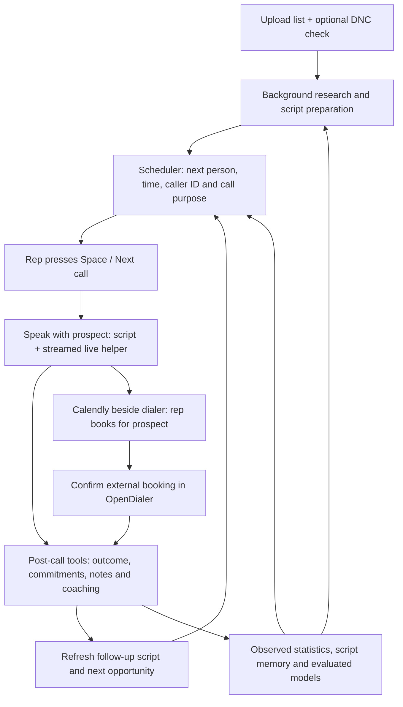

# Finish the manual calling workflow

**Owner scope:** November 2, 2026. **Source inspected:** `e2fa30f`, runtime 0.7.1.
**Status:** implemented in 0.8.0 (November 2, 2026) except the Calendly button, which the owner dropped: reps keep
Calendly in a browser tab. See the checkpoint in section 14 for what is verified and what still needs a real number.
This is the calling-workflow implementation detail under [LEAN_PLAN.md](LEAN_PLAN.md), which remains the active plan.
The [architecture review](ARCHITECTURE.md) records the current source and earlier findings.

## 1. What the owner selected

- Upload lead lists; optionally run DNC screening. No compliance-evidence wizard, source-approval process,
  carrier-approval-reference field or separate business/campaign approval step in the normal internal workflow.
- Keep **Space / Next call**. Do not add a general automatic calling loop. In the selected manual mode, every
  prospect dial, including a suggested second attempt, requires the rep's action. Existing opt-in voicemail
  advancement is not expanded and stays off for this flow.
- Prepare initial and follow-up scripts in advance. The rep should not manage research jobs or a manual call queue.
- The scheduler chooses the best permitted next action and opportunity, with learned estimates, initial/overdue
  starting preferences, callback commitments and capacity. Ordinary retries start at **24 elapsed hours** apart.
- Allow a scheduler-selected second attempt in the final outreach stage. This stage restriction is a versioned
  policy that can be changed deliberately later. It is not a second concurrent prospect call.
- Rep-spoken voicemail only, on the committed final attempt. No prerecorded voicemail delivery.
- Live coaching is a continuing text conversation supplied with new transcript sections about every two seconds.
  It displays advice; it cannot change business state. Research, post-call and memory actions use named tools.
- Use an existing Calendly booking page beside the dialer for meetings. A new calendar API integration, booking
  webhook, paid subscription or new cloud service is not a prerequisite for this version.
- Preserve local SQLite and hosted PostgreSQL, existing credentials, business data, privacy limits and signed updates.

## 2. What was verified today

Read-only inspection of the installed app showed:

| Observation | Meaning |
|---|---|
| Calling setup says Connected, with zero verified numbers | The shared delivery connection is present; this does not establish a callable caller ID. |
| Numbers shows zero owned numbers and zero ready numbers | There is no caller number in this workspace. No number was bought or synced in this review. |
| ChatGPT is connected; live-help key is configured | Saved setup exists. This review did not perform a fresh funded model request. |
| Readiness lists ten blockers, including three number-related messages | The UI reports dependent symptoms separately instead of giving one actionable cause. |
| Readiness also requires a registry, business approval, a carrier reference and approved hours | Those are real current app gates; the owner's selected simpler flow is not implemented. |
| Forecast excludes all three imported leads because screening is missing, then says existing capacity is sufficient | Zero executable demand is misleading when the entire list is excluded. Optional screening must be applied to forecasts as well. |

The reported error comes from `telephony/workflows.py::_agent_context`. It tests SIP username, credential ID and
the presence of a healthy/limited-use inventory row in one condition. Any missing element returns:

> Configure a scoped incoming-only SIP credential and an owned healthy caller ID

Consequently, the message does **not** prove that the SIP credentials are missing. Zero eligible inventory alone
explains that branch in this workspace. No secret was displayed or new credential created during this review.

Other source findings:

- `Service.context` sets `registry_required=True` regardless of a simpler UI choice. The normal authorization and
  readiness paths also require app-managed seller/policy approvals. This needs a change across the actual decision
  path, not cosmetic removal of settings.
- Initial preparation takes the imported row, script and script-memory digest. Its freshness key omits the lead's
  conversation, outcome and callback history. The prospect brief remembers those things, but that does not make
  the generated script an automatically refreshed follow-up script.
- The live provider uses a structured state/audit/guidance response and card validation. Continuous freeform text
  is a behavior change, not merely a label change.
- Meeting records explicitly set `invitation_sent=False`. OpenDialer does not currently send invitations.
- Ordinary retry authorization defaults to one hour. The preceding audit reproduced a five-minute callback being
  blocked by that cooldown. The new cadence must distinguish an ordinary retry, a callback and a late-stage pair.

## 3. The finished rep experience

After setup, the rep uploads lists, goes Ready, presses Space, speaks and occasionally corrects an ambiguous
outcome or confirms an external booking. There is no obligation to fill in an outcome form after every call.
If nothing is callable now, show when work next becomes available. Upload, preparation completion, elapsed time,
analysis completion and a callback becoming due must not independently dial anyone in manual mode.

The calling screen stays focused on the lead, actual script, brief context, helper conversation and essential
controls. Preparation progress, detailed models and number setup belong on their own existing pages.

## 4. Meeting booking with Calendly

### Use it immediately

1. The meeting host connects their calendar to Calendly and supplies their normal event link to the rep.
2. Keep that booking page beside OpenDialer. During the conversation, agree on the time and timezone and confirm
   the prospect's email address.
3. Book using the **prospect's** name and email. A signed-in host can use Calendly's Book meeting action; a rep can
   also use the host's public event page. Do not substitute the rep's email for the invitee.
4. Calendly handles its configured booking notification. Use the event's calendar-invitation notification type
   with a supported connected calendar when the desired result is an actual guest invitation and updates.
5. Record the booked time in OpenDialer. A booking holds further outreach to the lead/company. Reschedules,
   cancellation and meeting-held/no-show remain separate statuses.

Calendly documents [booking in real time](https://calendly.com/help/how-to-book-meetings-in-real-time) for all plans,
and explains [calendar invitations versus email confirmations](https://calendly.com/help/calendly-scheduling-notifications).
The selected workflow uses ordinary booking pages. Direct API booking is a separate paid-plan endpoint; it is not
needed here: [Create Event Invitee](https://developer.calendly.com/api-docs/calendly-api/scheduled-events/create-event-invitee).

### Small app changes

Add one optional booking URL per rep/host and an **Open booking page** button. Use known name/email to prefill
only when the rep chooses to open the page; never invent missing details. Calendly supports
[prefilled invitee links](https://calendly.com/help/how-to-pre-fill-invitee-information-in-your-calendly-link).
Default to the external browser, retaining the calling screen and audio connection.

After booking, a single confirmation accepts the AI-extracted time/timezone and optional external reference.
Retain the distinction between agreed meeting, rep-confirmed external booking and provider-verified invitation.
Opening a tab, hearing "let's meet" or the model saying "booked" is not a delivery receipt. The native app cannot
observe completion in an unrelated external browser automatically. No hidden email access or new booking webhook.

Keep cancellations/reschedules available in the existing meeting workflow. In this minimal version they are
updated by the rep; do not advertise automatic Calendly synchronization. Later, a one-click held/no-show/cancelled
result supplies useful ground truth. A calendar event's scheduled end is not evidence the meeting was held.

## 5. List upload and optional screening

The normal import is the file picker and import result. Run DNC screening is optional and off by default in the
selected internal workflow. There is no additional approval questionnaire. Basic phone parsing, deduplication,
known opt-outs and actual provider/audio availability continue to work automatically.

Implement the selected screening mode in one policy used by import, readiness, the queue, call submission,
capacity planning and reporting. Remove the hardcoded national-registry requirement. When screening is off,
do not perform a registry lookup or paid request, require a snapshot, or synthesize a "clear" result. Record
"not checked". When it is requested, use the configured source/budget, show clear/listed/unavailable honestly,
and keep the excluded result visible. Changing modes does not fabricate historical clearance or undo opt-outs.

Replace manual business-approval, campaign-approval and carrier-reference fields with normal saved calling
settings in this workflow. Do not forge approval records to pass old gates. Retain actual carrier API errors and
account restrictions: if Telnyx refuses voice service, show its specific action rather than asking for an invented
approval reference. Existing optional evidence tools can remain under advanced operations.

Keep the configured prospect-local hours, attempt limits and requested holds. Use supplied timezone/city/state
data without a separate verification form. A ported area code alone is not proof of location. For ambiguous US
rows, a conservative overlap of plausible timezones can preserve the selected hours without blocking import;
truly unresolvable or invalid rows get an ordinary row-level reason, not an extra campaign approval process.

The planner must distinguish no demand from excluded/unknown demand. It must not announce that no numbers are
needed merely because every lead was removed by the old mandatory screening gate.

## 6. Initial and follow-up scripts

Keep one Markdown script, its alternatives, Facts and Never say. Add an optional **Follow-up** section rather than
requiring a second script or a campaign builder. With no custom follow-up section, generate a short continuation
from the existing base and the lead's actual prior context.

| Next call purpose | Prepared behavior |
|---|---|
| First attempt | Research-based introduction and relevant discovery. |
| Prior no answer | A concise fresh introduction; never pretend a conversation occurred. |
| Requested callback | Acknowledge the actual callback promise and return to its stated subject. |
| Prior live conversation | Recap supported needs/objections, avoid re-asking answered questions, address the next open issue. |
| Final ordinary attempt | Brief close-the-loop script and rep-spoken voicemail text only if this is the committed final dial. |
| Wrong number, opt-out or booked company | Hold/exclude according to the recorded result; do not write another cold opener to bypass it. |

Extend the existing preparation context with bounded, versioned prior call summaries, outcome, role, answered
questions, objections, active commitments, human notes and upcoming call purpose. Reuse current prospect-brief
construction. Prior-call evidence gets its own source IDs and versions; it is not disguised as a web quotation.
Use a paraphrase when only derived notes survive. Do not invent a verbatim quote from expired raw speech.

Extend the preparation key with the relevant conversation/commitment/correction versions and call stage. Queue
the refresh after finalization or a material correction, and prioritize upcoming callbacks. Reuse the current job
queue, saved facts and script tools. Ordinary follow-up refreshes need not repeat the entire web research.

Prepare ahead of the due time, then freeze the selected version at dial submission. A slow model or 20-minute
plan pause must not make a five-minute callback impossible: use a current deterministic follow-up fallback with
the actual promise and supported brief if the rewrite is unavailable. Show that it is a fallback. Human edits
win over late output. Initial preparation and script-learning experiments retain their current version rules.

## 7. Phone-call scheduling and the adaptive policy

Scheduling phone calls is local queue work; it does not require a meeting invitation or another calendar account.
The rep can schedule a callback directly, and a post-call tool can save an unambiguous requested time. Ambiguous
phrases need one concise correction/confirmation. The app places a due callback at the front and alerts the rep;
it never interrupts an active conversation or guarantees a busy/offline rep can call at an exact second.

### One decision path

Extend `scheduling/policy.py`, `Service.context`, queue selection and the existing capacity planner. They must
share action classification and limits. Do not create another scheduler, an LLM dialer or a second reservation store.

| Action | Default rule |
|---|---|
| Initial call | Prefer uncontacted work from the starting policy; apply aging/coverage to avoid starvation. |
| Ordinary retry | At least 24 elapsed hours since the preceding ordinary attempt, then a permitted local window. |
| Requested callback | The confirmed promise is a separate action; bypass ordinary cooldown, not opt-outs, readiness or actual capacity. A new requested promise is separate from the closed cold sequence. |
| Final-stage pair | The scheduler may offer one immediate second attempt to an unanswered lead. No pair after a live conversation, booking, opt-out, invalid endpoint or pending callback. Both attempts count. |
| Final voicemail | Rep-spoken only on the precommitted final dial. No recorded playback. |

Persist the call purpose, sequence/stage, next normal opportunity, callback reference, pair reference, final flag,
decision reason and policy/model version before sending a dial. Keep actual provider effects and corrections
linked to their original identities; unknown submission results are reconciled, not treated as permission to dial again.

The four-attempt default remains a ceiling, not a requirement to call four times. A possible sequence is an
initial attempt, a next-day ordinary retry, then a final stage with either one call or a pair within the remaining
budget. Close the ordinary sequence when its final stage finishes; a refresh cannot extend it indefinitely.

In manual mode the second attempt is a suggestion selected for the next Space press. It does not dial itself.
The pair opportunity starts after the first terminal receipt and initially expires after five minutes, as a
versioned product default. If the rep pauses or chooses not to take it, expire/close
the opportunity without a surprise later immediate retry. A live answer cancels its remaining action.

### Optimize who and when

Retain the current funnel score: estimated human pickup × right-party probability × goal probability / expected
rep time. Add an explicit versioned starting preference for initial and overdue work plus a coverage safeguard.
Do not leave `coverage_due_at` permanently anchored to import so the same old repeat leads monopolize priority.

Compare permitted time windows in a short rolling horizon, using cached segment/hour/attempt estimates and any
reviewed trained model. Store the next recommended opportunity and reason, not a huge permanent schedule of
every hypothetical call. Exact callback promises retain their actual times. With flat/sparse estimates, do not
defer useful work on the pretense of knowing an optimal hour. Replan on new outcomes, corrections and availability.

Decision inputs include local hour/day, attempt index and gaps, source age, segment, conversation/callback history,
number health/load, available rep time and campaign goal. Log the chosen action, allowed alternatives and selection
probability for comparisons. Estimates and observed associations are not proof that a particular retry caused lift.
Cadence, capacity and known opt-outs remain boundaries that a higher predicted score cannot override.

## 8. Final-stage voicemail mechanics

Enable and qualify Telnyx's documented AMD request fields and signed human/machine/greeting events rather than
assuming handler code enables detection. Use the existing reducer/control path and keep the recorded-message
command blocked. Premium detection or another priced feature is not activated implicitly.

At a non-final machine answer, offer/end the mailbox path without a voicemail message. At the final dial, show
the prepared rep-spoken message and preserve the live microphone. A human answer continues normally and cancels
any pending second attempt. Test late humans, screening, silence, unknown and false machine results.

A rep already bridged to the prospect can speak before a classifier returns. Therefore a screen rule alone is
not a guarantee of physical enforcement. Qualify controlled bridging if strict machine-enforced exclusion of
non-final voicemail is required; measure its answer delay and false positives before adopting it. Until proven,
describe the rule as the app's calling policy and the rep's instruction, not perfect machine detection.

## 9. Live helper: a continuing streamed conversation

Keep continuous Telnyx/Soniox recognition and the existing direct-audio route. Feed new stable, speaker-labelled
text into one logical helper conversation per call, coalesced about every two seconds. Provide the current script,
verified facts, short prior-call brief and a bounded rolling conversation context. The provider may receive a
bounded context again per API request; this is not a permanent provider-side memory feature.

Use a small text-streaming output path, not the current state/audit/guidance-card schema for each visible reply.
The helper may suggest what to say or ask, explain briefly and answer a private rep question. Do not force an
empty response during silence or manufacture a new suggestion without new speech. Preserve pin/mute/cancel.

Use one in-flight generation per call and coalesce pending text. New speech must not continually cancel a slower
valid response and starve the UI. Tag replies with the covered transcript cursor; never let an older reply
overwrite a newer one. Corrections, ended calls and explicit cancellation invalidate inappropriate output.
Display partial text promptly, then finish it. A two-second input cadence is not a promise of two-second total
STT/network/model latency. Measure capture-to-transcript and transcript-to-first-useful-text separately.

Live-helper prose cannot save outcomes, book meetings, update memory, schedule calls or change policy. Separate
derived-state/post-call work owns those effects. Keep opt-outs and essential calling controls independent of the
helper. Bound context/history and keep the five-minute raw speech/helper lifetime; a long call must not grow
an unbounded prompt or disk transcript. Maintain derived continuity without resurrecting expired text.

Moving visible coaching to plain text must not delete the current interpreter's observation/commitment work.
Use the existing analysis job lane for a bounded derived-state checkpoint about once a minute and at call end,
with named observation/commitment tools over still-live chunks. Do not run a second heavy extraction for every
two-second helper message. Freeze source versions, account for this work, preserve corrections and mark missed
coverage if processing cannot finish before expiry. Immediate deterministic opt-out handling never waits for
that checkpoint. Long-call tests must prove that early supported issues survive as derived state while their
expired raw text stays unavailable.

Retain an explicit unavailable/reconnecting status when the configured route fails. Do not silently replace the
conversation with a card library and claim that live coaching worked. No new speech or model provider is needed.

## 10. Post-call tools, automatic labels and learning

Expose a small named tool set over existing commands: save/correct disposition, update notes, schedule/modify a
callback, record a rep-confirmed external meeting, update supported observations and submit script-memory changes.
The exact tool names can follow existing `submit_*` conventions. Reuse the current inference agent/tool adapter
and application validators rather than a second command system. Qualify actual tool support on the selected route.

Every action carries the source call/lead, expected record versions and existing request identity. App code owns
authorization, conflicts and persistence. Prose cannot trigger an action. The tool result reports what saved,
what was rejected and what needs a human correction. Late output cannot overwrite the rep's correction.

Save carrier-known effects automatically. Keep AI interpretation source/confidence and material uncertainty
visible; require human input only for necessary ambiguity. A carrier answer is not automatically a human pickup.
An AI-mentioned booking is not an invitation receipt. AI-only summaries are not observed held meetings or sales.

Keep observed outcome, provisional interpretation, rep confirmation and external receipt distinct in training.
Current pooled updates and automatic candidate training continue. Existing calibration, chronological/grouped
evaluation, model trials and activation/rollback remain; reps do not need to operate them. Show label coverage
so a campaign with no confirmed goals does not appear to be learning conversion lift from invented outcomes.
Supported script-memory updates preserve team notes and controlled-variation evidence.

## 11. Calling connection, numbers, registration and warmup

### Replace the generic SIP message

Return separate, actionable status for Telnyx API connection, per-rep audio credential, webhook delivery, owned
inventory, number routing/callback status and headset readiness. Deduplicate dependent failures. "Calling is
connected" must not look like "ready to dial" when inventory is empty.

| Actual condition | User-facing next step |
|---|---|
| No saved/valid carrier API key | Connect Telnyx in Settings. |
| Missing/mismatched/expired agent credential | Repair/import this computer's audio setup; preserve unrelated working credentials. |
| Zero owned numbers | Add a caller number: search/approve a rental or sync an existing Telnyx number. |
| Owned number has wrong route | Configure voice route and verify provider read-back. |
| Callback path has no real proof | Place one inbound test call and verify its signed routing result. |
| Route/callback work; reputation is unmeasured | Start conservative limited use; do not require an impossible pre-existing healthy history. |
| Headset is not connected | Connect/check audio, then Go ready. |
| Provider account refuses voice service | Show the actual carrier restriction and its resolution, not a free-text approval-reference box. |

The SIP credential identifies the app's rep/headset endpoint. The backend uses the existing Telnyx key to request
a short-lived JWT. The rep does not normally need a separate SIP password or a token pasted every day. Keep the
incoming-only/internal-URI scope and verify identity through the existing carrier checks. A fresh scope change
or credential replacement is not needed merely because there are no caller numbers.

### Number lifecycle

Keep search, exact quotes, explicit rental approval, count/spend caps and stable lead/caller bindings. Reuse
same-state capacity, with familiar area codes as a preference; do not rotate an existing lead's identity to evade
limits. Configure supported voice settings and route automatically as part of onboarding, with recording off.

Add a compact checklist for outbound business-name listing and external reputation enrollment. Automate a
supported outbound CNAM listing update with real owner-supplied business text and provider read-back. Do not
enable the separately priced inbound CNAM lookup feature. Where a registry lacks a supported API, provide the
prepared business/number data and the external submission link, and store submitted/accepted/unknown honestly.
CNAM or registry submission is not a promise of universal display, pickup or a clean reputation.

### Adaptive warmup

Start from the current conservative five-real-attempt allowance as an explicit product assumption, not a
carrier-certified rule. Keep an owner-set maximum and calculate a lower effective allowance from routing/delivery,
completed traffic and available health/reputation evidence. The proposed initial, versioned ramp envelope is:

| Parameter | Starting product assumption |
|---|---|
| Initial allowance | At most five actual attempts in a rolling 24 hours, further bounded by the existing approved maximum. |
| Earliest consideration for growth | At least 20 resolved attempts across at least 10 distinct leads and three active calling days, with current route/callback proof. Waiting alone earns nothing. |
| Growth ceiling | At most one increase per rolling 24 hours; no more than `max(1, floor(current allowance * 0.20))` extra attempts, clamped to the approved maximum. This is a ceiling, not a scheduled entitlement. |
| Decision under sparse/uncertain evidence | Hold the allowance. A new number's missing reputation samples do not imply a clean reputation. |
| Supported routing/delivery trouble | Reduce or hold promptly; preserve the reason and inbound route. Recovery must resolve the evidence before growth resumes. |

These thresholds seed an operating policy to qualify, not a universal safe calls/day schedule or an established
carrier recommendation. The learned health assessment may choose a smaller allowance or no increase. Preserve
every existing number's reviewed maximum; never silently raise a stored five-attempt maximum to the campaign's
40-attempt optimization ceiling. The owner can change that one maximum setting deliberately.

Count reservations, uncertain submitted effects and both attempts in a pair. Use an explicit rolling/pacing
window so UTC-midnight resets cannot double a new number's traffic. Spread genuine calls within the rep's work
and prospect windows. Reduce/hold on supported trouble and retain inbound callbacks. No synthetic warmup calls,
paid reputation subscription, automatic rentals or unattended calling. Missing external reputation data remains
unknown; answer-rate changes require case-mix-aware interpretation.

## 12. Implementation order and acceptance

Write the failing regression/acceptance cases before each runtime change. Extend existing tests instead of
adding a separate acceptance harness.

| Step | Change / source ownership | Required evidence |
|---|---|---|
| 1 | Specific calling readiness: `telephony/workflows.py`, `administration.py`, Settings/Numbers UI | Valid saved SIP + empty inventory returns only an add-number action; limited-use numbers work without observed-health history; invalid credentials get a distinct error. No secret in errors. |
| 2 | Upload-only internal flow and optional DNC: `service.py`, `compliance/policy.py`, operating/preflight, planner, Settings/Leads UI | No registry/source/business-approval form required when off; no paid lookup; "not checked" is preserved. Requested screening works. Opt-outs, invalid routes, saved hours and actual call constraints remain effective. Forecast includes the same eligible work. |
| 3 | Cadence, callback defect and sequence state: `scheduling/policy.py`, queue, `rep_workflows.py`, call submission, capacity planner | Five-minute callback is due at five minutes; ordinary retry is not due before 24 hours. Initial/overdue work is not starved. All paths use the same action rules. |
| 4 | Final-stage pair and voicemail: current submission, reducer and controls | Both actual attempts count; no earlier-stage/answered/held pair, third dial or repeated recorded VM. Final choice survives restart. Manual mode does not dial the second attempt itself. AMD/media behavior gets its own carrier qualification. |
| 5 | Follow-up preparation: current brief, preparation parser/context/key/jobs, ScriptReader | A callback and a prior live conversation get distinct scripts; no-answer never claims a previous conversation. Corrections invalidate stale text. Upcoming callback survives model pause via a current fallback. |
| 6 | Freeform streamed helper: `providers/openrouter.py`, coaching workflows/engine, LiveCoach | New speech produces successive contextual text responses; slow provider does not starve or overlap calls. Partial text, private questions, silence, corrections, cancel, mute, reconnect and ended-call cleanup work. No helper prose mutates business records. |
| 7 | Post-call named tools and learning labels: current inference adapter, intelligence, postcall and script-learning commands | Actual function calls reach the existing validators; prose and stale/repeated tools do not apply effects. Routine outcomes save without forms. Unverified AI goals do not become observed conversions. |
| 8 | External meeting convenience: Settings, Dialer/lead actions and `rep_workflows.py` | Correct host link and invitee prefill, external booking confirmation and company holds; no claim of automatic invitation delivery or cancellation sync. No new Calendly key required. |
| 9 | Registration assistance and warmup: provider/number operations, numbering/health, Numbers UI | Supported outbound listing only; registry status is honest; bounded caps and pacing handle midnight, reservations and unknown sends; lead identities remain stable. |
| 10 | Integrate and deliver | Full SQLite/PostgreSQL suites, relevant browser/frontend/native/package checks, signed release/update verification when implementation/update is requested, and preserved installed business/credential data. |

Specific end-to-end cases include a fresh list with DNC off, optional screening unavailable, a due callback while
the rep is busy/offline, a final-stage pair interrupted by pause/inbound call, stale post-call corrections, a model
limit during follow-up preparation, and a long call with bounded speech/helper memory. A complete transcript
fixture should replay the helper and action boundaries with explicit expected results.
Space in a booking page, script editor or text input must not trigger a dial; opening the external booking page
must preserve the live call/audio connection.

## 13. What proves it works

Software tests prove software behavior on both databases. Separately qualify one owned caller number, inbound
callback, headset, ordinary prospect call to a permitted test destination, real STT/live helper and costs. Reconnect
and restart must preserve the attempt and result without another dial. Test the actual target Windows machine
before claiming its hardware path works. Do not buy numbers, place billable calls or modify accounts as part of
this planning task.

The owner still supplies real business/number-registration details, approves any exact rental and performs any
provider-required identity step. The rep supplies a working headset and the prospect's agreed meeting details.
The app should handle routing setup, queue decisions, preparation, ordinary updates and learning automatically;
the Space key remains the rep's explicit call control.

## 14. Checkpoint

November 2: source and installed UI inspected; current zero-number readiness cause and mandatory screening
dependency identified. Calendly booking/notification/plan limitations checked against official documentation.
This file records the selected implementation scope. No runtime work, provider mutation, purchase, live call,
release publication or installed update has occurred in this planning step.

November 2 implementation (0.8.0, owner-approved on main with commits, push, release and Mac update):

- Telnyx access was checked with the saved key without buying or dialing
  ([receipt](evidence/lean/telnyx-access-20261102.json)): dialing app, outbound profile (US/CA), rep audio credential,
  WebRTC token, Soniox speech-to-text, number search and ordering are reachable. The account owns no numbers, and one
  feature reports "not permitted at this account level"; confirm Level 2 verification before campaign volume. The
  app's area-code search treated Telnyx's sold-out answer (400, code 10031) as an error; it is now an empty search.
- Steps 1-3 and 9: one specific readiness step per problem; no approval paperwork; optional DNC off by default in
  call authorization, readiness and forecasts; plausible-zone calling windows for leads without a time zone;
  24-hour ordinary retries with separate callback timing; managed sync of unrouted owned numbers; automatic limited
  warmup after an answered inbound test call; bounded evidence-based warmup on a rolling day; outbound CNAM listing
  with read-back and a Free Caller Registry pointer. A claimed lead now binds its own caller number (it could rewrite
  another lead's binding). Live calls carry the transcription permission the helper needs.
- Step 4: every dial requests standard Telnyx detection (`answering_machine_detection: detect`, about $0.002 per call
  on Telnyx's price list); a machine ends non-final attempts and keeps the line for the rep on the final one. An
  unanswered next-to-last attempt offers the same rep one immediate final attempt for five minutes, on their own
  Space press only.
- Step 5: a This call section is assembled from saved notes, callback promises and outcomes when a script is read
  (no model run, so it survives a model pause); optional Follow-up and Voicemail script sections. Outbound callbacks
  that reach the person complete the promise.
- Step 6: streamed plain-text live help on the Cerebras route, one in-flight reply per call that new speech does not
  cancel, interpretation checkpoints about once a minute or before speech expires, first-text latency recorded.
- Step 7 was already in place (named tools, prose cannot act, AI outcomes are not training labels) and keeps passing.
- Not verified without a number: a real order, outbound call, machine detection accuracy, inbound test call,
  headset audio, live Cerebras reply quality and latency, and caller-name display.
