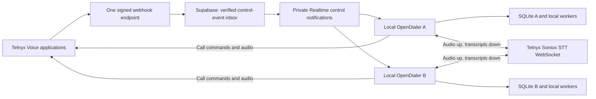

# Local OpenDialer with one shared Supabase webhook receiver

Date: October 28, 2026; revised October 29, 2026. Source inspected: `0973b33`.

Status: **Source integration and provider setup implemented; live calling qualification remains** (October 29).
Published installers and installed application/data are unchanged. See [integration receipt](evidence/lean/managed-integration-20261029.json).

### Current implementation checkpoint

- `OpenDialer` (`wfucwxgeexzwhinrylyn`, us-west-1) remains Free in Agite. The existing AGITE project is untouched.
- One signed webhook receives sanitized controls. The existing OpenDialer Voice API and incoming-only agent
  application now both point to it; their settings were read back. Updated Telnyx credentials validate.
- A real Mac delivery identity/profile is provisioned through the Auth admin API and saved privately outside Git.
  Import supplies carrier IDs and private refresh storage; startup reconnects automatically. No cloud login/tunnel
  steps are shown to callers. The available private profile includes the Telnyx key; no OpenRouter key was present
  in the staging file, so its existing Settings field remains the user's entry point.
- Local readiness/number ownership gate new calls and queued effects; stop controls remain usable. Supabase acks
  follow local durable receipt; the existing ordered worker applies events. Expired callbacks become review tasks.
- WebRTC tracks feed bounded PCM16 streams directly to Telnyx/Soniox. No additional microphone capture, audio file,
  transcript relay or duplicate carrier-STT command. Automatic coaching uses fixed two-second windows.
- Incoming signed DID proof assigns numbers to the registered workspace; another workspace's assignment is refused.
  Purchases still require explicit quote approval. This account currently has **zero numbers**.
- Retention runs hourly: unacknowledged controls expire after 24 hours with a gap; acknowledged bodies are cleared,
  dedupe records/call maps kept seven days. Reconnect after local reconciliation explicitly clears a recorded gap.
- Provider socket authentication succeeded with **zero audio sent**. This is not recognition quality, PSTN or hardware
  proof. Live call/audio, account eligibility, Windows, signed release and real free-tier usage remain unqualified.
- Scope is the minimal usable source path. Richer diagnostics/import previews from the original proposal are not
  required to use it. No number purchases, paid calls/inference, publication or installed-app/data modifications.

## 1. Decision and intended result

Keep OpenDialer in **local mode** and add **Managed connection** under calling setup. Use one Supabase project for a small shared event-delivery service. All configured Telnyx Voice API applications use the exact same public address:

```text
https://<project-ref>.supabase.co/functions/v1/telnyx-webhook
```

That is one webhook URL for all users, without per-user paths or query tokens. Supabase routes verified events using registered carrier identities. Each local app connects outward to Supabase; no PC needs a public address, port forwarding, separate tunnel, custom domain, DNS changes or a terminal command.

The receiver is not a hosted dialer. Leads, scripts, Markdown script memory, scheduling, call decisions, local job processing, StatML models and history stay in each PC's SQLite workspace. Existing external providers still receive the data required for their features. Supabase sees sanitized carrier control-event metadata, not audio or transcripts. Each PC sends call audio directly to Telnyx/Soniox and receives transcripts over an outbound WebSocket using its existing Telnyx API key. This is not an all-data-stays-on-device claim.

The owner manages one service and prepares a different connection profile for each independent workspace. Recipients import their profile, provide any missing provider credentials and check their microphone. They do not manage Supabase accounts in its dashboard or understand webhook routing.

**Recommendation:** implement and qualify this design on Supabase Free first. Do not promise unlimited free production use. Usage, latency and direct streaming audio/transcript handling are early feasibility gates, before polishing onboarding or releasing it.

## 2. What the user experiences

### New recipient

1. Install a signed OpenDialer version that contains this feature.
2. Choose **Start a local workspace**, then **Import setup**. Paste the supplied setup block or select its file.
3. Review the named workspace/service and connect. The app imports the provider configuration, signs into the delivery service and remembers the session. If keys were omitted from the profile, it asks only for those missing keys. Codex login import remains its existing separate flow.
4. See a short checklist: **Calling account**, **Call events**, **Live transcription**, **Microphone**, **Numbers**, **Calling requirements**. Technical IDs and route details remain under Advanced.
5. Upload the Markdown script in Intelligence, import the contact list, resolve genuine readiness requirements, and start calling.

The desired normal setup is **one import, one Connect click, microphone permission**. Numbers, provider account eligibility, authorized DNC coverage and campaign readiness cannot be replaced by a cosmetic green check. If the sender has not prepared them, setup clearly identifies the unfinished item.

A recipient may instead enter the same profile fields manually, but this is an alternative to the import, not additional work. Do not require both import and re-entering all fields.

### Everyday use

- Open the app; its local backend reconnects automatically and refreshes the delivery-service login.
- Calling shows **Connected**, **Reconnecting — new calls paused**, or a concrete remedy such as **Sign in again**.
- Network recovery restores event delivery without restarting the app or repeating provider setup. A restored connection does not automatically resume a campaign the user paused.
- The app must be running, the PC awake, and the network available during calls. A shared receiver cannot provide microphone audio or execute local call logic while the PC is asleep.
- Normal operation does not display raw webhook JSON, SIP configuration, Supabase project settings or a separate background-worker UI.

### Sender/owner

The owner sets up the shared service once. For each recipient, the operator provisions a connection identity, registers that workspace's Telnyx application and assigned numbers, and produces a ready-to-import profile. The same service address is reused; a full provider setup is not repeated on every launch.

There is still one-time administration per independent workspace. Copying the identical calling identity and number assignment to several independent PCs is not a supported substitute.

## 3. Current implementation and exact integration points

These findings come from source, not assumptions about a generic dialer.

| Existing code | Current behavior | Planned integration |
|---|---|---|
| `services/backend/app/config.py`, `cli.py` | Runtime modes are `local` and `connected`. Local desktop authority uses SQLite; the bundled authority is not a PostgreSQL server. | Keep both modes. Add a delivery setting such as `webhook_transport = direct / supabase`, defaulting existing installs to direct. |
| `apps/desktop/src-tauri/src/lib.rs` | Launches the backend on a random loopback port; optional SSH forwarding is separately managed. | Keep the sidecar lifecycle. Managed delivery runs inside that backend, so it needs no public local port or new native connector executable. Prevent SSH forwarding and managed delivery from being active accidentally together. |
| `services/backend/app/runtime.py` | Runs webhook, coaching, post-call, maintenance, research, scripts and ML lanes locally. | Own one managed receiver task for the local workspace in `authority_lifetime`; close it on shutdown. Reuse the existing job lanes. |
| `deploy/compose.yml` | Hosted API and background workers share PostgreSQL and server data. | Preserve this supported deployment. The managed local option does not require this stack. |
| `main.py`, `POST /webhooks/telnyx` | Verifies exact body bytes with Ed25519 and a five-minute timestamp window, then calls `accept_webhook`. Chooses the first tenant whose configured key verifies. | Preserve direct ingress. Managed routing must select an explicit registered workspace, not infer it from a public key shared by multiple users. |
| `telephony/ingress.py` | Durable receipt/deduplication by tenant and event ID; hash collisions rejected; existing worker applies events. Raw transcription content is ephemeral. | Add an internal trusted-delivery adapter into this same pipeline, with original receipt time and safe recovery semantics. Do not create a second call reducer. |
| `privacy.py`, `transcripts.py` | Allowlisted metadata persists. Raw speech TTL is 300 seconds; original receipt time affects transcript lifetime. | Preserve the boundary. Carry first verified receipt time through delivery; never restart TTL at local download time. |
| `administration.py` | Direct reachability check requires exact `/webhooks/telnyx` and fetches `/webhooks/ingress-check/<nonce>` on that host. | Add a transport-specific managed check; a Supabase Functions URL cannot pass the current direct check unchanged. |
| `service.py` | Builds call context, claims and dispatches outbound calls using local configuration and command receipts. | Enforce current managed-connection readiness at call admission and again immediately before new dial submission. |
| `telephony/workflows.py` | Manages persistent agent legs, prospect bridging, transcription and provider control outbox. | Preserve controls; cover all leg types and give stop/reconciliation priority during delivery failures. |
| `telephony/callbacks.py` | Routes incoming calls by the local owned DID; starts answer/transfer commands and sets a 40-second deadline using local receipt processing time. | Prevent delayed delivery from creating a new ringing window or answering an already-ended call. |
| `number_operations.py` | Syncs account inventory; ownership checks see only the current database. Route changes invalidate callback evidence. | Filter managed inventory to registered assignments and enforce those assignments before configuring or using a number. |
| `security.py`, `main.py` settings endpoints | Provider configuration is encrypted under the data directory; versioned saves; secret settings are not returned in normal reads. | Store service sessions separately from editable provider fields; preserve version checks and secret redaction. |
| `SettingsPage.tsx`, `App.tsx` | Current calling form exposes connection/public-key/webhook fields and SSH setup. | Managed import replaces these steps for managed workspaces. Keep manual/direct and hosted setup available. |

The managed integration and Codex import ship in 0.6.0. Existing 0.5.1 clients need the desktop update; changing Supabase alone cannot upgrade them.

## 4. Scope and effects on features

| Feature | Effect |
|---|---|
| Script upload, sections, objections, script learning and Markdown memory | Stay local; no redesign. |
| Next lead, adaptive capacity and scheduler-selected second attempts | Stay local; paused when event delivery is unavailable. |
| StatML training, estimates, experiments and reports | Stay local; no pooling across friends. Missing speech remains incomplete evidence. |
| AI research, live helper and post-call tools | Same providers and tool boundaries. Automatic coaching groups newly finalized speech on a two-second cadence; urgent/manual handling remains immediate. The delivery service does not execute model actions. |
| Live transcription | Continuous Soniox through Telnyx's direct STT WebSocket, initiated by the PC. No raw speech through Supabase and no independent two-second audio-file uploads. |
| WebRTC/SIP audio | Continues between the desktop and Telnyx; Supabase does not relay RTP/audio or replace the agent credential. |
| Numbers | Each independent workspace has a defined assignment. Existing limits, quote approvals, callback tests and legitimate-use gates remain. |
| DNC, internal suppression, consent and budgets | Existing local checks remain. Sharing delivery does not synchronize suppression lists or combine spend limits. |
| Shared team features | Not enabled by this connection. No shared leads, rep pushing or cross-user history. |
| Hosted mode | Remains available, with its existing server authority. |
| Offline use | Local viewing/editing still works. Live calling and live callback handling require the PC online. |

Independent local workspaces are not a substitute for coordinated operation by a shared sales team. If several PCs call for the same seller, overlapping leads, seller-wide opt-outs and account-wide spending still need coordination. This plan must not advertise them as synchronized. Resolve that operational scope before distributing profiles; separate numbers alone do not solve shared suppression or overlapping outreach.

## 5. Service design: one address, multiple destinations



Use Supabase Edge Functions for short requests, Postgres for routing and durable control receipts, Auth for connection identities, and Realtime for control-event notifications. Do not host an indefinitely running worker or WebSocket server in an Edge Function: its lifetime is bounded. The desktop subscribes to Supabase's managed Realtime service.

One webhook address does not mean one API operation in the whole system. Auth, authenticated fetch/acknowledgement and health operations use ordinary Supabase APIs. Only the single carrier webhook URL is configured at Telnyx.

### Routing rules

1. Admin registers a Telnyx account's verification public key and its authorized Voice API application IDs. Each calling application belongs to exactly one independent workspace. Different applications may all point to the same webhook URL.
2. A bounded parse extracts an untrusted candidate `connection_id`. Look up the registered route, verify the signature over the exact original bytes using that route's account key, then authorize the destination. An ID in JSON is never authentication by itself.
3. Prefer this application mapping for prospect, agent and inbound control events. Validate real carrier payloads for each supported event class before release.
4. For events without `connection_id`, use only a previously established provider-call mapping from a verified event. If a required event type lacks both, explicitly implement and test a verified account/DID or registered-call lookup. Never broadcast unknown events to all clients, pick the first matching account key, or trust arbitrary `client_state` as routing authority.
5. For incoming calls, cross-check the called DID against the registered workspace assignment. No preceding outbound call or `client_state` is required.
6. Agent and callback legs must retain the owning route even when their `client_state` differs. Preserve the existing `agent_leg_id`, `inbound_task` and `attempt` behavior. Direct transcription sessions correlate locally to the call and speaker.
7. Route changes are versioned and explicit. Existing in-flight call mappings remain pinned to their original workspace until closed/expired; do not reassign a live call to a new PC.

Unknown/ambiguous/invalid routes fail closed with bounded, redacted diagnostics. Retryable storage failures return a retryable error; invalid signatures do not receive successful integration receipts. Actual carrier retry behavior must be tested rather than assumed infinite.

### Minimal cloud data model

Exact names may change during implementation; these are responsibilities, not a second CRM schema.

| Record | Purpose |
|---|---|
| `relay_workspaces` | Auth owner, active/revoked status, route version, current local-consumer lease and generation. |
| `relay_carrier_routes` | Admin-controlled application/account/public-key binding and assigned number identities. Unique application and number ownership. |
| `relay_call_routes` | Bounded provider call/leg mapping needed for event types that omit application identity. |
| `relay_events` | Unique provider event identity, original body hash, verified receipt time, sanitized event/control metadata, delivery state and expiry. No raw transcript column. |
| `relay_health` or workspace health fields | Last probe, acknowledgement/lag and aggregate usage counters, without speech or credentials. |

Use indexes on route identity and workspace/pending-delivery state. Keep `relay_events` as the sole transport inbox; do not also introduce another generic queue framework for the same work. Existing local `webhook_inbox` remains the durable boundary for application processing.

Maintain a fixture-backed control-event schema shared by receiver contract tests and the Python adapter. Direct speech has its own provider-to-local normalizer and session/call/speaker identity; do not route it through Supabase or invent carrier webhook signatures for it. Existing direct/hosted webhook transcription stays supported and must retain its correlation regression coverage.

## 6. Authentication and the setup profile

### Recipient credentials

Use standard Supabase Auth rather than inventing a second long-lived webhook password system. Initial distribution is administrator-provisioned email/password accounts for known recipients, with sign-up closed. The administrator verifies the recipient out of band before marking the account confirmed.

The profile contains the project URL, publishable key, workspace label, prepared Telnyx application/public-key/agent settings, and the recipient's connection login. Provider API keys may be included privately or left blank for entry on the recipient's PC. After signing in, the backend stores the refresh session and discards the imported connection password from its saved profile.

This deliberately avoids making email delivery a prerequisite: Supabase's default mail service does not support general production recipients. No new SMTP service is necessary for this initial operator-provisioned workflow. Password recovery is operator-assisted unless proper email delivery is added later. These are ordinary recipient logins, not Supabase dashboard memberships.

The import must validate a versioned schema and expected HTTPS service origin, show the service/workspace name before sending credentials, accept no scripts or arbitrary commands, and never export an existing PC's refresh session, installation identity, database or full config directory. Manual sign-in remains available when a password has changed.

Refresh is serialized by the backend and persisted atomically. The React frontend never owns the background connection or a Supabase service-role key. No tokens in URL query strings, telemetry, standard settings responses, support exports or committed fixtures. Store credential files privately, with explicit file permissions/Windows access checks; do not claim the current plain-JSON config is encrypted.

### What is and is not secret

| Item | Handling |
|---|---|
| Supabase service/admin key | Server/operator only; never in recipient profiles or desktop builds. |
| Supabase publishable key and project URL | Public configuration; safe to package. They do not grant access without authorization policies. |
| Recipient password and refresh/access tokens | Secret; private handoff and local storage. Revocable per recipient. |
| Telnyx/OpenRouter keys | Secret; stay on the local PC in this design. Supabase needs neither to forward signed events. |
| Telnyx application ID, signing public key, credential ID, SIP username | Configuration, not sufficient authentication secrets. |
| SIP password | Not a setup requirement here: current `/v1/telephony/token` obtains a short-lived WebRTC JWT from the configured telephony credential using Telnyx's API. |
| Codex login file | Existing separate secret import; not automatically copied into shared profile exports. |

A shared Telnyx account's API key can grant wider account access than the app's number filter. Local UI restrictions cannot narrow that key's permissions outside the app. For people who should not have that access, use independently scoped carrier accounts/credentials where the provider supports them, or the existing hosted authority model. Do not claim per-PC relay isolation also isolates a shared carrier master key.

### Cloud authorization

Keep routing/admin tables private. Expose only the minimal client operations needed for its own workspace. Enable RLS on every exposed table and test both grants and policies. Authorize with the actual Auth subject and server-controlled membership, never user-editable metadata.

Clients may retrieve their own admitted events and acknowledge delivery; they cannot insert carrier events, set `signature_verified`, edit hashes/route ownership, or read another workspace. Use a narrow transactional RPC for acknowledgements/leases where field-level invariants require it. Prefer invoker permissions; any unavoidable definer helper must live behind explicitly restricted entry points with an authenticated owner check and fixed search path.

Recipient Realtime channels are receive-only. Clients cannot publish carrier envelopes to another client or themselves and have them treated as verified control events. Separate authenticated probes from carrier events, and validate protocol/schema versions before delivery. An old client that cannot process the service's event contract must stop new calling with an update message rather than dropping unknown events.

The public carrier function disables Supabase JWT enforcement only because Telnyx authenticates with Ed25519. It verifies the signature itself before any receipt is trusted. Other user APIs retain authentication; no public `verified=true` ingestion shortcut.

## 7. Reliable delivery and transcript privacy

### Durable call/control events

1. Edge verifies signature freshness and schema; resolves a single authorized destination.
2. Atomically insert/deduplicate the sanitized event and original body hash. Same identity with a different body is a collision, not an overwrite. Key identity by carrier account and event ID, not event ID across unrelated providers/accounts.
3. Notify that workspace after commit. Return success to Telnyx only after durable acceptance; a successful broadcast alone is not durable acceptance.
4. Local receiver fetches pending events, passes each into the existing `accept_webhook` machinery, and acknowledges the relay only after the local receipt/job transaction succeeds.
5. If acknowledgement is lost, delivery repeats; existing local identity/hash deduplication prevents repeated effects. Local processing status and relay delivery status remain distinct.
6. Reconnect and periodic bounded catch-up queries recover missed notifications. Realtime is the wake-up mechanism, not the only copy of a call event.

Retrieve pending/unacknowledged rows, not only `sequence > last_seen`. Concurrent inserts can commit out of sequence; a naive cursor can permanently skip a late commit. Preserve arrival ordering where the existing application relies on it, but do not claim Telnyx delivers events in causal order. Test reversed and simultaneous events.

Supabase is the signature-verification boundary for persisted, sanitized controls. The local adapter trusts a receipt fetched through the configured authenticated service with immutable server-only verification fields; it cannot re-verify a Telnyx signature against sanitized JSON. Direct public ingress still verifies the original signature normally. Document this trust boundary rather than pretending sanitization preserves a signature.

### Direct live speech: PC to Telnyx/Soniox

The selected speech path is `PC audio → Telnyx STT WebSocket → local transcript pipeline`. Use `wss://api.telnyx.com/v2/speech-to-text/transcription` with the existing Telnyx API key and Soniox engine. Confirm supported model, options, format, concurrency, account eligibility and actual billing in the prototype; documented support is not a successful account test. No additional Soniox/Groq account is required by this design.

Capture separate microphone and remote WebRTC audio streams in the desktop, preserving speaker identity. Send bounded short audio frames over an authenticated loopback connection to the local backend, which owns the Telnyx WebSocket and API key. Do not expose the key in browser JavaScript, send audio through Supabase, or record it to disk. Validate this audio bridge on Mac and Windows before committing to its packaging. Keep recognition continuous; two seconds is the coaching schedule, not an audio-upload duration or a transcription-session restart interval.

Normalize the actual Telnyx/Soniox WebSocket response format into existing local transcript segments. Preserve finality, corrections, confidence where provided, ordering and speaker/call identity. Soniox token output is not automatically identical to the existing Voice API webhook schema; fixture-test conversion, stable IDs and revision behavior. Reuse local suppression, coaching and finalization logic without pretending these authenticated socket results have carrier webhook signatures.

Select one transcription source per call. In this managed-local configuration, stop issuing Voice API `transcription_start` commands; otherwise there would be duplicate recognition, transcript effects, webhook traffic and billing. Existing direct-local and hosted webhook modes remain available. Never silently fall back to speech-through-Supabase or change providers after failure. Unexpected signed speech webhooks at the shared receiver must be bounded, acknowledged after validation with only a sanitized configuration-warning receipt, and never logged, stored or broadcast as raw speech. Do not retry them into a billable storm; surface the misconfiguration.

Respect mute/unmute, device changes, answered/bridged state, inbound callbacks, transfers, persistent agent legs and call boundaries. Do not transcribe the rep's room outside an authorized call or leak the previous prospect's speech into the next call. Test whether pre-bridge speech is required by any kept feature; carrier AMD/control events remain separate. Flush valid final results at call end before the existing bounded finalization deadline; mark absent speech incomplete. Stop capture/sockets on call end or permission revocation.

The local ephemeral raw-speech lifetime remains at most 300 seconds. Track first receipt and audio capture/session timestamps so delayed buffering or reconnect replay cannot reset the lifetime or revive revoked speech. Bound audio buffers, discard expired data, and represent disconnects as explicit speech gaps. Do not promise recovery of uncaptured or expired audio. Verify Telnyx/Soniox retention terms; app buffers, logs, errors, exports and backups must not retain raw audio/text. Supabase stores no transcript payload and needs no speech Broadcast channel, replay table or speech acknowledgements.

### Two-second automatic coaching cadence

Current source uses a 300 ms debounce after finalized transcript updates and a separate cap of 30 automatic admissions per call per minute. The selected change applies a two-second cadence to automatic coaching for the managed-local path; it does not imply a complete tip every two seconds.

- Accept all interim/final transcription promptly. Run opt-out detection and required suppression effects immediately, before any coaching batching.
- When new finalized speech becomes pending, open a fixed window of at most two seconds. Later speech merges into that pending work without moving the deadline indefinitely. After dispatch, subsequent automatic admissions are at least two seconds apart, retaining the existing rolling-minute cap and capacity checks.
- Preserve every unprocessed finalized segment within the existing retention window. Coalesce scheduling, not the content: never keep only the most recent sentence and discard earlier evidence.
- No unchanged-text polling/model requests and no unbounded overlapping inference. If the coach is busy, retain bounded pending work and process it once eligible; measure the extra delay rather than promising a two-second completion SLA.
- Manual help, opt-outs, hangup and other urgent controls do not wait for the automatic-coaching timer. Interim text/display can still update immediately. Finalization flushes remaining valid evidence at call end instead of losing the last partial window.
- Reuse existing job/coaching mechanisms, cancellation, stale-result guards, cost limits and tool boundaries. Test scheduler timing with a fake clock, including sustained speech, silence, busy models, expiry and manual requests. Preserve existing direct-local/hosted behavior unless explicitly selecting the new cadence there.

Initial bounded retention proposal: pending sanitized control events up to 24 hours, acknowledged payload metadata deleted promptly, identity/hash tombstones for 7 days to deduplicate later retries. Call-route mappings expire after call completion plus the verified retry window. These are recovery limits, not a replacement for local backups; size and provider retry measurements may require adjustment before release.

Use bounded memory and batch sizes on both sides. A slow consumer must not block other workspaces; the service carries control traffic only. At retention expiry, preserve a gap/reconciliation marker and surface it on the next connection rather than silently presenting complete history. The existing local receipt's first time/hash cannot be overwritten by a later relay retry or delivery-mode switch.

## 8. Readiness, recovery and offline callbacks

Managed readiness must include a current authenticated connection, current route/number assignment, successful round-trip delivery probe and no excessive backlog. Check local capture and direct STT availability separately; a green Supabase check does not prove transcription works. Avoid continuously streaming billable idle silence for health probes. Surface an STT failure during a call immediately, keep hangup usable, mark analysis gaps and pause subsequent calls until recovered. Historical ingress evidence alone is insufficient.

The managed check posts an authenticated, non-carrier probe through a separate authorized operation and returns it through the same inbox/Realtime/acknowledgement path. It cannot inject a fake Telnyx event or grant `live_verified` status. Show **Connection verified** separately from **Calling tested**.

A preliminary lease/probe interval is 15 seconds with a short bounded stale threshold (at most 45 seconds); measure and tighten it in the prototype. Use a monotonic local deadline as well as server expiry. Check actual socket state immediately on disconnect. A new dial requires current evidence at admission and dispatch; automatic next-call advance obeys the same rule. Stop/hangup and recovery remain available when new calls are blocked.

Only one active local consumer may own a workspace. Enforce this using an atomic application lease; do not assume Supabase Free includes a single-session Auth feature. A second independent copy shows **This workspace is active on another computer**. Transfer is explicit and not allowed to silently take over active calls. Session revocation disables membership/lease immediately; generation-scoped private topics stop sending to old cached subscriptions.

Bind the first connection to the existing local workspace/store identity. An empty database is not a continuation of another PC just because the same login was pasted into it. Moving an existing workspace requires the supported local backup/restore plus explicit idle rebind and reconciliation; a new independent workspace gets a new profile and carrier assignment. Lease expiry does not prove that carrier calls have ended, so takeover after a crash must reconcile outstanding call mappings before allowing another dial.

On recovery, stale events must not blindly run fresh call commands. Reconcile provider state for active/uncertain calls first, apply terminal state safely, then process pending work. An inbound event delivered after its original answer window becomes a missed callback/task, not a fresh 40-second attempt. Propagate original receipt time into callback deadlines and ensure delayed answer/bridge/transcription-start commands cannot revive ended calls.

The receiver does not answer calls when all PCs are offline, execute carrier commands, or have Telnyx API keys. It can retain sanitized missed-event information, but that does not help an already-waiting caller. Always-on answering/failover would require a separately verified carrier feature or hosted call control and is outside this delivery-only plan. Keep the current offline-callback limitation visible.

## 9. Numbers and carrier provisioning

Prepare one Voice API application per independent local workspace, all with the same webhook URL; give each workspace its own compatible incoming-only agent credential. Use existing objects when they match the intended recipient. Confirm trial/account object limits before promising that provisioning will succeed.

The sender's provisioning helper or admin runbook must read back the actual carrier configuration: application webhook, agent credential identity, assigned DID connection and recording settings. Route registration is admin-controlled and based on that evidence. A recipient cannot seize another registered application by submitting its ID.

Managed number sync must not import every number in a shared Telnyx account. Filter to the current registered application and approved assignments. Recheck membership at add/configure/dial boundaries; unassigned or reassigned numbers stay unavailable. Preserve callback-route fingerprints and require fresh callback evidence after a route change.

Existing purchase flow remains explicit and priced. In managed mode, after a completed approved purchase, register the new DID to its owning workspace before it can become callable. Failed registration leaves it visibly purchased-but-not-ready; retry registration never places another order. Initial assignments can be operator-provisioned. For later in-app additions, use the already-required signed inbound callback test as the proof that a candidate DID reaches the workspace's registered application: allow a pending enrollment to accept that proof, then atomically bind the previously unassigned DID. A conflicting existing assignment requires explicit reconciliation, never automatic theft/reassignment. The pending request alone must not prove ownership. Test this route before claiming the existing number-purchase journey is preserved without operator assistance. Do not make “import setup” buy numbers or start warmup.

Two separate local schedulers must not use the same number pool simultaneously. This design assigns carrier resources; it does not allocate leads to reps or introduce shared scheduling. Account-wide carrier limits and balances may still constrain everyone sharing that account.

## 10. Proposed code changes

| Area | Concrete work |
|---|---|
| `supabase/config.toml`, `supabase/functions/telnyx-webhook/` (new) | Single carrier receiver, schema bounds, account/application verification, routing, deduplication, control receipt and rejection/sanitization of unexpected speech events. Pin dependencies. |
| `supabase/migrations/` (new) | Minimal route/inbox/membership/lease schema, indexes, grants, RLS and acknowledgement/probe operations; scheduled sanitized-data cleanup. |
| `services/backend/app/managed_webhooks.py` (new) | Backend-owned Auth session, refresh, private subscription, pending fetch/ack, lease, health and transport adapter. Use a pinned supported async Supabase client if its packaging/refresh behavior passes the prototype; avoid inventing a WebSocket protocol implementation. |
| `apps/desktop/src/telephony/client.ts`, local audio bridge, backend STT adapter (new) | Separate speaker capture, bounded loopback audio transport, backend-owned Telnyx/Soniox sessions, normalization, call lifecycle and gap handling. |
| `coaching/workflows.py`, `privacy.py`, configuration | Two-second fixed-window automatic scheduling; immediate suppression/manual actions; retain finalized evidence, existing rate limits and final flush. |
| `runtime.py`, `config.py`, `security.py` | Local-only opt-in lifecycle; independent session file; settings/status schema; explicit credential storage permissions. |
| `main.py`, `administration.py` | Profile import/connect/disconnect/status operations; managed ingress check; mask secrets; keep direct endpoint and direct validation intact. |
| `telephony/ingress.py`, `privacy.py` | Internal verified-control-receipt adapter, trusted original timestamps and deduplication; direct STT feeds the existing local speech pipeline and explicit gap handling. Keep direct-path defaults unchanged. |
| `service.py`, `telephony/workflows.py`, `telephony/callbacks.py` | New-dial readiness gate; stale-event recovery, original callback deadline and expired-command guards. Reuse existing outbox/reconciliation. |
| `number_operations.py`, carrier provider | Assigned inventory filtering and route read-back/provisioning helpers without automatic purchases. |
| `SettingsPage.tsx`, workspace state/types, `App.tsx` as needed | Import preview, Connect button, automatic status, actionable errors; hide manual URL/SSH in managed setup. No frontend-owned delivery connection. |
| `pyproject.toml`, lockfiles, existing packaging scripts | Pin added SDK dependencies, verify sidecar collection, signing and Mac/Windows operation. |
| `scripts/managed_webhook_setup.py` or equivalent (new) | Operator-only provisioning/read-back and profile creation. Writes secrets privately and prints redacted summaries. No generic admin portal needed. |
| Existing test suites, docs and CI | Add targeted acceptance/contract/UI coverage; update install/setup/privacy docs and release notes after implementation. |

Use the Supabase CLI's current help to create migration files; iterate against disposable schema state, inspect advisors and then produce a clean reproducible migration. Do not apply test migrations or run broad tests on the owner's existing production database. Prefer a dedicated free project when available; if both slots are occupied, inspect existing usage and isolation before deciding how to deploy. No paid project creation or upgrade is implied.

## 11. Implementation order and stop/go gates

### Phase 1 — Contract and feasibility, before UI work

- Add failing tests for managed receipt timestamps/deduplication, two-workspace routing and stale callbacks.
- Build a disposable vertical slice: signed synthetic event into an Edge Function, private delivery to two independent local receivers, durable acknowledgement and reconnect catch-up.
- Prototype direct Telnyx/Soniox streaming from both local audio tracks. Verify response normalization, actual account access, rate/billing behavior, privacy, media lifecycle and explicit gap detection. Add regression-first tests for the two-second scheduler and immediate suppression; prove the managed path sends no speech through Supabase.
- Validate SDK session refresh, packaged dependency size/startup and background operation independent of the webview.
- Measure cold/warm event latency, DB calls, function invocations, messages and bytes. Confirm account tier, region, pausing behavior and provider payload coverage.

Proceed only if one-address routing, privacy and latency are supportable. This phase prevents committing to a polished but unsuitable transport.

### Phase 2 — Transport and local pipeline

- Implement the minimal Supabase schema and receiver with RLS/privilege tests.
- Add local connection lifecycle and session persistence, original-receipt timestamps and existing-inbox reuse.
- Implement stale replay handling, exclusive consumer ownership and reconnection readiness.
- Integrate direct STT/capture and two-second automatic coaching; select exactly one transcription source per call, with no duplicate Voice API transcription starts.
- Keep direct local and hosted acceptance suites green on SQLite and PostgreSQL.

### Phase 3 — Provider assignments and simple setup

- Add operator provisioning/read-back and per-recipient profiles.
- Enforce managed number ownership; exercise the approved purchase-to-registration boundary without buying live numbers during tests.
- Add import/connect/status UI with preserved edits, retry after partial failure and no duplicate provisioning on repeated clicks.
- Ensure a default new managed recipient never sees an SSH/tunnel form or must copy the common webhook URL into Telnyx themselves.

### Phase 4 — Qualification and distribution

- Run targeted and full applicable CI; freeze the sidecar with new dependencies.
- Test a real Supabase Free project using non-sensitive synthetic events from two local databases, with permission to deploy it.
- Perform authorized carrier/audio/callback tests, then a measured multi-user calling soak using approved destinations and spending.
- Verify signed Mac packaging and native Windows behavior. Two test processes on this Mac prove isolation, not Windows compatibility or two real networks.
- Prepare the signed release and clear setup docs. Publish/install only within the applicable authorization; the current installed-app freeze remains in force during this planning work.

Commit coherent implementation steps without credentials or generated artifacts. Do not run a release workflow simply because the planning document is complete.

## 12. Required acceptance matrix

| Group | Cases that must pass |
|---|---|
| One URL, isolation | Two applications/accounts; two workspaces using the same Telnyx public key; prospect/agent/callback controls and unexpected speech rejection; inbound caller with no previous call; wrong application/DID; attempted route hijack. |
| Signature | Invalid/stale signature, changed body, wrong key, key rotation, malformed/oversized body; no client-forged verified receipts. |
| Durable delivery | Repeated carrier event, same-ID/different-hash collision, lost notification, commit-before-notify crash, local commit-before-ack crash, failed local commit, concurrent out-of-order commits, database outage and replay. |
| State recovery | Answer/hangup reversal; delayed machine result; expired inbound window; missed callback creation; no stale answer/bridge command; uncertain dial reconciliation without a second dial. |
| Speech | Two audio tracks, mute/device change, callback/transfer/bridge lifecycle, no room audio outside calls, correct call attribution, socket normalization/revisions, disconnect/restart, expired buffers, permission revocation, final flush, no duplicate carrier transcription, no audio/text in Supabase or persisted logs/exports. |
| Two-second coaching | Fixed non-starving window, no repeated idle work, all final segments retained, min admission spacing and existing rate cap, busy-model backpressure, immediate opt-out/manual controls, cancellation and call-end flush. |
| Auth | Expiry/refresh, single refresh writer, offline refresh failure, disabled identity, private channel isolation, forged user metadata, forbidden client event inserts/route updates, old cached subscription after revocation. |
| Readiness | No new call after disconnect or stale probe, queued dial recheck, auto-next obeys gate, hangup still usable, no auto-resume after user pause; number/route/config changes invalidate evidence. |
| Multi-PC | Independent profiles concurrently; identical profile on a second machine refused; explicit idle handoff; restore from backup cannot silently activate a second consumer. |
| Setup UI | Empty/partial/invalid profile, import preview and secrets masking, no repeated field entry, edited drafts survive late responses, clear retry, revoked password/session, missing provider key and missing number. |
| Existing features | Local/direct and hosted regression suites, scripts/memory, scheduling, StatML, outcomes, number limits and DNC gates unchanged. |
| Packaging | Sidecar starts/stops, refresh/reconnect survives webview reload, signed build, Mac and Windows credentials permissions and microphone/WebRTC checks. |

Extend `services/backend/tests/acceptance/test_feature_calling.py`, carrier/number contract tests and `apps/desktop/tests/admin-setup.spec.ts`; add focused managed-transport and Supabase authorization tests. Do not duplicate the full call state machine in relay tests.

Provisional performance targets for the initial two-active-workspace test: added relay-to-local durable receipt latency p95 at most 250 ms and p99 at most 1 second; no lost durable controls or duplicate business actions; reconnect catch-up within 5 seconds of a healthy connection for a small backlog. Measure warm and cold paths and full Telnyx-to-call-action timing separately. These are qualification targets, not measured claims, and cannot be relaxed silently to declare success.

## 13. Free-tier capacity and reliability boundary

Official documentation checked October 28, 2026 lists Free allowances including 500,000 Edge Function invocations/month, 2 million Realtime messages/month, 200 concurrent Realtime connections, 100 Realtime messages/second, a 500 MB database and 5 GB egress. Free projects can pause after a week of inactivity and do not provide an uptime SLA. Existing projects in the organization may share relevant usage allowances. Recheck the actual account before deployment.

The selected design sends no transcription through Supabase, so speech does not consume its Edge Function invocations or Realtime messages. Call controls, retries, probes, authentication and catch-up still consume resources. Measure rather than extrapolating user capacity from egress alone. Keep initial forecast usage below 70% of each binding quota; never auto-upgrade or hide dropped events to fit Free.

Avoid frequent Edge Function polling/heartbeats when authenticated PostgREST/RPC suffices. Use a single private control subscription per active workspace, compact sanitized payloads, batched acknowledgements and bounded pending-event catch-up. Cache stable configuration with version invalidation, never stale readiness/ownership as proof. Keep logs and accounting counters free of speech and credentials. Back up route configuration, and retain a runbook for pausing, quotas, outages and rotation. Do not create artificial activity solely to defeat inactivity policies.

### 13.1 Selected design estimate: control-only Supabase

Planning scenario, not measured usage: 100 call attempts/day × 22 days × 12 control events/attempt × 600 bytes/event × two counted payload copies × 1.25 allowance = **39.6 MB/month/caller**. Add an assumed 10–60 MB for idle/probe/Auth/acknowledgement/fetch overhead: **approximately 50–100 MB/caller/month** in decimal units. Actual event frequency, payload sizes, idle time, retries and Supabase metering can increase this. The two-copy model is a budgeting assumption, not a billing guarantee. Validate both app counters and dashboard totals.

The earlier speech-volume scenario was 44 connected hours/month. With direct streaming this talk time primarily affects Telnyx STT charges and the PC's audio upload, not Supabase egress. Two continuous uncompressed mono PCM16 tracks at 8/16 kHz upload approximately **5.07/10.14 GB** over those 44 hours, before protocol overhead. Supported compression may lower that; confirm format compatibility. This is PC-to-Telnyx traffic, not Supabase egress. Transcription and carrier services remain paid even if the shared Supabase project fits Free.

Two-second automatic coaching changes local/model-request scheduling. It does not reduce audio upload frequency or independently account for the Supabase saving. Bypassing Supabase for speech creates that saving. Measure transcript finalization delay, window wait, model latency, CPU/audio quality, bytes per call attempt, idle egress and provider charges separately.

### 13.2 Earlier estimates, retained only to explain the change

| Superseded alternative | Illustrative Supabase egress/caller/month |
|---|---:|
| Full 2 KB speech envelopes relayed through Supabase at 0.5–2 combined updates/sec | 0.6–1.8 GB |
| Compact 500-byte speech envelopes at the same variable update rate | 150–500 MB |
| Compact relay with one update per speaker every two seconds | 250–300 MB |
| **Selected: direct Telnyx/Soniox STT, Supabase controls only** | **50–100 MB** |

The earlier speech scenarios assume 44 connected hours/month; their control allowances differed and were explicitly unmeasured. The two-second relay row counts two speakers, hence one combined update/second, about 198 MB of speech including the assumed two copies and 25% margin, plus 50–100 MB of controls/idle overhead. These are different designs, not successive measurements of one implementation. Do not build the raw-speech relay, local recognizer or Groq/OpenRouter alternative as a hidden fallback. See [transcription comparison](STT_COMPARISON.md) for the bounded Groq experiment; it did not validate Telnyx live latency.

## 14. Responsibilities

### Implementation/operator work

- Inspect the selected Supabase project's tier, available capacity and existing schema before deployment.
- Implement, test and deploy the receiver and minimal schema; configure Auth/private channels and redacted operational visibility.
- Prepare carrier objects/assignments and connection profiles; verify that the shared URL is saved on every relevant Voice API application.
- Build the direct Telnyx/Soniox audio path, two-second coaching scheduler, app integration, simple import UI, documentation and signed release candidates.
- Demonstrate routing/recovery/privacy/usage results and distinguish synthetic proof from actual carrier/audio proof.

### Owner work

- Make the intended Supabase project/account accessible, completing login/MFA if required. No need to paste its admin secret into chat.
- Identify the recipients and whether they are independent operators or a coordinated team sharing seller-wide obligations.
- Enter current provider secrets privately where needed; keep the already configured Codex login.
- Approve any actual number rental, funding, paid calls or paid capacity. The plan itself authorizes none of those charges.
- Supply an authorized test destination and participate in microphone/audio tests. A Windows recipient/machine is needed for real Windows verification.
- Privately distribute the prepared profiles. Recipients do not need a Supabase dashboard login or project key administration.

There is no additional webhook secret to collect from Telnyx. The recipient's normal service login is generated during provisioning, and session refresh is automatic. A setup profile containing passwords/API keys remains sensitive even if it is convenient to import.

## 15. Rollout, coexistence and rollback

Existing local workspaces remain on direct delivery until explicitly connected. Additive settings and optional transport metadata must not reset the workspace, overwrite provider keys or require importing a new database. Any schema addition follows the project's existing schema mechanism, not revival of retired legacy migrations.

Switch webhook delivery and transcription source only while no call or unresolved carrier command is active. Record both settings for rollback; never run old webhook STT and new direct STT for the same call. Read back the current Telnyx webhook before switching; preserve the previous address/configuration for rollback. Reset route/callback evidence after a routing change. Do not concurrently feed old direct ingress and new managed ingress with mismatched receipt semantics.

If rollback is needed, pause new calling, reconcile outstanding calls, restore the previous verified route and recheck reachability. Never reinstall old binaries against unknown changed state as a shortcut. Existing ad-hoc tunnel/relay resources are not required by this design; retire them only after replacement verification and an explicit resource inventory. Do not change unrelated website DNS or registrar settings.

## 16. What counts as done

The feature is complete only when a recipient on a supported machine can install the signed build, import their prepared settings, connect without terminal/DNS/tunnel work, pass real account/number/audio checks and make/receive authorized test calls while another independent recipient does the same through the **identical webhook URL**.

Evidence must include isolation, recovery without duplicate calls/transcription, direct Soniox streaming on Mac and Windows, two-second coaching scheduling with immediate opt-outs, original speech expiry, explicit missing-speech handling, native packaging, actual latency and a free-tier usage forecast with headroom. Offline callbacks, unbounded free capacity, shared business-data synchronization and live provider success cannot be inferred from software tests.

The initial planning pass changed no provider resources or runtime. The October 29 implementation checkpoint above supersedes that planning-only status.

## References

- [Telnyx direct STT WebSocket lifecycle and authentication](https://developers.telnyx.com/docs/voice/stt/websocket-streaming)
- [Soniox integration with Telnyx WebSocket STT](https://soniox.com/docs/integrations/telnyx/stt)

- [Supabase pricing and Free limits](https://supabase.com/pricing)
- [Function invocation accounting](https://supabase.com/docs/guides/platform/manage-your-usage/edge-function-invocations)
- [Edge Function runtime limits](https://supabase.com/docs/guides/functions/limits)
- [Realtime limits](https://supabase.com/docs/guides/realtime/limits)
- [Unified and cached egress accounting](https://supabase.com/docs/guides/platform/manage-your-usage/egress)
- [Realtime egress: HTTP publish and WebSocket delivery](https://supabase.com/kb/troubleshooting/realtime-egress-faq)
- [Realtime message accounting and subscriber fan-out](https://supabase.com/docs/guides/platform/manage-your-usage/realtime-messages)
- [Telnyx speech engines and example transcript event](https://developers.telnyx.com/docs/voice/programmable-voice/speech-to-text)
- [Broadcast transports and database message retention](https://supabase.com/docs/guides/realtime/broadcast)
- [Private Realtime authorization and cached policies](https://supabase.com/docs/guides/realtime/authorization)
- [Admin-created Auth users](https://supabase.com/docs/reference/python/auth-admin-createuser)
- [Default SMTP restrictions](https://supabase.com/docs/guides/auth/auth-smtp)
- [Telnyx webhook delivery and event identities](https://developers.telnyx.com/docs/voice/programmable-voice/receiving-webhooks)
- [Current lean plan](LEAN_PLAN.md), [testing handoff](HANDOFF.md), [script-learning contract](SCRIPT_LEARNING.md), [setup guide](GETTING_STARTED.md), [server deployment](../deploy/runbooks/deploy.md)
