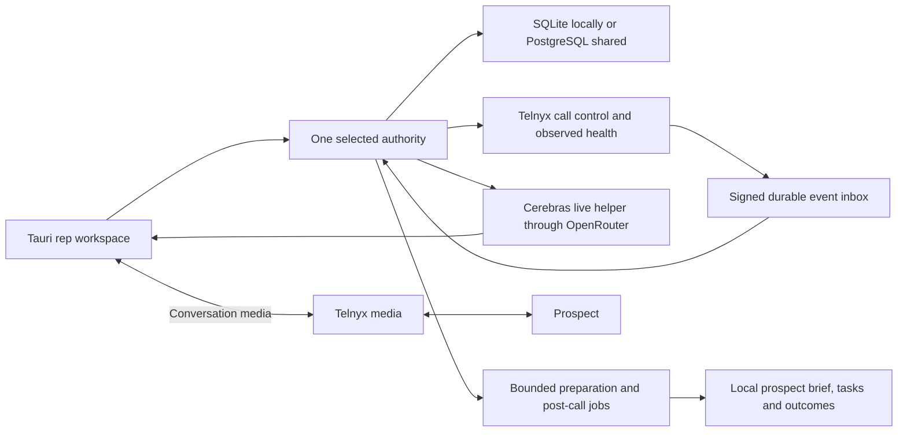

# OpenDialer completion and simplification plan

Date: October 17, 2026. Status: **implementation authorized; M0 tests-first baseline complete; remediation active across M1–M7, with milestones still partial**. Baseline: `2bad067c20d23bce84b78538ab00ef009b4c7e9f`, released desktop 0.2.1.

OpenDialer should help a rep reach the right people, have better conversations, and reliably complete the agreed next steps. It should do this with a small local application, fast statistical models, Telnyx telephony and number intelligence, and a live Cerebras assistant that can reason and write freely using the actual conversation and business context.

This is the implementation contract for correcting the audits and completing that product. It specifies mechanisms, migration, tests, operating limits, and release gates. Implementation checkboxes in section 21 remain open until verified; withdrawn scope is recorded explicitly, never marked as implemented. Writing this plan does not implement its features or certify a provider integration.

Navigation: [simplest architecture](#3-simplest-architecture-that-preserves-the-requirements) · [performance repair](#4-data-model-and-performance-repair) · [freeform live helper](#6-live-cerebras-helper-and-coaching) · [coaching and tips](#7-coaching-tips-practice-and-improvement) · [statistical learning](#9-statistical-ml-and-learning-from-outcomes) · [number allocation](#10-minimum-viable-number-allocation-and-intelligent-use) · [Telnyx health](#11-telnyx-number-health-procurement-and-onboarding) · [post-call work](#12-post-call-rundown-local-tasks-and-prospect-continuity) · [short retention](#13-five-minute-raw-retention-and-no-synchronization) · [performance gates](#18-performance-and-simplicity-acceptance-gates) · [tests](#20-test-first-acceptance-design) · [execution todos](#21-ordered-execution-checklist) · [all 17 repairs](#22-every-audit-defect-mapped-to-a-concrete-repair) · [original requirement coverage](#23-requirement-coverage-source-map-and-simplification-boundaries).

## 1. Scope, precedence and product decisions

This plan incorporates the original [implementation specification](spec/IMPLEMENTATION_SPEC.md), the [October 16 extension](OPTIMIZATION_PLAN.md), both subsequent audits, and the user's October 17 clarification. Preserve the original specification verbatim as history. Where requirements conflict, this plan supersedes the old constraints on canned wording, Groq as the default coach, process proliferation, and the assertion that only credentials remain outstanding. Original safeguards, both operating modes, and the Mac/Windows update requirements remain.

### 1.1 The product we are completing

| Responsibility | Intended implementation | What must not masquerade as it |
| --- | --- | --- |
| Permission, identity, reservations, budgets and irreversible operations | Small deterministic services and database constraints | An LLM deciding whether an opt-out matters |
| Pickup, timing, retry, caller-ID and treatment optimization | Pooled statistical estimates from observed outcomes; more expressive models only when they improve validation | Invented training data, a pile of fixed topic rules, or a large model on every queue request |
| Live conversation understanding and guidance | Cerebras through OpenRouter, with freeform suggestions and answers grounded in current context | Choosing one of five canned sentences |
| Preparation and persistent knowledge | Cached research, approved product facts, prior conversations and commitments | Hallucinated personalization or a new research job during every utterance |
| Post-call completion | One structured analysis followed by a small authorized action executor | A transcript dump that leaves the rep to remember everything |
| Rep coaching | Contextual live tips, specific post-call feedback, reviewed examples and outcome-informed improvement | A universal talk ratio or unsupported personality score |

The aim is feature strength against **Gong's calling workflow**, not recreation of the entire Gong platform. Feature completeness and comparative outcome lift are separate questions. Local-number matching alone is not a differentiator: Gong documents matching, provisioning, callbacks, notes, outcomes and CRM export. OpenDialer's intended strengths are explicit capacity planning, adaptive timing and numbers, contextual live help, and complete local control. Local task and prospect continuity are in scope; CRM/calendar synchronization was withdrawn by the latest instruction. [Gong dialer documentation](https://help.gong.io/docs/make-calls-with-gong)

### 1.2 Nonnegotiable scope

- Fully useful standalone local workspace, with SQLite and no OpenDialer account or shared server required.
- Authenticated connected workspace, with one shared authority and PostgreSQL for concurrent reps; the same domain behavior in both modes.
- Mac ARM64 and Windows x64 desktop delivery. Retain the currently validated OS minimums until actual dependency/platform testing permits changing them. Do not imply Mac Intel or Linux support.
- Preserve installed app identity, databases, notes, suppressions, keys and sessions. Deliver updates in place. A fresh machine may install once; an existing installation must not be reset or reinstalled as a repair technique.
- All agreed acceptance tests first, actual failing receipts before implementation, targeted regression tests before fixes, regular coherent commits, native computer use, and a clean final release.
- No provider keys are currently supplied. Continue later implementation with isolated simulators and contract fixtures, but keep funded inference, carrier traffic, account eligibility, audio devices and production receipts distinct.
- Simplification must retain observable behavior and recovery guarantees. Removing reliable events or suppressions to reduce line count is not simplification.

### 1.3 A minimal configuration surface

Rep setup should ask for the workspace, identity, campaign and audio device. Admin setup should ask for business identity, authorized providers, list source, campaign goal and time horizon, permitted calling policy, rep availability, and budgets. Advanced model/concurrency/debug settings live behind an advanced view. Use one configuration definition and one source of defaults; eliminate inconsistent constants hidden in dashboards and workers.

The user need not invent an objection taxonomy or label a large corpus before starting. They do need to describe what they sell, what claims/prices are valid, and what counts as success. Engineering starting values are configurable and labeled as assumptions. Provider restrictions and approved calling policy are constraints, not parameters to learn away.

### 1.4 Latest accepted scope and cost decision (October 17)

The latest user instructions override older integration, retention and spending assumptions throughout this repository:

- A proactive Cerebras helper follows stable transcript chunks continuously in the background. It is quiet when no useful intervention exists. Its primary surface is a fixed top coaching strip beside/above the set script, always visible without scrolling; typing is optional and secondary.
- During the call, show compact uncertainty-aware statistical guidance and the current prospect brief. Afterward show the rundown, local follow-up and updated cross-call numeric/natural-language scorecard.
- Research and script filling run before calls in bounded batches and off-hours when the authority is awake. Fill the seller's versioned script template, including gatekeeper and iPhone name-and-purpose screening lines. Keep a prepared queue; no live web research.
- Raw call audio and transcripts have a hard **five-minute rolling lifetime**, not five minutes after an arbitrarily long call ends. Persist only minimal derived notes, observations, outcomes and statistics. Recording is disabled. See section 13 for every storage boundary and provider limitation.
- No CRM/calendar synchronization, calendar creation, invitations or autonomous scheduling agent. The rep books meetings in their own workflow; OpenDialer records a manually confirmed outcome and appropriate outreach hold. Local callback tasks remain.
- All US outbound attempts require national screening plus the local DNC registry. Cache valid screening, but recheck internal opt-outs and coverage/freshness before every submission. No missing-data clearance or automatic exemption inference.
- **No subscriptions or recurring commitments may be activated by OpenDialer.** Use existing authorized inventory and first-party health. Add a prepaid DNC option, with seller-access requirements made explicit. New DID rentals, Telnyx reputation subscriptions and paid registry access remain blocked under this policy; proposals can disclose them without purchasing. Existing numbers may already cost their owner money: do not represent reuse as zero total carrier cost.
- Voicemail is eligible only on the final permitted attempt, with all existing separate permission/mailbox/topology gates. A list change or model score must not silently shorten the attempt allowance to enable an earlier voicemail.

This removes the former M6 connector implementation and replaces it with short retention, DNC and no-subscription acceptance. Historical source/receipts remain in Git. External accounts/hardware and legally adequate source authorization cannot be manufactured by tests or checkboxes.

## 2. Baseline and what is actually wrong

The existing product contains substantial usable work: native packaging and updates, policy checks, encrypted persistence, call-control adapters, simulation, statistical baselines, model training, research, review and an OpenRouter coach adapter. It also contains incomplete behavior and false completion assertions. This is a focused repair and completion effort, not an instruction to replace everything.

The October 16 audit reported 17 issues, 15 failing regression cases on both SQLite and PostgreSQL, and missing workflow pieces. The existing 289 SQLite tests, 288 PostgreSQL tests plus one skip, 11 frontend unit tests, eight browser flows and five Rust tests did not cover those counterexamples. Backend statement/branch coverage was 82.59%/64.92%; the displayed frontend coverage covered only selected modules. These are historical receipts, not new results from writing this plan.

| Evidence | Interpretation | Required response |
| --- | --- | --- |
| 503 synthetic leads: next-lead selection 11.393 seconds and 2,438 SQL statements in the repeat audit | Repeated scans, decryption and per-lead setup in a request path | Batch reads, indexed selection, incremental projections and short reservation transactions |
| Optimization report: 5.512 seconds and 2,913 SQL statements | Reports rebuild operational datasets and future plans synchronously | Read persisted projections; explicitly enqueue expensive refreshes |
| Six simulated 700 ms coach jobs: approximately 4.24 seconds | Different calls are awaited sequentially | Bounded concurrent calls with per-call ordering and obsolete-work replacement |
| AST: 51 Python files, 10,434 lines, 346 functions; 19 TS/TSX files, 6,643 lines, 511 function-like nodes | The code is not enormous, but responsibilities are concentrated | Refactor around independently testable responsibilities, not a new framework |
| `reserve` 291 lines; `coach_turn` 191; `optimization_report` 276; large UI functions around 624–1,040 lines | Large orchestration paths combine data access, decisions, mutation and formatting | Extract bulk reads, pure decisions and small persistence steps; split UI by user workflow |

AST decision counts from the audit are a custom static measure, not standard cyclomatic complexity or proof of runtime cost. Python is not established as the cause of latency. Fix the measured algorithm, queries and lock scope before considering a language change.

The full defect-to-fix register is section 22. Every old checkbox that includes a demonstrated defect or missing workflow is reopened. A green simulation preflight is not a certificate that the rep lifecycle is complete.

## 3. Simplest architecture that preserves the requirements

### 3.1 Keep, consolidate and remove

| Keep | Consolidate or change | Remove from the default path |
| --- | --- | --- |
| Tauri, React/TypeScript, small Rust native boundary | Split giant screens into calling, helper, wrap-up, tasks and admin components | Product implementation details on the rep's main screen |
| Python/FastAPI, current maintained dependencies | One authority service and one small job runner implementation | Multiple competing scheduling/reporting calculations |
| Local SQLite; shared PostgreSQL | A common repository contract with database-specific claims/indexes | Network-share SQLite or competing local/shared authorities |
| Encrypted sensitive content and scoped access | Typed indexed operational fields alongside encrypted payloads | Full encrypted-document scans for ordinary filtering |
| Durable event inbox, external-action outbox and work jobs | Three clearly different responsibilities, sharing small lease/retry utilities | A generic workflow engine, multiple queue frameworks, arbitrary agents |
| Simple statistical baseline | Lazy-load a challenger only when actually serving; batch scoring | Heavy ML imports, model-file hashing and training in next-lead selection |
| Existing provider adapters where still supported | Capability-checked provider roles and one accountable request path | Groq as a required provider, silent provider fallback, duplicated cost holds |
| Approved knowledge and examples | Freely generated guidance using that knowledge | Exact sentence allowlists, fixed objection taxonomies as semantic truth |

Do not add Redis, Kafka, Kubernetes, a vector service, a feature-store service, an agent-orchestration platform or a separate analytics warehouse. A new dependency requires a named failing requirement and a comparison against the simpler existing-stack solution. Refactoring cannot be justified solely by replacing long functions with many one-line wrappers.

### 3.2 Runtime arrangement

**Local:** Tauri plus one bundled Python authority process. That process owns SQLite, HTTP/webhook ingress, live events and bounded asynchronous network tasks. Use a small explicit thread boundary for existing synchronous database work; never block the event loop with SQLAlchemy or substantial decryption. CPU-heavy fitting runs in one low-priority child only while needed. No Docker or separately installed Python is required on a rep machine.

**Connected:** one application image, one API/control/live process, one bounded background process, PostgreSQL and the existing TLS reverse proxy. Keep live and call-control work ahead of research. Training is an optional resource-limited child/job. Split processes further only if measured isolation needs justify it. This replaces the default fleet of one process per lane without merging their priorities.

Maintenance is always scheduled by the normal runtime: job recovery, retries, call reconciliation, due-task updates, health aggregation and expired holds. It must not accidentally disappear when the optional training profile is disabled.

### 3.3 Local is independent, not disconnected from providers

Local lead management, learning, tasks, allocation proposals and cached review work without an OpenDialer server. Inventory synchronization and call-event health use outbound Telnyx HTTPS requests from the local authority; cost policy blocks new recurring commitments. Live telephony/transcription still require the provider and a reachable signed-event ingress. No hosting subscription is mandatory; a user-owned host or eligible free ingress can be configured without exposing administration.

A loopback-only URL cannot receive Telnyx callbacks. Finish a guided **webhook-only HTTPS ingress** setup using a documented tunnel or user-owned forwarding host. Expose only the ingress routes, not administration or the database; verify signatures at the authority. Display reachability, last verified event and failure reason. Do not silently install a tunnel, create an account, or publish the full API. Include a tested setup recipe and diagnostics so this is not a hidden engineering prerequisite.

If the local machine sleeps or closes, it cannot perform background preparation work or receive local callbacks. Persist pending work, resume on wake, and configure a carrier-side business fallback for inbound calls. Keep the local-only identity clear rather than quietly introducing an OpenDialer cloud dependency. A shared server provides continuous availability, not different business rules.

Connected mode may add a control-plane round trip. Media should remain directly between desktop, Telnyx and prospect. Never require the shared server to relay voice merely to provide coaching. Measure network delay separately from database and model delay.

### 3.4 Authority and credential ownership

Exactly one workspace authority owns each active call, lead reservation, external action and model decision. Switching modes never creates simultaneous live authority for the same pending work. Migration between authorities is an explicit export/import cutover with identity mapping, quiesced calls and duplicate prevention, not automatic multi-master synchronization.

In local mode, store master provider credentials in the operating-system protected store or the protected backend configuration, accessible to the local authority rather than the webview. Connected reps receive scoped application sessions and short-lived telephony credentials; master credentials stay on the server. Optional provider credentials follow the selected authority. Do not embed a confidential OAuth client secret in a distributable desktop binary.

## 4. Data model and performance repair

### 4.1 Change the hot storage shape, not every historical table

The current generic document approach stores operational values inside encrypted JSON and filters them in Python. Preserve encrypted content, but add indexed typed columns for fields needed to find work: tenant/seller, lead/endpoint references, call status, due time, owner, active flag, expiry, provider object ID, source version, action identity and lease state. Keep private notes, research content and credentials protected; raw transcripts use only the ephemeral buffer described in section 13.

Start with leads/endpoints, attempts/legs, inventory/capacity, inbox/outbox/jobs, tasks/commitments, conversion events and serving-model pointers. Add only indexes exercised by actual queries. Use seller-scoped indexes such as `(tenant_id, seller_id, status, next_attempt_at)` and uniqueness for active claims and durable external identities. Store phone lookup keys as keyed hashes where equality lookup suffices. Explicitly review which operational metadata becomes visible in database files; do not move raw PII into unencrypted indexes for convenience.

Full-text search over private content must not secretly persist a plaintext transcript index. Start with a bounded in-memory index of authorized knowledge and cached context. Add SQLite FTS/PostgreSQL search only for an approved storage boundary and a demonstrated retrieval need. No embeddings are required for the first completion.

### 4.2 Next-lead path

1. Load the seller/campaign's active settings and serving-model pointer once.
2. Query indexed due candidates by callback, requested-contact and coverage priorities. Read bounded scored candidates, not the entire historical document store.
3. Fetch related endpoint evidence, recent outcomes, number capacities and allowed actions in bulk. Reuse versioned aggregates and immutable inputs within this decision.
4. Score a vector/batch once. Cache the verified loaded artifact by model ID/checksum; hash on activation/load, not for every row.
5. Choose outside a write transaction. Inside a short transaction, recheck mutable eligibility, reserve lead/endpoint/rep/number resources, and persist decision plus call intent.
6. A lost compare-and-swap/claim retries selection with a bounded retry budget. A stale cache can lower ranking quality, but can never bypass the authoritative policy recheck.
7. Refresh candidate scores incrementally on relevant changes and time boundaries. Preserve a due-work path so low-ranked/unscored leads are not starved by a bounded candidate page.

Target complexity is proportional to the bounded candidate batch and relevant inventory, not candidate count multiplied by all calls, assignments or suppressions. Query count must stay approximately constant as history grows. Test both explain-plan/index use and wall-clock latency.

### 4.3 Transactions, SQLite and async work

Remove the process-wide read/write mutex and shared PostgreSQL advisory lock used for unrelated work. Use scoped transactions and database uniqueness/row locks. Serialize only the resources that actually conflict: an endpoint, rep, DID capacity or seller's authorization stream.

For local SQLite use a maintained patched runtime, WAL on a local filesystem, short write transactions, explicit busy timeout/retry, foreign keys and managed checkpointing. WAL permits concurrent readers with a writer but does not create multiple simultaneous writers. Keep SQL sessions confined to their thread and do not await provider HTTP while a transaction is open. PostgreSQL remains the shared multi-rep database. [SQLite WAL](https://www.sqlite.org/wal.html), [SQLite deployment guidance](https://www.sqlite.org/whentouse.html)

Use pooled persistent HTTP clients with bounded connection limits rather than opening a new client for each inference. Async provider I/O can run concurrently; CPU work and synchronous DB calls must not block call-control delivery. Cancellation should release local resources, without assuming it canceled a provider's already-billed work.

### 4.4 Incremental reporting and accounting

Maintain small daily/per-campaign/per-number aggregates as outcome events commit. Rebuild them through an explicit replay job when a correction invalidates history. Reports read projections with an `as_of` time and refresh status; a dashboard GET must not fit models, scan every transcript, recompute a three-day plan for hundreds of leads or acquire a broad write lock.

One usage record progresses through reserved, submitted, reconciled or uncertain for each actual provider attempt. A receipt settles the estimate rather than adding another charge while leaving the estimate held. Preserve unknown liabilities until reconciled; release known unused holds. Late and duplicate receipts update the same attribution. Procurement, reputation checks and provider-managed scheduled charges belong in the same visible budget model.

### 4.5 Safe migration

Make a raw-content-free encrypted backup and record counts, IDs, human-note hashes, suppressions, active obligations and schema versions before migration. Add columns/tables and backfill in bounded resumable batches. Compare old and new read results on a copied workspace before switching. Run a single authoritative writer after cutover; avoid indefinite dual-write machinery.

Do not automatically roll an app binary back across a non-reversible schema change. Keep the supported rollback path explicit. Preserve audit/event history and idempotency identities; remove obsolete fields or readers only after compatibility and restore tests. Test upgrades from the actual installed 0.2.1 data as well as a fresh workspace.

## 5. Durable telephony, events and jobs

### 5.1 Event receipt is not event completion

Verify webhook signature and replay constraints, persist a unique provider event with payload hash and `received` status, then acknowledge promptly. A worker claims that event and commits reducer changes, normalized transcript changes, emitted work and `processed` status together. On failure retain retryable state and an error receipt. A duplicate delivery returns success for receipt while still allowing unfinished processing to resume. The receipt ID must not suppress a failed transcript forever.

Keep source timestamp, receive timestamp, processing sequence and source revision separate. Enforce monotonic terminal call state: a late agent-answer event must not revive an ended leg or reserve the rep again. Retain provider data needed for reconciliation instead of reconstructing reality from arrival order.

### 5.2 Every external command has recovery semantics

Use a durable action identity and state progression: `prepared → sending → acknowledged/succeeded`, or `uncertain → reconciling → succeeded/failed/review_required`. Claim with owner, lease expiry and fencing version; heartbeat genuinely long jobs. Expired `sending` is not a permanent state and is not automatically equivalent to permission to send again.

Define recovery separately for dial, bridge, answer, transfer, hangup, transcription start/stop, legacy recording stop/reconciliation (new recording start is disabled), playback, gather, number orders, configuration changes, local task and outcome transitions. Reuse the provider's documented idempotency mechanism where supported. Otherwise reconcile by persisted request/object references before retry. If an operation cannot safely be reconciled, surface an actionable uncertain state instead of issuing another potentially paid or customer-visible effect.

External HTTP happens outside database transactions. Persist and audit the policy snapshot immediately before send. An opt-out cancels unsent intents and blocks future work; an already transmitted request needs explicit cancellation/recovery rather than pretending it never happened. Leases reserve only live obligations and are released on authoritative completion.

### 5.3 Speech and call path completion

Normalize all documented Telnyx track fields, including `transcription_data.transcription_track`, with engine/topology-specific fixtures. Distinguish rep/remote transport sides from actual speaker identity. Unknown side remains unknown. Interim/final segments, revisions, timestamps, duplicate events and missing confidence are preserved honestly.

Validate actual Telnyx agent/prospect linkage, explicit caller ID, bridge-on-answer, unavailable rep, direct-call credential bypass, reconnect, carrier maximum lifetime and orphan cleanup. Do not wait for an LLM or unnecessary AMD result to bridge a ready rep. Classify screening, IVR, gatekeeper, wrong party, human prospect and voicemail separately.

Keep one live prospect per rep. An optional ready-and-continue mode may advance a sequential queue after wrap-up, with explicit rep opt-in, pause and readiness checks; it must never become predictive overdial or parallel ringing. Normal dial, mute, keypad, hangup, opt-out and notes remain usable during AI failure.

### 5.4 Voicemail and callback obligations

Enforce final-permitted-attempt-only voicemail on the server immediately before submission. Snapshot the attempt allowance and count actual attempted contacts, not expired reservations; reject early monitored and detached drops, and recheck cadence/opt-outs on final attempts. Retain the original permission-separated monitored drop and tested detached-playback workflow. Do not release the rep until the exact topology and playback-start receipt prove the old prospect leg is independently owned. Track that leg's lifetime, costs, capacity and completion even after the rep starts another call. Handle no beep, full mailbox, false machine classification, playback failure, backend restart and late human recovery. Carrier playback success is not proof that a mailbox saved the message.

Each unfinished control action and each expired job must have an owner, next attempt or explicit review reason. Dead-letter/recovery views must offer scoped retry/reconciliation rather than requiring database edits.

## 6. Live Cerebras helper and coaching

### 6.1 Required seller experience

The helper stays active throughout an authorized, transcribed call. It follows meaningful conversation turns, maintains context, suggests useful responses when appropriate, and answers the rep's own questions. It is not restricted to a fixed list of objections or approved sentences. “Freeform” describes its reasoning and wording, while factual claims and external actions still respect known evidence and authority.

| Situation | Required behavior |
| --- | --- |
| Prospect asks something unexpected | Explain it in context and suggest a useful answer or clarifying question, even if no playbook card matches |
| Rep is stuck | Help hotkey or typed question gets a direct contextual response; no regex topic gate or automatic cooldown blocks it |
| Prospect raises an objection | Understand the actual meaning, including negation, qualifications, previous answers and changed circumstances |
| Prospect is explaining a need | Offer a timely follow-up question or listening tip when useful; avoid distracting repeated prompts |
| Prospect asks for a fact absent from the knowledge base | State the missing fact and offer a truthful way to respond or follow up; do not invent pricing, integrations, guarantees or prior relationships |
| Next step is emerging | Suggest how to clarify owner, action and time; draft the commitment without claiming a booking already exists |
| Rep wants depth | Expand the explanation, alternatives and cited product/context evidence without replacing the main call controls |
| Rep disagrees | Dismiss, edit or flag the suggestion; preserve this feedback and the nonverbatim derived context for evaluation; raw context expires on schedule |
| Model/provider is unavailable | Keep calling functional, show a clear helper status and useful cached knowledge; manual search remains usable |

The aim is to prevent the seller from being left without useful support. No system can promise a correct answer to every unknown; a clear admission of missing information plus a sensible next move is useful assistance.

### 6.2 Context assembled before and during the call

Build a versioned context packet once before dialing and update it incrementally:

- Seller identity, product description, current approved capabilities, prices, limits, proof points and prohibited claims.
- Campaign goal, relevant script/treatment, preferred language, rep preferences and the call's purpose.
- Lead/company facts, provenance, freshness, entity match and uncertainty; no entire unrelated CRM export.
- Earlier verified needs, objections, answers, outcomes, human notes and unresolved commitments across calls.
- Current stable transcript, a compact summary of older turns, recent utterances and uncertain speaker attribution.
- Questions already answered, facts already stated, current unresolved questions, offered next steps and last advice shown.
- Current authoritative permissions and call state as read-only context.
- Relevant examples/tips from the approved knowledge library and successful reviewed paraphrased examples, when available.

Pin the newest utterance, unresolved commitments, fact provenance and material corrections when trimming context. Older dialogue can be summarized, but the summary must retain source pointers and uncertainties. A summary is not a new fact. If a correction contradicts the summary, rebuild the affected state before new guidance.

Use a simple cached lexical/keyword index over the authorized knowledge packet first. Retrieval helps ground an answer; failure to retrieve a card must not stop the LLM from reasoning about the conversation. Add embeddings only if held-out retrieval misses demonstrate a worthwhile gain, keeping them in-process or in the existing database. No vector service is required.

### 6.3 Replace the semantic choke points

Remove `TOPICS` as the source of truth, regex-based objection resolution, exact-match `say_or_ask` enforcement, and the prompt requiring verbatim approved formulations. Preserve manual/deterministic opt-out controls and conservative safety holds. A regex may flag a possible issue for review; it may not assert that a nuanced objection is resolved.

Use one live inference to interpret a meaningful turn and propose help, with an optional compact state update. Open-ended needs/topics/questions are text with evidence, not a closed five-topic enum. An unresolved budget issue remains unresolved when someone says “the budget is not approved.” An unfamiliar objection is still eligible for guidance.

Keep a small transport envelope such as action, short suggestion, explanation, evidence references, context version and optional state changes. The content inside it is generated freely. Separate factual assertions from suggested questions or hypotheses. Do not require a playbook-card ID when the advice is a new, supported question. A schema is useful for UI consistency; it must not become a hidden phrasebook.

### 6.4 Timing, streaming and concurrency

Update lightweight state whenever a meaningful stable turn arrives. Do not run paid inference on every interim token, nor require a fixed objection keyword to permit a request. Coalesce rapid revisions and let the model choose no unsolicited advice when it has nothing useful to add. Explicit rep help always takes priority.

Allow one current request per call and a bounded concurrent set across calls. Start with a configurable eight live network requests in the shared runtime, then measure memory, rate limits and tail latency. The local single-rep case normally uses one. Replace obsolete queued work with the latest relevant turn; cancel an in-flight obsolete request when supported and discard late output regardless of provider cancellation support. A global concurrency limit needs fair per-rep scheduling and admission control so one rep cannot monopolize it.

Show one primary suggestion in a fixed top strip that remains visible while the main prepared script is read or scrolled. Keep call controls accessible. The helper conversation is a secondary expansion; the rep need not type to receive guidance. Concision is the default, not a 25-word semantic straitjacket. A first useful answer may be roughly one or two sentences; longer explanations belong in the expansion or manual-help response. Use relevance and turn changes to retire advice; urgent help bypasses the nonurgent pacing limit. Do not discard a useful pinned answer merely because a fixed seven-second timer elapsed.

Prefer streaming for manual answers and fuller explanations. Stream a small structured envelope only on an endpoint that supports it; render validated complete fields or sentences, not broken JSON or half a pricing claim. Measure **first useful validated suggestion**, not merely first token. If the selected endpoint's reliable tiny nonstreaming response is faster, use it for automatic tips while keeping full manual help streaming. This is a transport choice, not a restriction on freeform wording. [OpenRouter structured outputs](https://openrouter.ai/docs/guides/features/structured-outputs)

Separate timeouts for connection, first useful response and full manual answer. Do not let a short automatic-card deadline repeatedly abort a longer rep question. A missed automatic deadline drops stale work; a manual question shows progress and offers cancel. Never deliver a backlog after a hangup, authority change or expired session.

### 6.5 Provider configuration and receipts

Keep Cerebras pinned through OpenRouter, with provider fallbacks disabled, required parameter support, `zdr: true` and `data_collection: "deny"`. Disable provider prompt/output logging and do not retry through a non-ZDR route. The current candidate remains `openai/gpt-oss-120b`; public endpoint metadata checked on October 17 lists a Cerebras endpoint with structured-output support. This is catalog evidence, not account access or funded latency verification. Pin the evaluated model/endpoint configuration and detect changed capability rather than silently routing elsewhere. [Provider routing](https://openrouter.ai/docs/guides/routing/provider-selection), [endpoint metadata](https://openrouter.ai/api/v1/models/openai/gpt-oss-120b/endpoints)

Record model, actual provider, request ID, prompt/context versions, supported mode, token/cost receipt, queue time, first useful output time, final time, cancellation and display result. Missing provider confirmation is unknown, not proof of a Cerebras route. Handle refusals, truncation, malformed output, rate limits, disconnects and endpoint changes without interrupting telephony. Budget settlement includes requests discarded locally but potentially billed upstream.

### 6.6 Grounding without turning the helper back into canned text

Approved product knowledge restricts **facts and commercial authority**, not syntax. The model can explain, paraphrase, compare supported capabilities and ask novel questions. It cannot invent unsupported company facts, discounts, capabilities, guaranteed results or evidence that the prospect agreed.

Check evidence IDs, source versions, quoted text and material numbers/names. Do not claim these checks mathematically prove semantic truth. Evaluate contradiction, unsupported entailment and missing assertion coverage with adversarial replays and human review. Use selective semantic checking for novel/high-impact factual claims; avoid a mandatory second LLM round trip on every benign question. When support is uncertain, render a clarifying question or an explicitly qualified response rather than a confident assertion.

Treat transcripts, websites, notes and CRM fields as untrusted content, not instructions to change prompts or access tools. The live coach has no unrestricted CRM, shell, SQL, purchasing or telephony tool access. Its suggested next steps feed the separate authorized workflow.

## 7. Coaching tips, practice and improvement

Yes: coaching and tips are a first-class feature, not only objection answers. The existing app has limited cards and review; the completed feature needs these four surfaces:

1. **Before a call:** brief account recap, why call now, the unresolved issue, the next useful question, and any promised action from a previous call.
2. **During a call:** freeform help, product questions, objection clarification, discovery questions, relevant proof points, listening/pace reminders and next-step guidance. Observable timing can inform a tip; an arbitrary universal talk ratio cannot determine quality.
3. **After a call:** one or two concrete improvements and what went well, with exact supporting moments and an alternative way to phrase a response. Distinguish an interpretation from a verified fact.
4. **Across calls:** a compact rep improvement view with repeated opportunities, examples, unresolved practice goals and whether a tested change improved comparable outcomes. Managers can publish reviewed examples and reps can practice a scenario using the same knowledge context in a clearly non-live session.

Allow tips to be muted, pinned, dismissed and marked useful, wrong, late, repetitive or distracting. Manual questions remain available when automatic tips are muted. Feedback measures helpfulness and timing; it is not a conversion label or automatic proof of business impact.

Provide campaign/call-type rubrics for cold introduction, qualification, discovery and follow-up. Select the rubric using the actual opportunity in the call, with an explicit uncertain/operational-only state. Wrong numbers, IVRs, voicemail and brief disconnects must not receive fabricated full sales scores. Use all configured dimensions to compute coverage, include explicit N/A and insufficient evidence, and reject missing/duplicate dimension IDs. A one-dimension call cannot appear fully assessed.

Keep AI scores separate from human review and preserve appeals. Transcript corrections invalidate affected AI notes, trackers, scores, commitments and tips by source version; preserve human edits with a visible conflict/diff. Wire the existing stronger-review model setting into selective difficult-call review or remove the nonfunctional setting. No emotion, honesty or personality inference, and no automated consequential employment decisions from these scores.

Practice and coaching use real approved knowledge and permitted examples; sample calls remain isolated demonstration data. The system may propose newly observed techniques for review. Team-wide claims or formal playbook changes require editorial approval, while the live helper remains free to phrase valid advice without preapproving every sentence.

## 8. Preparation, knowledge and personalization

Complete the bounded research pipeline promised in the original specification: use authorized imported lead context first, relevant official company pages and a configured permitted search provider when needed. A single homepage is not enough for every company, but research should stop once enough useful context exists. Use per-company caching, single-flight work, a rolling preparation horizon and explicit search/page/token budgets.

Each fact has source, entity match, retrieval time, freshness, status and conflicts. A source containing an instruction cannot direct the application. Keep DNS/redirect/private-network/size/content restrictions and do not use unrestricted browser automation in the live call process.

Generate a short call plan, useful questions, screening introduction and optional objection examples from those facts and approved product knowledge. Maintain script versions and diffs; do not rewrite the active script mid-sentence. Every personalized factual assertion in every visible field must have support, not merely assertions the generating model elects to list. Inspect omissions and negation as well as IDs. Unsupported facts yield a truthful generic fallback or question.

Prepare new leads and refresh packets when relevant knowledge, imported facts or prior-call commitments change. Do not require an admin to manually queue preparation after each call. Reuse unchanged results; retry only failed objects in a partial batch. Heartbeat work leases and isolate per-lead failures. Use provider Batch only for tasks with enough lead time and a route that actually supports it; an urgent script fix cannot wait for a delayed batch window.

Keep configurable roles for research, script writing, post-call extraction and selective review, with a shared capability/budget layer. Existing LiteLLM or official eligible plan-based access is an optional adapter, not a prerequisite or a promise that any ChatGPT endpoint supports every operation. Verify its actual Responses/tool/schema/usage behavior before enabling an agent role.

### 8.1 Prepared queue and set-script contract

Store a seller-authored template with ordered sections and placeholders: identity/purpose, contextual opener, gatekeeper, iPhone screening, discovery, approved proof, closing question and final-attempt voicemail reference. Generated text fills permitted slots; it cannot replace identity, prices, claims or the template wholesale. Every inserted factual claim has source IDs. Generic fallback fills only known facts and explicit questions. Freeze the visible version through an active call.

Prepare in work units of up to 20 leads grouped by company, with bounded concurrent network work and per-object identities. Maintain a configurable prepared-ahead target and priority for tomorrow's due work; run off-hours only within the configured timezone schedule and remaining PAYG budget. On startup/wake catch up once, not by replaying every missed timer. Local mode cannot work while its machine is off. Publish ready/stale/fallback/failed counts and estimated runway. A stale or missing packet must not falsely appear researched; use a safe cached script without blocking otherwise permitted calling. Automatically refresh affected slots after a prior-call brief or knowledge change. No provider delayed Batch for live transcript processing: it exceeds the retention window.

## 9. Statistical ML and learning from outcomes

### 9.1 What learns, and what needs a definition

Business outcomes need a small explicit definition: live human, right party, qualified conversation, requested callback, booked meeting, held meeting and won sale. These are operational targets, not a handcrafted catalogue of how customers talk. The model must learn which allowed choices correlate with these outcomes using actual observations.

Collect immediate outcomes from carrier/media events, supported transcript interpretation and rep correction. Collect delayed outcomes from explicit rep-confirmed outcomes or authorized outcome-file import. Preserve source, confidence/status, occurrence time, observation time, label-available time and any correction/retraction. LLM-inferred labels are provisional until the evidence standard for that label is met. A booked meeting is not proof of attendance, and a sale is not proof that a meeting happened.

Start without fabricated history. Use pooled priors and obvious scheduling constraints while data is sparse. Show sample counts and uncertainty. Unknown number health is unknown, not a perfect score or an automatic ban. The prior should permit legitimate limited use so evidence can accumulate.

### 9.2 Model stages

1. **Cold start:** pooled/smoothed outcome rates and conservative handling-time estimates, with visible assumptions and fair coverage.
2. **Useful operational learning:** empirical shrinkage or a small regularized model for time, source, attempts, history, location match, health and approved treatments. Update aggregates cheaply as real outcomes arrive.
3. **Challenger:** calibrated histogram gradient boosting, only after enough representative positive/negative data and an honest comparison. Keep baseline rollback and missing-feature behavior.
4. **Conversation-informed learning:** LLM-extracted evidence-backed observations from prior calls and coaching decisions, tested for incremental predictive or treatment value. Add complexity only when it materially improves a held-out result and latency/cost remain acceptable.

Do not present “100 rows” or another fixed count as universal statistical sufficiency. Estimate uncertainty, rare-outcome support, subgroup coverage and effective sample size. Retain a simpler pooled stage when a conditional funnel stage lacks evidence.

### 9.3 Features and temporal boundaries

Freeze each decision's input and allowed action set. Pre-call features may include local time/day and uncertainty, source freshness, endpoint evidence/type, prior attempts and elapsed time, prior verified needs/commitments, campaign/segment, location match, number health with freshness/missingness, available capacity and requested-contact status.

A current-call transcript cannot predict that call's earlier pickup. It can inform a later coaching decision; freeze that decision at its own timestamp. Prior-call conversation features are permitted only if they were available before the new decision. Do not use future call duration, outcome, later corrected facts or registry membership as pre-call features. Never pool unrelated sellers' private data by default.

Capture call/lead/account and number/rep groups for evaluation, even where the serving model deliberately avoids individual IDs. Prevent an ID from becoming a shortcut for lead mix or a sensitive proxy. Treat source quality, region and missingness honestly rather than inferring protected characteristics.

### 9.4 Discovering conversational patterns without a fixed taxonomy

Have the post-call LLM extract open-ended, paraphrased observations such as an expressed constraint, timing event, buying process, question, objection, response approach or agreed next step. Preserve the text and provenance; do not force each into five preset categories. Normalize synonymous observations in a bounded offline job with a versioned vocabulary, examples and human correction. Start with simple text features/regularization; introduce local embeddings/clustering only if measured need warrants it.

Investigate which observations and **response approaches** correlate with qualified conversations, held meetings or wins. Require minimum support, uncertainty, time separation, lead-mix adjustment and multiple-comparison controls before surfacing a discovered relationship. Rare phrases must not become confident rules. Distinguish descriptive correlations from treatment effects.

Keep coaching exposure, actual displayed advice, optional rep-use feedback and response strategy separate from exact wording. A generative assistant has an effectively unlimited sentence space; do not invent an exact action probability for a generated sentence. For causal experiments randomize finite strategies, helper availability, timing policies or approved treatment families, and log the true randomization probability. Log strategy, context versions and derived observations; raw wording expires within the retention window, not a fictitious finite bandit arm.

Validated associations can inform future context and suggest experiments; only tested policies affect automatic scheduling materially. Changes must preserve coverage, reputation, cost and customer experience. This completes the currently missing observation → outcome → learning → future guidance loop.

### 9.5 Honest delayed-label evaluation

For every training cutoff use only labels actually available by that cutoff. Pending windows remain censored. Purge or embargo observations whose delayed windows overlap calibration/validation boundaries. Fit preprocessing, vocabulary, feature selection, models and calibration only on their proper training periods. Group repeated leads/endpoints; test generalization to later periods and different reps/numbers.

Use rolling as-of backtests, then a predeclared controlled trial where feasible. Report Brier/log loss, calibration, support, cohort reach, conversions, rep time and cost. Bootstrap/interval calculations must respect the experimental unit and clustering. Retractions and changed goals create explicit dataset/policy versions; never silently rewrite an old trial's success definition.

### 9.6 Serving and scheduling

Estimate human pickup, right party conditional on human, and the selected conversion conditional on right party separately where evidence allows. Compute expected conversion value per unit of **predicted rep work**, with a declared monetary/cost adjustment only when configured. Keep raw pickup, qualified outcomes and uncertainty visible.

Honor requested callbacks and commitments, then coverage urgency, then expected value among allowed candidates. Optimize timing/retries/number selection jointly within capacity. A hard lead may move to another good slot but cannot disappear from the original cohort. Observe prior success and appropriate next-step holds so the scheduler does not repeatedly call an easy reached lead to inflate metrics.

Refresh future slots incrementally and show why each slot is allowed, its local time and confidence. Use a configurable horizon, not hidden 14-day/40-call constants. Production model promotion needs an explicit reviewed policy/trial decision and reversible activation; background training is not automatic production promotion.

## 10. Minimum viable number allocation and intelligent use

### 10.1 The decision the product must answer

For the actual retained list, inventory, rep availability and horizon, answer: **what can we accomplish with the numbers already owned, what is the smallest useful addition, and what extra capacity or expected outcomes does that addition buy?** Buying a number is not itself progress. The result must distinguish number constraints from insufficient rep time, bad endpoints, calling windows, missing permissions and uncertain demand.

Use an explicit objective hierarchy: satisfy permissions and promised callbacks; preserve whole-list coverage within the declared horizon; maximize expected qualified/selected conversions from feasible rep work; minimize added numbers and recurring cost for that service level. If these conflict, expose the tradeoff rather than hiding a weighted score. Show the existing-only plan, the minimum feasible additional-number plan, and an optional higher-capacity plan only when it adds defensible value. No universal number-per-lead or number-per-area-code ratio.

### 10.2 Inputs and state

| Input | Required treatment |
| --- | --- |
| Existing DIDs | Paginate the real inventory; retain provider ID, seller ownership, capabilities, region, connection/routing, lifecycle, bindings, callback obligations and external-number status |
| Purchased but not ready | Track order/provisioning progress and expected availability; not usable capacity today and not justification to buy the same capacity again |
| List | Preserve original cohort; group eligible new work, due retries, requested callbacks, active opportunities, invalid/correctable endpoints and suppressed records separately |
| Geography | Use verified business/prospect location and uncertainty; do not assume area code establishes current residence or calling time zone |
| Time | Per-lead local windows, explicit appointments, coverage deadlines, campaign horizon, holidays/configured closures and daylight-saving transitions |
| Rep work | Actual staffed/declared availability minus appointments, breaks, active calls and expected wrap-up/preparation; one live prospect per rep |
| DID workload | Reviewed daily/burst limits, existing use, pending reservations, active/detached obligations, health and ramp stage; distinct from account concurrency limits |
| Learning | Pooled estimates of pickup, right party, conversion, handling time, retry need and location-match effect, with support/uncertainty |
| Provider/account | Channel/CPS/concurrency/destination constraints, number availability, setup lead times, reputation support, current quotes and approved spending |

Every proposal records the input versions and an `as_of` time. A changed list, inventory, health state, purchase, policy, horizon or staffing schedule invalidates or refreshes the affected proposal. A stale proposal cannot authorize an unbounded purchase.

### 10.3 Capacity calculation without double counting

Use a common unit: feasible **attempt slots** within a region/time bucket. Convert staffed minutes into slots using measured or explicit cold-start expected rep work per attempt, including ringing/setup occupancy, talk, wrap-up and necessary preparation. Connected talk time alone is not enough. Pending calls reserve their actual resources; when a reservation becomes an attempt, its reservation debit is replaced by usage, not charged twice.

For each DID/day, calculate remaining reviewed workload after completed usage and unconsumed reservations. Separately constrain concurrent legs, account channels and bursts. Allocate a general DID's remaining slots across all eligible regions from **one shared pool**. Never give its full daily capacity independently to every region. Stable bindings consume the appropriate DID's slots before unbound work. A DID's capacity and a rep's capacity constrain the same scheduled attempt, not two extra kinds of calls.

For homogeneous unconstrained numbers, a lower bound is `ceil(max(0, feasible_attempt_demand - usable_existing_slots) / added_number_slots)`. This is only a lower bound when geography, time windows, ramping or callbacks constrain assignments. Count schedule-feasible demand, not list size multiplied by a fixed retry count. Forecast retries from observed outcome rates with a conservative range; already completed goals and scheduled meetings should not generate fresh cold-call demand.

### 10.4 Small allocation algorithm

1. Refresh inventory and aggregate list demand; reserve explicit callback/active obligations first.
2. Build a small region-by-time capacity table from existing numbers and rep slots. Test whether existing inventory can cover the horizon, including general fallback where permitted.
3. If there is a shortfall, identify its binding constraint. Do not buy DIDs to solve a rep-hours or eligibility shortfall.
4. Generate candidate additions only for regions with uncovered feasible demand or a supported location-match benefit. Group interchangeable candidates by region/capacity/price; do not enumerate every available telephone number.
5. For small proposals, enumerate added counts in increasing total-count order, using the simple capacity lower bound to prune. Use a small in-process assignment/flow feasibility calculation where overlapping pools require it. Within the first feasible count, prefer lower cost and higher supported conversion value. Stop at an explicit computation budget; this runs in background proposal work, never the next-lead hot path.
6. For larger pools, use a deterministic greedy proposal followed by a removal/redistribution pass. Label it **best feasible proposal found**, not a proven global minimum. Show the lower bound and any optimality gap. Require exhaustive comparison on small generated fixtures to validate the heuristic.
7. Show existing-only capacity, proposed incremental capacity, total cost, ramp-up delay, expected reach/conversion range if supported, and unresolved shortfall. If there is too little data for outcome estimates, show capacity and uncertainty without invented lift.
8. Persist approval against that proposal version, price ceiling and maximum count. Revalidate inventory and uncertainty immediately before submitting an order.

This is a small capacity planner, not a new optimization platform. Only add a general mathematical solver if measured cases demonstrate that the simpler bounded approach cannot meet accuracy/runtime requirements.

### 10.5 Cold start and progressive expansion

With no history, reuse authorized callback-capable inventory and start at a modest **declared** workload. If none exists, propose the minimum initial pool that can support the initial staffed cohort; explain any ramp-related limit. Use broadly pooled priors and explicit assumptions rather than inventing per-region advantages. A sparse outlying area does not automatically require its own DID.

Recompute as the list grows, numbers become ready, reps change availability or real outcomes mature. Additional procurement requires a persistent forecast shortfall or supported incremental benefit, not two missed calls or a low-sample health dip. Avoid oscillation with a configurable review period and separate thresholds for expansion and contraction. Never purchase automatically beyond the already authorized count, spend, regions and purpose.

Warmup means bounded legitimate use. Its workload can increase when real delivery, callback routing and reputation observations support it, within the approved ramp policy; scarce data stays uncertain. Do not require invented universal volume milestones. Pauses or reductions preserve inbound routing and explain the evidence. Retirement/release requires a separate decision after callback obligations and retention periods are satisfied.

### 10.6 Location-aware rotation

For a new unbound lead, choose an owned usable number based on known region, current capacity, expected outcome, health and callback coverage. Preserve that number on later attempts while it remains appropriate. Distribute **different leads** across useful inventory to avoid overloading one DID; do not spin a different identity on every retry. Respect requested callbacks even if another DID has a slightly higher estimated score.

When a DID becomes unsuitable, make an explicit reassignment with old/new IDs, reason and effective time. Keep inbound service on the old identity. No number replacement or rotation to evade spam enforcement, opt-outs or account restrictions. Model geography as an empirical feature with uncertainty, not an assumption that a familiar area code always improves conversion.

### 10.7 Worked acceptance example

Synthetic, illustrative assumptions: the near-term list needs 240 allowed attempts; staffed rep time supports 180. Existing usable regional inventory supports 60 attempts and one general DID supports 80 shared across regions. Existing-only executable capacity is at most 140, leaving 40 of the rep-feasible attempts number-constrained and 60 additionally staffing-constrained. If an immediately ready candidate adds 50 usable slots, one extra DID can raise executable capacity to 180. A second cannot solve the remaining staffing shortfall. If the candidate starts with only 20 ramp slots, the report shows 160 now and a later expansion path. The same general 80 is never counted once per region.

Show this calculation and its assumptions in the UI. These numbers are fixtures, not production limits or a predicted conversion rate.

## 11. Telnyx number health, procurement and onboarding

### 11.1 Two kinds of health evidence

Keep **external reputation** and **observed operational performance** side by side. Telnyx Number Reputation can provide spam-risk data; local call telemetry estimates delivery, pickup, connected duration, callbacks and changes after adjusting for lead mix. Neither a healthy label nor STIR/SHAKEN attestation guarantees pickup. Telnyx Number Lookup supplies different endpoint/carrier information and must not be presented as spam reputation.

The current public reputation documentation supports US numbers in Telnyx inventory and authorized external numbers after ownership verification. Registration and LOA approvals are separate prerequisites. Keep unsupported country/account status visible. This capability is planned integration work, not present live proof. [Reputation phone-number guide](https://developers.telnyx.com/docs/number-reputation/phone-numbers)

### 11.2 No-subscription health path

Default to Telnyx call-event/CDR observations: delivery failures, human/right-party pickup, connected duration, callbacks, opt-outs and route/configuration evidence. Pool sparse numbers toward campaign baselines and show counts, confidence and freshness. Free Caller Registry registration is optional manual setup, not a clean-label guarantee. Telnyx Number Lookup is an optional PAYG endpoint/carrier check; it is not spam reputation.

Do not enroll an enterprise, sign an LOA, register paid monitored numbers, start scheduled checks or submit paid remediation. Telnyx's current reputation service has a $100/month base plus usage and therefore conflicts with the accepted cost policy. Remove active subscription setup buttons; expose an honest unavailable external-reputation state. An already-authorized observation file can be imported with source/time/ownership and nullable fields. Do not equate a third-party inbound fraud score with how AT&T/Verizon/T-Mobile label an outbound DID.

### 11.3 Explicit prices and alternatives

Use the pricing register in section 16.3. Telnyx reputation's $100/month base, $0.10 fresh check and $1 remediation are excluded, not hidden behind a PAYG label. Cached results are not necessarily free when an uncached lookup triggers a charge. No paid lookup runs merely to open a dashboard. There is currently no verified all-carrier PAYG spam-label feed in this acceptance baseline; local operational health remains fully useful and external labels remain unknown.

### 11.4 Reacting to health changes

Ownership/configuration failure blocks outbound use immediately. Statistical deterioration requires comparable call mix, sufficient evidence and uncertainty; reduce workload or investigate when supported, not after two unanswered calls. Explain the measure and the intervention. Inbound callbacks remain enabled. Manual evidence can confirm an external incident, but an observation cannot prove universal remediation. Do not rotate identities to evade blocking. Refresh health from actual Telnyx events and display health recommendations automatically, within approved workload limits.

### 11.5 Finish purchasing and number activation

Under the no-subscription policy, number-purchase submission is blocked because new DIDs incur rental obligations; display the quote and constraint without creating an order. Preserve/test purchase recovery for previously submitted intents and any future explicit policy change. Persist one purchase intent before an authorized UI submission; return that intent on reload/retry. It contains proposal version, approval, requested numbers/count/regions, quote expiry, maximum liability and provider order references. A timeout changes the intent to uncertain. Reconcile the existing order before another submission; do not generate a new UUID to make the warning disappear.

Make number activation a small resumable sequence: reconcile order → sync owned number → configure the correct voice connection and inbound route → verify configured identity/capabilities → obtain required registration evidence → perform an authorized callback test → enter limited real use. Use `configure_number` in this path; inventory sync must reconcile existing configuration changes rather than skipping every known number.

Track pending orders and partial fulfillment. Retry idempotent configuration steps individually. An unknown order, pending registration or failed callback test does not create ready outbound capacity. Do not delete/rebuy as a generic repair strategy. Support existing owned numbers without forcing a purchase. Monitoring an external number does not by itself authorize originating it through Telnyx; confirm the actual authorized calling path separately.

## 12. Post-call rundown, local tasks and prospect continuity

### 12.1 Incremental interpretation and immediate rundown

One bounded Cerebras interpretation pass can update live advice and a compact call-state summary together. Fold each stable chunk into paraphrased needs, unresolved questions, commitments, strategy observations, rubric accumulators and counts before raw data expires. Never reconstruct a permanent transcript by concatenating summaries. On hangup finalize a brief rundown from this derived state plus still-live chunks; do not wait for a transcript archive or provider Batch. Calling controls and wrap-up remain independent of analysis.

Output includes source version/IDs/times, summary, suggested disposition, unresolved questions, next action, one or two coaching improvements, what went well, known/unknown prospect state, and structured outcome evidence. Source IDs may outlive raw content but UI must say when original evidence expired. Model output is provisional; rep confirmation outranks it. Conflicting evidence is qualified or placed in review. A late correction invalidates dependent AI scores, observations and suggestions while preserving human edits. Expiry is intentional unavailability, not a silently completed analysis.

### 12.2 Local commitment and task transitions

Resolve unambiguous dates against call time and explicit prospect timezone. Retain the normalized time/window and confidence, not the raw utterance after its TTL. Exact Tuesday 2 PM Pacific can yield an exact callback; Tuesday afternoon remains a window; maybe next month remains tentative. Ambiguous dates/timezones/DST gaps require focused confirmation. Never unconditionally discard a model-provided date.

Local tasks support confirm, assign, reschedule, snooze, cancel and complete, with expected-version conflict checks, owner, zone, source and one stable commitment/task identity. Re-extraction updates the same task; canceled promises cannot keep an active reminder. Clear confirmed callbacks can be created automatically within policy; ambiguous requests become suggestions. Queue priority honors agreed callbacks over model ranking. No messaging, calendar call or external API write occurs.

### 12.3 Rep-booked meetings and goal state

The rep books meetings themselves. Provide manual booked/held/no-show/canceled/rescheduled outcomes and optional time/reference, clearly labeled rep-reported. Marking booked establishes an outreach hold even if the final campaign goal is held. Do not create a calendar event, invitation, ICS file, integration connection or background sync. Passing the reported time is not attendance proof. Resuming outreach after cancel/no-show requires the appropriate rep-selected next action and all normal policy checks.

Keep permission, engagement, goal completion, outreach hold and next action separate. A changed goal versions future policy and previews/reconciles prior converted states while retaining suppressions, booked holds and callbacks. Preserve historical trial definitions. No silent mass redial.

### 12.4 Prospect scorecard and cross-call brief

One prospect view combines transparent numeric estimates (pickup, right party, selected conversion, timing, support and uncertainty) with a short natural-language brief (needs, previous answers, unresolved issues, commitments and recommended next question). This is a state summary, not a fabricated overall 0–100 buyer-quality score. Separate rep coaching/rubric scores from prospect opportunity status. Cold start displays pooled estimates and sparse-evidence labels; new evidence updates the view cheaply between calls. Actual outcomes remain separate from LLM interpretations.

Refresh the prepared packet automatically after meaningful changes. Do not repeatedly ask resolved questions or overwrite rep corrections. Support brief corrections with provenance and versioned learning features. Normalization discovers open-ended conversation concepts without requiring a preset objection taxonomy. Observation usefulness is validated on later outcomes with temporal separation and support, not model self-confidence.

## 13. Five-minute raw retention and no synchronization

### 13.1 Storage contract

Raw audio is never recorded or downloaded by OpenDialer. Disable recording-start commands and playback/archive UI for prospect recordings. Human-authored reusable voicemail assets are separate product assets, not recordings of calls. Raw transcript segments, interim text, revision text, raw STT webhook payloads, helper questions/answers containing quotes and model prompt/response bodies expire within **300 seconds of original receipt**. A revision, retry, backup or restart cannot extend that deadline.

Prefer an in-memory bounded per-authority buffer with monotonic expiry and startup-empty behavior; never write raw content to the permanent encrypted document/event/job tables. Durable inbox keeps event IDs, hashes, timing, side and processing state, with raw content only in the TTL buffer. Retry within TTL processes once. If the buffer is lost on restart or expires before interpretation, mark the specific analysis unavailable/expired and retain telephony/outcome metadata. Do not sacrifice the retention contract to pretend every raw utterance is durable forever.

Cap bytes/segments per call and globally. Purge on timers and reads, hangup plus TTL, logout/authority switch, wake and process shutdown. Frontend live state and encrypted desktop caches must obey the same boundary; no raw transcript in persisted event cursor snapshots. Backups, support bundles, prompts logs, errors, job payloads, model datasets, comments, snippets, export and telemetry must contain no raw chunks. Use IDs and derived state only. Do not store verbatim transcript quotations inside long-lived summaries as a workaround.

### 13.2 Migration and retained information

Before migration retain a protected backup of **allowed persistent data only**: IDs, human notes, suppressions, consent/policy evidence, settings, tasks, derived outcomes and event/action metadata. Remove legacy raw transcript/revision text, recording URLs/data, raw webhook/event payloads and quote-bearing machine notes from copied/active stores before enabling the new runtime. Preserve human-authored notes and relationship context; sanitize machine quotes, do not reset the workspace. SQLite secure-delete/checkpoint can reduce residual pages but is not an SSD forensic-erasure guarantee. Existing external backups require an explicit inventory/removal report; never claim provider or unrelated backup deletion without receipts.

After TTL, review shows the retained rundown, score coverage, changes and source timestamps with “raw evidence expired”; no replay/export transcript button. Training uses as-of numeric features and bounded paraphrased observations, never an accumulating transcript corpus. Synthetic QA fixtures remain clearly separate from production data. Real-call quality review must occur within authorized retention or use separately permissioned evaluation material.

### 13.3 Provider privacy

OpenRouter calls require Cerebras-only routing, no fallback, ZDR and denied data collection; prompt/output logging disabled. Verify endpoint/account support and include request metadata receipts without content. Telnyx/STT processing retention must be verified through current account/provider terms; do not certify end-to-end five-minute deletion from local TTL tests alone. Fail capability preflight or leave transcription disabled when required retention cannot be established. A generic API `store:false` flag is not proof of full upstream zero retention. No calendar/CRM credentials, connectors, transcript uploads, invitations or synchronization are part of this release.

## 14. Callback routing and continuity across calls

### 14.1 Finish the inbound path

Resolve the called DID to the correct seller before looking up the caller. Match the caller to the endpoint/history with explicit ambiguity handling. Try the responsible available rep, then an authorized teammate, then a configured business destination or a genuine callback/voicemail experience. Do not call a stored task a live queue.

The minimum fallback is a real configured inbound destination or an appropriate caller-facing message plus a durable callback task. Implement a bounded live waiting queue only if the business actually needs it. Ring attempts have deadlines and terminal handling; a stale presence record must not leave the caller indefinitely parked. If all reps are busy, say what will happen and record the obligation. Retain callback ownership/history when a DID is paused for outbound use.

Local mode routes to the online local rep when available and has a carrier-side fallback when the laptop is unavailable. Connected mode can route among authorized teammates. Unknown/ambiguous callers do not receive or reveal another contact's details. Callback completion feeds the original lead/attempt lineage and clears the appropriate task exactly once.

### 14.2 The next call should start with a useful brief

After post-call analysis or a relevant imported-data/knowledge update, rebuild only the affected lead packet. Include: last conversation and outcome; what the person actually cares about; unresolved questions/objections; explicit promises and due dates; what was already answered; relevant new facts; and the recommended next question or explanation. Label uncertainty and human overrides.

Display this beside the current lead before dialing, not only in a separate history page. “Why this lead now?” should explain a requested callback, coverage need or statistical preference in plain language. Keep evidence drill-down available without making the rep read a report during a call. A handoff to another rep carries ownership and the same context.

Do not regenerate unchanged packets on every view. Cache by transcript/commitment/knowledge/policy version, refresh asynchronously, and show freshness. A stale or failed personalized packet falls back to a truthful brief with known commitments; it must not erase what was already promised.

## 15. Rep and administrator product completion

### 15.1 Rep workflow

| Surface | Minimum complete behavior |
| --- | --- |
| First run | Choose local or connected; clearly separate sample workspace; restore saved workspace/session; explain which provider capability is missing |
| Ready state | Device/microphone check, campaign, available/pause state, next due work; do not imply ready when telephony is disconnected |
| Before dialing | Identity, local time, contactability, prior-call brief, purpose, chosen number/reason and next useful question |
| Active call | Unobstructed call controls, fixed top coach strip, prepared script, compact stat-ML context and optional ephemeral transcript/help expansion; expandable context/tips |
| Wrap-up | Suggested disposition and editable note, confirmed/suggested follow-up, visible analysis/task state; no long blocking analysis step |
| Tasks | Due/overdue/upcoming, owner, exact time/window and zone, evidence, confirm/reschedule/snooze/complete/cancel; clear distinction between task and booking |
| Lead/account timeline | Calls, human notes, commitments, tasks, rep-reported meetings and outcome corrections in chronological context |
| Review/coaching | Grounded notes, retained rundown, evidence-expiry status, calibrated scores, concrete tips, corrections, disputes and practice goals |
| Problems | A concise exception list for ambiguous dates, conflicting notes, missing facts and failed external actions; one actionable resolution per item |

Private rep questions and helper answers must not accidentally enter the prospect transcript, call recording or CRM activity unless deliberately included. Automatic tips can be muted without disabling manual help. Support keyboard operation, readable contrast, focus management, screen-reader names and ordinary small-window sizes; do not hide hangup/opt-out behind scrolling or an AI panel.

### 15.2 Admin workflow

Provide a usable setup/check sequence for seller identity, campaigns/goal, calling and data policies, inventory, list, knowledge, Telnyx connectivity, observed health, PAYG inference, DNC and retention. Each step shows its actual state and remedy. A green local health check cannot stand in for every optional provider's readiness.

The number view shows owned/ready/pending/limited/paused inventory, external reputation with freshness, observed health with support, callback status and capacity versus the list. The purchase proposal shows minimum additions and real bottlenecks. Configuration is editable with validation, versioning and scope; defaults come from one definition. Model/experiment detail and raw diagnostics stay in advanced views.

Managers can edit product knowledge, claims and examples; review disputed analyses; and inspect outcome associations and team coaching opportunities without ranking reps on unadjusted pickup alone. Roles restrict sensitive records and publishing permissions. Every advertised setting must affect behavior or be removed from the active UI.

### 15.3 Honest capability states

Use consistent states such as unconfigured, configured, account-approved, software-verified, live-verified, degraded and unavailable, with evidence/time where relevant. Simulation is visibly separate and cannot purchase, send, book or train the live workspace. Do not seed fictional facts/results into a production workspace. Generic help examples can be offered as editable examples, clearly distinguished from the seller's approved product knowledge.

## 16. Metrics, experimentation and accountable costs

### 16.1 One metric definition used everywhere

Replace duplicate dashboard calculations with one versioned set of definitions consumed by home, optimization, exports and trial reports. Report imported, initially eligible, excluded with reasons, pending, attempted, unique human/right-party reached and matured converted counts. Preserve failed and difficult leads in their proper denominators. Keep requested contact separate from cold outreach.

| Metric | Correct denominator or timing |
| --- | --- |
| Human pickup | Attempts with reliable answer classification; show unknown/unclassified separately and retain all-attempt rate alongside it |
| Unique right-party reach | Unique originally eligible leads/endpoints reached under a declared deduplication rule and horizon |
| Held/qualified/won conversion | Frozen campaign goal and original eligible cohort; separate pending delayed windows and retractions |
| Conversions per rep-hour | Actual declared working intervals, using the union of ready/call/wrap-up work; exclude breaks/offline time; display unavailable when unobserved |
| Attempt efficiency | Predicted/observed attempt work and cost; label this separately from actual rep-hour productivity |
| Connected short-call rate | Answer/bridge-to-end connected timing for the correct leg, not dial-to-end elapsed time |
| Number health | Comparable call mix, sample counts, freshness, external feed and local evidence kept distinct |
| Coaching quality | Opportunity coverage, usefulness, groundedness, latency, distraction and corrections, not suggestion count alone |
| Cost | Actual provider legs/minutes/requests/tokens plus rentals/fees/storage; show estimated, held, settled and uncertain liabilities |

Capture rep presence changes and heartbeats with idle/forgotten-ready detection, manual correction and audit history. Presence is a transparent work-time measure, not covert employee surveillance. Avoid double counting overlapping call/wrap-up intervals or two devices for the same rep. Estimate fields remain labeled estimates.

### 16.2 Controlled learning

Freeze goal, window, cohort, assignment unit, treatment and analysis before a comparison. Use stable controls, rep-balanced assignments and number/pool clusters where caller-ID contamination matters. Log action support and true selection probabilities; evaluate coverage, cost, opt-outs and customer experience along with pickup/conversion. Respect sample uncertainty and delayed outcomes; do not stop early merely when the candidate looks good.

Document the distinction among predictor accuracy, observational associations, assistance usefulness and causal business lift. Corrections and goal changes create new versions without rewriting historical success claims. Do not make a Gong outcome-superiority claim from feature tables, simulated wins or a small internal replay. Feature comparisons can be published separately with dated primary documentation.

### 16.3 Costs and limits

Published reference prices checked October 17, 2026; actual rates/rounding/taxes depend on account, route and provider receipts:

| Component | Cost policy and estimate |
| --- | --- |
| Local application, SQLite, observed health | No service fee; own hardware/network |
| Telnyx voice | PAYG Voice API $0.002/min plus termination (US example from $0.005/min); separately bill actual browser/agent leg, not just prospect talk time |
| STT | PAYG selected engine, published examples Soniox $0.002/min / Parakeet $0.0015/min; verify track and rounding charges |
| Cerebras via OpenRouter | Candidate GPT-OSS-120B endpoint $0.35/M input, $0.75/M output; platform/credit fees additional (standard pricing currently 5.5%); fetch account rates before spending |
| DNC prepaid API candidate | DoNotCallDNC: $100/60,000 queries (~$0.001667 each), no recurring charge or credit expiry; source/account authorization still required |
| DNC one-off file scrub | Same vendor publishes $0.00070/number first tier, $15 minimum; manual import requires provenance, freshness and seller authorization |
| Official national registry | First five prospect area codes free with seller registration; broader non-exempt access has annual fees. Prepaid service does not waive this requirement |
| Number rental | Existing commitments disclosed; new Telnyx DIDs from $1/month are blocked under no-recurring policy; no silent release of existing callback identities |
| External reputation | Telnyx $100/month service excluded; first-party observed health default, external label unknown unless authorized evidence imported |
| Recording / calendar / CRM sync | Disabled; no corresponding usage should be generated |
| Optional lookup, AMD, search | PAYG only when useful and budgeted; list exact configured rate, units and receipt, no automatic paid health probes |

Every monetary estimate separates prepaid balance/minimum top-up, usage, recurring commitments already owned, uncertain liabilities and taxes. No provider account is created or funded automatically. Do not silently enable a subscription under a feature switch. Cached screening may reduce queries but cannot exceed source freshness or remove seller-access requirements.

Keep unified accounting for telephony legs, STT tracks, AMD/playback, existing number rentals, prepaid DNC queries, research/search, live inference and post-call inference. Subscription enrollment, new rental commitments, paid hosting and recurring monitoring are blocked by the accepted policy. Local software has no subscription. Use account/provider receipts where possible and explicit estimates otherwise. Reconcile canceled/failed/late inference attempts, duplicate usage events and provider credits without silently releasing unknown liability.

Separate required calling controls from optional AI budgets. Stop scheduling new optional work when its authorized budget is exhausted, while allowing hangup, opt-out, recovery and previously owed bookkeeping. A caller-ID rental or provider schedule is an ongoing obligation, not a one-time API-request estimate. Show meaningful limits to admins without exposing cost/debug internals on the rep's active call surface.

## 17. Security, permission and operational basics retained

Simplification keeps the controls that prevent wrong calls, lost records and leaked data. Use scoped roles and seller isolation; maintained authentication/cryptography; protected secrets; signed webhooks; short-lived telephony credentials; and explicit authorization for customer-visible effects. Keep local ingress separate from administration and reject renderer-origin attempts to access master credentials or bypass reservations.

Retain normalization/deduplication, separate format/ownership/reachability/permission evidence, authoritative authorized registry imports with staging/checksum/freshness/coverage, seller-specific suppressions and time/cadence restrictions. Finish scheduled source refresh and useful setup diagnostics. Where RND subscription/access is unavailable, retain authorized result import and explicit unconfigured capability; add the documented subscribed adapter only under the configured account. Do not claim a manual result-import stub is automated RND verification.

Calling, recording, transcription, prerecorded playback and follow-up messaging remain separate policy scopes. Use reviewed current destination rules; the historical specification's legal fees/intervals are not forever-current product constants. Do not train on registry membership. Deterministic/manual opt-outs stay independent of LLM availability and cannot be removed by generation.

Use encrypted persistence/cache/backups, keyed lookup identities and a deliberate operational-metadata boundary. Keep sensitive content out of metrics/logs. Enforce recording/transcript permissions and retention at source, export and share-link access. Backups must not restore revoked consent or erase newer opt-outs: reconcile the retained authorization journal before enabling outbound work.

Treat prompts, CRM fields, website text, model output and generated attachments as untrusted. Safe fetching retains SSRF/DNS/redirect/size restrictions, preferably in the small background process in connected mode and a restricted child when actual untrusted fetch work needs isolation locally. No fleet of browsers. Render text safely in Tauri; preserve CSP/capability restrictions. Model artifacts must come from owned verified storage; do not deserialize arbitrary uploaded pickle files.

Operational preflight checks database integrity/migrations, disk capacity, pending/uncertain actions, active calls, queue ages, credential capability, webhook reachability, provider quota, registry freshness, callback routing and update state. Health checks read state; they must not unexpectedly buy numbers, sign terms, contact prospects or run paid model tests. Controlled live checks are explicit and use authorized destinations.

## 18. Performance and simplicity acceptance gates

### 18.1 Measurement contract

Measure wall-clock durations with monotonic timers, separating queue wait, DB reads/decryption, scoring, atomic claim, provider network, STT finalization, inference first useful output, delivery and rendering. Capture p50/p95/p99, sample size, cold/warm state, hardware, database mode, concurrency, data volume and exact commit. Do not subtract model failures or timeouts from user-experience metrics. Use bounded redacted traces and low-cardinality counters; no new paid telemetry platform is required.

### 18.2 Initial performance budgets

These are **proposed engineering release targets**, not measured achievements or carrier guarantees. Any revision must retain the original target and explain evidence; do not silently relax a failing test.

| Path | Target and test boundary |
| --- | --- |
| Warm next-lead server decision | p95 under 250 ms for the defined load profile, including authorization/claim; provider dial is separate |
| Bounded next-lead data access | Initial budget at most 30 SQL statements per uncontended selection; no history-sized scans/decryption and no per-candidate query loop |
| Cold baseline decision | No optional training-library import; first reservation after ready under 1 second on reference hardware |
| Live state plus retrieval | p95 under 100 ms after a normalized turn is accepted |
| Live queue wait | p95 under 100 ms within advertised concurrency; overload visible, stale work discarded |
| Useful automatic guidance | p95 under 2.5 seconds from the end of the qualifying utterance, including STT; report unknown rather than inventing an end-of-speech timestamp |
| Manual help | First useful answer p95 under 1.5 seconds after submit under accepted provider load; expanded answer has a separate bounded completion deadline |
| Event acceptance | Durable receipt/ack p95 under 100 ms excluding internet transit; no provider call inside the receipt transaction |
| Event-to-operational-state | p95 under 250 ms for already received events under accepted load; external reconciliation reported separately |
| Cached report response | p95 under 250 ms with freshness displayed; expensive refresh is an asynchronous job |
| Wrap-up save | Local/server persistence p95 under 250 ms; analysis visibly pending and separately timed |
| Controlled six-call coach fixture | Six 700 ms jobs with capacity at least six complete in roughly one provider interval plus measured orchestration, initial bound 1.5 seconds; per-call order remains correct |
| Local startup/idle | Ready UI/authority target under 5 seconds; idle CPU under 2% of one core averaged over 5 minutes; baseline authority RSS target under 200 MiB with no training model loaded |
| Normal desktop memory | Initial total steady-state target under 500 MiB for one rep, measured per OS; exclude separately reported transient training child and long-call cache peaks |

Use targets to find the simplest responsible fix. A miss is evidence to inspect, not automatic justification for rewriting Python. Profile SQL and allocations first; move a genuinely measured CPU hot spot only if batching/caching/data-layout improvements are insufficient.

### 18.3 Load and failure profiles

Retain the exact historical 503-lead reproduction. Add a normal single-rep profile with 10,000 leads and 100,000 attempts; shared profiles at 8 and 20 concurrently active reps; and a 100,000-lead/1,000,000-attempt scaling profile. Final supported capacity is whatever the smallest advertised hardware actually passes, not a claim that the proposed profiles already work. Separate a 2-vCPU/4-GiB shared reference from a normal supported laptop.

Exercise cold caches, trained-model serving, growing assignments/history, broad suppression sets, duplicate events, a noisy tenant, simultaneous wrap-ups/imports, slow DB, provider throttling, disconnection and a long shift. Training/research must yield to call-control/live work. Bounded queue/caches prevent linear memory growth. The client virtualizes long transcripts/timelines and applies incremental events rather than rerendering all history per token.

### 18.4 Complexity reduction scorecard

Before/after receipts include query count, decrypted records, critical-section duration, process count, optional imports, startup/RSS, queue delay, file/function hotspots and dependency count. Review each new abstraction against a concrete caller and failure case. Delete dead compatibility paths after migration gates; consolidate repeated policy/labels/metrics/config logic; remove unused settings and fake-finished UI affordances.

Keep one schedule engine, one metric definition set, one provider request/accounting boundary, one action executor and one shared typed contract per behavior. Do not enforce arbitrary line-count targets that encourage scattered helpers. A smaller function is useful when it separates pure decisions from I/O, not merely when it moves lines elsewhere.

## 19. Migration, Mac/Windows delivery and operational handoff

### 19.1 Protect the existing installation

The starting product is 0.2.1. Snapshot the exact installed app/backend versions, bundle/installer hashes, schema version, record IDs, human-note content hashes, suppressions, tasks/commitments, pending actions, settings and secure-session references before an update. Back up to a protected location. Never include keys, production transcripts or real databases in Git or public test artifacts.

Apply additive migrations to a copy first. Backfill indexed fields and projections resumably, detect wrong keys/corrupt rows, verify counts and referential integrity, and compare scheduling/permission outcomes. Migration completion must precede enabling new code paths. If interrupted, resume safely without duplicating external actions. Old audit findings remain open until their new tests pass.

### 19.2 Release in place

Build Mac ARM64 and Windows x64 packages from the same accepted product source, recording separate artifact/test/documentation hashes. Preserve the app identifier, update channel, key pin and data paths. Do not rebuild already-approved bytes merely to fix a test harness. Verify manifest version, artifact digest, updater signature and tamper rejection before publication.

For Windows, prove the real existing-version signed upgrade: stop only this installation's owned backend processes, wait for updater completion, verify the backend hash against the exact accepted installer, then relaunch. A new GUI version alone is insufficient. Exercise the actual supported NSIS route and MSI install/update behavior separately if both remain advertised. Preserve the bundled WebView2 and time-zone/runtime prerequisites.

For Mac, use the existing app's signed updater, verify its exact executable/backend version and retained data, then quit/reopen. Keep sidecar-specific entitlements limited. Updater authenticity, ad-hoc signing and Apple Developer ID/notarization are separate facts. Public handoff requires appropriate publisher trust/signing for both platforms or an explicitly labeled limited preview; do not describe preview trust prompts as a clean public installer experience.

### 19.3 Native and live acceptance

Use computer control on the installed Mac app through local and connected journeys: setup/reconnect, readiness, calling, live helper/manual question, wrap-up, dated task, review/correction, allocation/reputation screen, DNC/cost/retention status and restart. Use the Windows native harness or a real supported Windows environment for the equivalent journeys, fresh machine and in-place upgrade. Browser automation alone does not certify system webviews, microphone or native lifecycle.

When credentials and owned endpoints become available, verify actual outbound/inbound calls, observed caller ID, bridge/audio timing, STT side/finality, call-control recovery, permitted voicemail, account billing, Cerebras route/quality/latency, observed number-health events and any authorized prepaid screening receipts. Test headset changes, NAT, Bluetooth, microphone permission, sleep/wake, long calls and provider outages. Retain sanitized receipts with exact versions and destinations redacted.

### 19.4 Complete handoff and cleanup

Provide a rep quickstart and an admin setup/diagnostic runbook: local vs shared, keys vs telephony tokens, ingress, inventory/setup, external reputation costs, DNC authorization and prepaid screening, knowledge, tasks, backups/restore, updates, expected degraded states and support export. Show how to recover uncertain orders/actions and how to pause optional charges. A new installer should boot without Python/Node/Docker on the rep machine.

Final preflight checks scope-appropriate tests/types/lint/build, dependency/secret/license checks, database integrity, migration/backup restore, no abandoned task-owned test processes, no unintended active claims/calls and clean committed/pushed Git. Remove only this task's disposable resources; preserve user data, signing keys, historical evidence and unrelated services. Publish accurate release notes and a remaining-gates table. Do not call missing software an external credential gate.

## 20. Test-first acceptance design

### 20.1 Write the contract suite before product edits

First copy/adapt the saved adversarial cases into the maintained suite, preserving the original receipts. Then write all currently specified end-to-end contracts below before changing production behavior. Capture actual red failures that assert the intended behavior, not only missing imports. Existing behavior may pass; record that honestly. Add a new failing regression before fixing any newly discovered case. Refactor only after the relevant behavior is green.

Use pure domain tests for scheduling/date math/capacity, real temporary SQLite and PostgreSQL integration tests for transactions/recovery, HTTP/provider fixtures for contracts, browser tests for workflows, Rust/native tests for lifecycle and installed-app computer use for delivery. Use actual time/event interleavings and crash boundaries. Never point reset fixtures at an installed or user authority database.

### 20.2 Acceptance catalogue

Each ID is a test family with explicit cases, not permission to collapse the whole behavior into a shallow smoke test. Assert persisted state and receipts as well as visible UI.

| ID | Required cases and pass condition |
| --- | --- |
| A01 | Existing local workspace migrates without losing IDs, human notes, suppressions, keys or pending obligations; interrupted backfill resumes |
| A02 | Local setup with no OpenDialer account works; sample data isolated; missing Telnyx/LLM/DNC does not produce fake readiness |
| A03 | Shared login, role changes, session expiry and seller isolation; no direct endpoint/caller-ID override from renderer |
| A04 | Webhook accepted then processing crashes; retry within TTL processes once; restart/expiry explicitly reports unavailable raw content rather than claiming successful analysis |
| A05 | Duplicate/out-of-order events, event-ID payload conflict, late answer after end and missing terminal webhook reconcile correctly |
| A06 | Every external command state is crashed before send, after send, before receipt persistence and during recovery; no permanent sending state or blind duplicate |
| A07 | Actual documented transcript-track shapes, unknown side, interim/final revision and engine-specific timestamps; corrected derived state invalidates |
| A08 | Two reps/same endpoint, multiple campaigns, expired claims, opt-out racing a start and active detached obligations preserve all invariants |
| A09 | Control/AI/DB outage, disconnect, desktop/authority restart and wake; audio controls remain responsive and orphan legs reconcile |
| A10 | Final permitted attempt only, no early drop despite model/UI suggestion; monitored/detached mailbox, opt-out, late-human and restart gates remain. |
| A11 | Callback owner unavailable, teammate available, everyone busy, offline local machine and ambiguous caller; actual fallback plus durable task |
| A12 | Inventory pagination/existing configuration changes, pending/partial orders, stale quote and denied budget; correct usable vs waiting capacity |
| A13 | Purchase timeout, UI reload/retry and crash reconcile one logical intent; no new order key for uncertain work |
| A14 | General DID 80 shared across regions remains 80; usage/reservations/leases do not double debit or count twice |
| A15 | No history/no numbers/sparse regions/adequate existing pool; minimum proposal and assumptions clear; no automatic one-DID-per-area-code behavior |
| A16 | Rep-limited vs DID-limited vs window-limited list; worked 240/180/140 example; ramp delay and future capacity correct |
| A17 | Small exhaustive allocation cases match the optimum; large heuristic reports bound/gap; stable IDs and incremental demand changes preserved |
| A18 | Location-aware initial binding, retries, unhealthy reassignment, old-number inbound retention, wrong seller and unknown geography |
| A19 | Observed health has support/uncertainty; optional imported external labels retain source/time/null; account/country/ownership denial never produces green health. |
| A20 | No subscription/rental activation; prepaid per-request budget, no charged dashboard GET, duplicate/cache/uncertain accounting and existing recurring disclosure. |
| A21 | PAYG DNC adapter exact response/phone/time validation, denied/empty credits/timeouts/malformed response all fail closed; no billing retry loop. |
| A22 | Unknown objection, paraphrase, negation, sarcasm, previous answer and changed facts produce contextual freeform help without card match |
| A23 | Proactive help without typing; fixed top strip and main script visible at small sizes; manual help secondary and available with muted tips. |
| A24 | Valid novel wording passes; unsupported claim, invented price/relationship, contradiction and omitted assertion coverage fail or qualify appropriately |
| A25 | Concurrent six-call latency case, per-call ordering, latest-turn coalescing, fairness, overload and no post-hangup/stale output |
| A26 | Cerebras pin, wrong provider, unsupported schema, SSE error, truncation, refusal, timeout/rate limit/cancellation and billed discarded response |
| A27 | Five-minute context buffer expiry retains derived needs/commitments/latest brief; corrections invalidate, no cross-seller leakage or persisted raw cache. |
| A28 | Tips mute/pin/dismiss/usefulness, before/during/after-call advice, practice isolation and replay usefulness/distraction review |
| A29 | Research wrong company/stale source/SSRF/prompt injection, supported claims, all-field personalization and truthful fallback |
| A30 | Advance/batched/off-hours template filling, gatekeeper/iPhone sections, readiness runway, wake catch-up, partial retry/cache/single-flight and post-call refresh. |
| A31 | No fabricated training history; cold priors with unknown health; provisional vs confirmed outcomes; wrong-party/screening/voicemail distinct |
| A32 | Delayed label availability, censored windows, grouped chronological splits, fitted preprocessing and correction/retraction prevent leakage |
| A33 | Sparse conditional classes, model rollback, corrupted/unowned artifacts, batched prediction and artifact hashing only on load |
| A34 | Conversation observation normalization, evidence/versioning, rare-pattern controls, feedback vs outcomes, true finite-strategy propensities |
| A35 | Coverage and promised callbacks win over ranking; hard leads retained; time zones/DST and goal-change migration preserve holds |
| A36 | Post-call finality/disposition races, quick vs final analysis, contradictory quotes and source-version invalidation |
| A37 | Exact date retained, vague window preserved, missing zone/DST ambiguity asks clarification; confirm/reschedule/snooze/cancel one task |
| A38 | Rep-reported booked/held/no-show/canceled/rescheduled with holds; no calendar API or invitations, no inferred attendance. |
| A39 | AI revision preserves human edits; all rubric dimensions validated; N/A/missing/duplicate dimensions and short irrelevant calls handled |
| A40 | Every US outbound attempt: internal DNC first, authoritative national snapshot or fresh authorized provider result, seller coverage/freshness; no unverified exemption or missing-data clearance. |
| A41 | Raw transcript/revision/webhook/model content expires within 300 seconds, including DB/events/jobs/logs/frontend/caches/backup/export; restart cannot extend TTL. |
| A42 | Legacy update removes raw machine content/recording URLs while preserving IDs, human notes, suppressions and allowed derived state; backup contains no raw content. |
| A43 | No recording-start command, no CRM/calendar write/sync/invitation, no raw transcript export/archive; local rep-confirmed meeting/follow-up works. |
| A44 | Provider ZDR/Cerebras-only/data-collection-deny contract; unavailable privacy capability prevents raw inference; diagnostics preserve metadata only. |
| A45 | Complete local journey: import → prepare → call/help → commitment → dated task → restart → next-call context → corrected outcome |
| A46 | Connected two-rep journey with local tasks/handoff/corrections/ephemeral speech and provider failures; no external CRM/calendar dependency. |
| A47 | Dashboard/report/export definitions agree; support-aware connect-rate/health warnings and numeric/natural-language prospect brief update without invented score. |
| A48 | Rep working interval union, breaks/idle/two devices, corrected intervals and missing data; connected duration excludes ringing |
| A49 | Inference reservations/settlement/unknown charges/duplicates and multi-leg billing; optional budgets cannot block hangup/recovery |
| A50 | 503-lead repeat plus scaling/load profiles; constant bounded query counts, no global fences, no full-history decryption on hot paths |
| A51 | Reports read projections, freshness exposed, correction replay; default deployment runs maintenance without training profile |
| A52 | Native Mac/Windows UI, keyboard/small-window/accessibility controls, hardware/reconnect/sleep tests where available |
| A53 | Signed real upgrade from installed baseline, exact backend hash, data/session continuity, tamper rejection and owned-process cleanup |
| A54 | Backup/restore and journal reconciliation, wrong key, corrupt data, disk full, retention/export restrictions and secret-free diagnostics |
| A55 | Fresh installer on supported OS without developer tools; provider setup, missing entitlement and revocation all actionable |
| A56 | Frozen feature comparison and reviewed real-call evaluation; no synthetic lift/provider claim substituted for real evidence |

### 20.3 Coverage, model evaluation and independent review

Inventory the entire backend, frontend component/workflow and native boundary in coverage configuration. Set an initial regression floor of 90% backend statements/80% branches and 100% of the enumerated critical state transitions/invariants, with no exclusions that hide changed behavior. These are engineering gates, not a definition of full correctness. Require meaningful coverage of actual UI workflows and all newly introduced branches; identify defensible unreachable/generated-code exclusions explicitly.

Use property/state-machine tests for event permutations, resource claims, capacity conservation, repeated retries and dated-task transitions. Use targeted mutation/counterexample checks to confirm that removing idempotency, negation handling, evidence coverage or the shared capacity constraint actually fails tests. Do not chase 100% line coverage with assertion-free tests.

Keep deterministic provider fixtures for software tests and a separate representative permissioned replay set for semantic quality. Include ordinary successful conversations, unexpected topics, poor STT, accents/languages supported by the product, opt-outs, partial information and corrections. Human-reviewed examples assess usefulness/grounding; no prompt can deterministically guarantee every answer. Track explicit failure categories and regression examples, not a single averaged score that hides serious hallucinations.

Freeze the candidate source before complete SQLite/PostgreSQL, UI/native and release checks. Record exact commands, environment, fixtures, results, timings and artifact hashes. Repeat expensive suites only after relevant source changes or unresolved failures; do not repeatedly run all CI merely because documentation changed. A separate reviewer should trace both success and uncertainty/recovery paths before closing the plan.

## 21. Ordered execution checklist

**Current authorization is to implement the entire revised plan, tests first, with frequent commits/pushes and native Mac/Windows updates. No reinstall or database reset.** All unchecked items below are outstanding. M1 is active; do not reinterpret the older all-checked release plans as completion of these requirements.

Each milestone ends with its focused red/green evidence, a reviewed documentation/status update and a coherent Git commit. Push accepted milestones to `TanushV/OpenDialer`. Mark an item complete only when its stated behavior and tests pass; attach the test/evidence IDs, exact source and remaining external gate in `STATUS.md`. Read this plan, the original specification, earlier plans and current status after every compaction. Keep one current execution cursor so a continuation resumes rather than restarts.

### M0 — Establish the full contract before implementation

Depends on this written plan. Exit: maintained acceptance suite, reproducible failing evidence and explicit implementation baseline; no product edits before this gate.

- [x] M0.01 Record baseline Git, installed versions/data, existing uncommitted work and protected evidence; preserve user-owned changes.
- [x] M0.02 Import the 17-defect regression catalogue and saved performance fixtures into maintained test locations; retain original red receipts.
- [x] M0.03 Write the complete A01–A56 acceptance suite and test data contracts before production changes; identify tests needing actual accounts/devices.
- [x] M0.04 Run and record meaningful initial red results in both database modes without touching user databases.
- [x] M0.05 Freeze source/fixture versions and acceptance latency/load definitions; inventory current coverage exclusions and critical invariants.
- [x] M0.06 Record latest scope, no-subscription policy and DNC authority limitations; replace withdrawn connector tests with A40–A44 privacy/DNC contracts.
- [x] M0.07 Commit the tests and baseline receipts before implementation; reopen contradictory completion claims as specified here.

### M1 — Repair durable events and external effects

Depends on M0. Exit: P1 defects and event/control recovery pass A04–A10, A13 and A49 with crash/retry evidence.

- [ ] M1.01 Add resumable received/processing/processed event state and atomic reducer/output completion.
- [x] M1.02 Normalize documented transcript-track variants and keep unknown side/finality honest.
- [x] M1.03 Enforce terminal-state monotonicity and late-event handling for every call leg.
- [ ] M1.04 Complete leased/fenced recovery for every control command, not only dial/hangup; wire heartbeats where needed.
- [x] M1.05 Persist purchase intent identity across UI retry/reload; reconcile uncertainty before any new order. New purchases are disabled; existing intents reconcile by verified carrier order ID (STATUS.md, October 18 order-recovery receipts).
- [ ] M1.06 Repair usage-hold settlement and uncertain liability; deduplicate provider receipts.
- [ ] M1.07 Verify opt-out/start ordering, active claims, detached obligations and orphan-call safeguards.
- [ ] M1.08 Add actionable recovery/dead-letter status; no ordinary recovery requires editing database rows manually.

### M2 — Make the normal backend small and fast

Depends on M1 state contracts. Exit: A01, A08, A33, A50–A51 and the relevant section 18 targets pass.

- [x] M2.01 Add scoped indexed operational columns and lookup keys; backfill resumably while keeping sensitive content encrypted.
- [ ] M2.02 Introduce only the bulk repository methods needed by hot paths; remove all-history/per-candidate reads there.
- [x] M2.03 Move ranking outside the atomic claim transaction and recheck authoritative policy before send.
- [x] M2.04 Remove the process-wide read/write mutex and unrelated shared advisory fence; retain resource-specific concurrency guarantees.
- [ ] M2.05 Batch model predictions, cache serving pointers/verified artifacts and keep heavy imports off the baseline path.
- [ ] M2.06 Replace report-time planning with versioned incremental projections and explicit background refresh/replay.
- [x] M2.07 Consolidate job runtime and priorities; schedule recovery/health/retry maintenance without optional training mode.
- [ ] M2.08 Reuse bounded HTTP clients; move synchronous DB/CPU work off live event-loop paths without proliferating services.
- [ ] M2.09 Measure 503-lead and growing-history profiles, query/decryption counts, locks, RSS/startup and mixed live/background load.
- [ ] M2.10 Remove superseded readers, duplicate config/metrics helpers and unused dependencies after compatibility gates.

### M3 — Deliver the live freeform Cerebras helper and tips

Depends on M1/M2 event and concurrency foundations. Exit: A22–A28 pass, with separate model-quality/provider gates still explicit.

- [ ] M3.01 Build versioned seller/product/lead/history context and bounded incremental conversation memory.
- [x] M3.02 Remove exact sentence validation and fixed topic/regex semantic authority; retain factual/permission boundaries.
- [ ] M3.03 Implement generated contextual suggestions and private manual questions without requiring matching cards.
- [ ] M3.04 Support concise primary help, expandable analysis, evidence and unknown-fact responses; no arbitrary wording straitjacket.
- [ ] M3.05 Add bounded cross-call concurrency, per-call ordering, latest-state replacement, cancellation, fairness and backpressure.
- [ ] M3.06 Implement endpoint-capability-checked streaming/nonstreaming paths, meaningful deadlines and complete error handling.
- [ ] M3.07 Verify actual Cerebras routing, context/request/usage receipts and budget settlement in contract tests.
- [x] M3.08 Add mute/pin/dismiss/help hotkey and feedback; manual help remains available when automatic tips are muted.
- [ ] M3.09 Wire reviewed snippet retrieval, before/after-call tips and lightweight practice with clear simulation boundaries.
- [ ] M3.10 Build semantic replay/contradiction/novel-objection examples and display timing instrumentation.

### M4 — Complete inventory, allocation and Telnyx health

Depends on M1 durable orders and M2 projections. Exit: A12–A21 and proposal UI journeys pass.

- [ ] M4.01 Reconcile all owned inventory, existing configuration, pending/partial orders and actual usable capacity.
- [ ] M4.02 Implement shared region/time capacity accounting, rep workload and binding constraints without double counting.
- [ ] M4.03 Implement existing-only and minimum-addition proposals, bounds/uncertainty and a small-case optimality oracle.
- [ ] M4.04 Support no-history cold start, sparse geography, changing lists, progressive ramp and persistent-shortfall expansion.
- [ ] M4.05 Implement location-aware initial assignment, load distribution, stable retries and explicit health reassignment.
- [ ] M4.06 Finish approved purchase → configuration → callback verification → limited-use onboarding/recovery.
- [ ] M4.07 Disable subscription activation and expose observed-health / external-label capability states honestly.
- [ ] M4.08 Add observed and imported PAYG health evidence with provenance/null/freshness and budget-aware refresh.
- [ ] M4.09 Present investigation/remediation guidance with evidence and no paid enrollment; preserve any prior uncertain effects for reconciliation.
- [ ] M4.10 Combine external and first-party evidence into explainable workload/hold recommendations; no automatic enforcement evasion.
- [ ] M4.11 Build capacity-versus-list, incremental benefit/cost and ready/pending/health UI; retain callbacks on paused/retiring numbers.

### M5 — Complete the local rep lifecycle and post-call work

Depends on M1/M3; can use M2 persistence contracts. Exit: A29–A30, A36–A39 and A45 pass without requiring a CRM.

- [ ] M5.01 Complete evidence-backed preparation, company caching and every-field personalization validation.
- [x] M5.01a Configure fixed templates, advance/off-hours bounded work, ready-queue counts, cached partial retries and frozen active scripts (October 18 preparation receipts in STATUS.md). Deferred Batch, fuller discovery and legacy assertion validation remain M5.01.
- [x] M5.01b Apply template/source fencing and original-request usage settlement to delayed provider Batch; reject mismatched identities, isolate missing evidence and avoid blocking live control (October 18 deferred preparation receipts). Fuller discovery/grounding and uncertainty recovery UI remain open.
- [x] M5.01c Require source-bound meaning review for every novel visible script field, including assumption-bearing questions; keep unchanged approved text and complete factual template slots on the inexpensive path. Recheck facts at publication and invalidate corrected/legacy unchecked prepared text. Immediate/deferred provider fixtures and both databases pass; broader discovery, deferred-review throughput and real semantic evaluation remain open.
- [ ] M5.02 Implement one structured post-call analysis with suggested outcome, evidence, commitments, actions and next-call brief.
- [x] M5.02a Bind complete meaning-review receipts to the actual post-call fields and source revisions; unsupported/unavailable review cannot publish a new task or score. Wire the review model role, preserve rep notes, expose review state and account for rejected/expired requests. Extraction/review deadlines respect remaining raw lifetime (October 18 grounding receipts). Long-call interpretation, call-type rubrics and real model quality remain open.
- [x] M5.03 Resolve precise dates and windows using call date/zone; keep uncertain dates for focused confirmation. Supported exact calendar expressions are verified against the proposed instant; unsupported/ambiguous expressions remain drafts (October 18 post-call date/task receipts in STATUS.md).
- [x] M5.04a Manual wrap-up callback tasks retain identity, expected-version edits, owner, snooze, cancellation/completion and reload recovery (October 18 focused receipts in STATUS.md). Inferred commitment integration remains M5.04.
- [ ] M5.04 Build commitment-to-task identity and confirm/assign/reschedule/snooze/complete/cancel transitions.
- [x] M5.04b Publish source-linked inferred commitments/tasks atomically with notes; preserve task identity across rephrasing/manual wrap-up, protect rep edits/closed tasks, invalidate corrected sources and retain older expired-source commitments. Semantic assertion review and legacy identity reconciliation remain open.
- [ ] M5.05 Separate contactability, engagement, goal state, booking and next action; enforce appropriate outreach holds.
- [ ] M5.06 Implement rep-reported booked/held/no-show/canceled/rescheduled outcomes and outreach holds, without invitations/calendar work.
- [ ] M5.07 Add source-version invalidation, human-edit conflicts, complete rubrics, selective stronger review and appeals.
- [ ] M5.08 Automatically refresh next-call context and display prior needs/promises/reasons beside the dialer.
- [ ] M5.09 Finish actual inbound fallback and callback completion with ownership and local-offline behavior.
- [ ] M5.10 Verify one complete local journey through restart, correction and the next call with no lost follow-up.

### M6 — Short retention, DNC and no-subscription operations

Replaces the withdrawn CRM/calendar milestone. Depends on M1/M5; acceptance A40–A44 and A46. No new integration platform.

- [ ] M6.01 Implement bounded five-minute rolling in-memory transcript/model-content buffer with original receipt deadlines.
- [ ] M6.02 Remove raw content from permanent inbox/events/jobs/logs/notes/snippets/model datasets and browser caches.
- [ ] M6.03 Fold chunks into compact nonverbatim state before expiry; persist prospect briefs, counters and derived scorecards only.
- [ ] M6.04 Disable call recording/archive/export paths; expose expiry honestly and preserve human-authored notes.
- [ ] M6.05 Migrate legacy raw content and verify sanitized backup/restore; no app reinstall/reset.
- [ ] M6.06 Enforce Cerebras ZDR/data-collection-deny and verified STT retention capability; no silent incompatible provider fallback.
- [ ] M6.07 Implement documented prepaid DNC adapter plus authorized snapshot import, freshness/coverage and seller authorization.
- [ ] M6.08 Recheck national and local DNC for every US submission; queue background refresh and fail closed on unavailable data.
- [ ] M6.09 Enforce no subscription/new rental commitments, disclose existing obligations, and document PAYG prices/minimums/limits.
- [ ] M6.10 Verify both modes without CRM/calendar credentials; no integration buttons, writes, invitations or synchronization.

### M7 — Complete learning and measurement

Depends on reliable outcomes from M1/M4/M5/M6; useful cold-start estimates remain available earlier. Exit: A31–A35, A47–A49 and A56 pass at their software/evaluation boundaries.

- [ ] M7.01 Capture versioned as-of features, outcome occurrence/availability and corrections from actual workflow events.
- [ ] M7.02 Fix delayed-label temporal leakage, grouping, censorship and preprocessing/calibration boundaries.
- [x] M7.02a Partition each funnel stage by observed outcome/label availability, embargo delayed windows, retain correction/retraction history and keep timestamp ties/entities separate. Per-stage audit cutoffs and sparse conditional fallback pass focused dual-database tests. Vocabulary/preprocessing changes and broader rolling backtests remain open.
- [ ] M7.03 Keep pooled cold-start baselines and batch challengers; support missing data, evaluation, reviewed promotion and rollback.
- [ ] M7.04 Add evidence-backed open-ended conversation observations, bounded normalization and supported incremental feature evaluation.
- [ ] M7.04a Active: persist reviewed open-ended observations, source/reviewer corrections, versioned name normalization and background, temporally separated association reports; expose supported correlations to future coaching without altering dialing policy. Tests-first 5b359e5; initial 25 targeted cases pass, boundary/UI acceptance still in progress.
- [ ] M7.05 Connect observed strategy/help exposure and corrected feedback to future recommendations without fabricated propensities.
- [ ] M7.06 Preserve callbacks/coverage in learned time/retry/number scheduling; monitor drift and avoid starving difficult leads.
- [x] M7.07 Add campaign-goal change preview/migration and frozen historical reporting definitions. Explicit rep review protects reopened relationships; stale meaningful context conflicts while background preparation does not (October 18 learning/goal receipts in STATUS.md).
- [ ] M7.08 Correct actual rep-time and connected-duration collection; reconcile dashboard/report/export definitions.
- [x] M7.08a Capture heartbeat-supported working intervals, per-rep/device union, explicit pause/idle/logout, bounded verified call occupancy and audited corrections; collect source answer-to-end timing separately from human classification. Home/optimization share goal/window/denominator definitions and show support-aware pickup warnings. Focused dual-database and browser evidence is in STATUS.md; projection/export/trial-window reconciliation remains open.
- [ ] M7.09 Produce uncertainty-aware cohort/treatment/number/help reports with real cost and sample support.
- [ ] M7.10 Keep feature comparison, replay usefulness and controlled outcome-lift evidence separate.

### M8 — Complete product, migration and operational simplicity

Depends on M2–M7. Exit: all local/shared software journeys pass; no known reproducible defect or promised software gap remains.

- [ ] M8.01 Finish first-run/provider/integration diagnostics, tasks/timeline/exception UX and keyboard/small-window accessibility.
- [ ] M8.02 Remove misleading checked-complete docs, unused settings, duplicate modules and placeholder connector/health states.
- [ ] M8.03 Complete local HTTPS ingress recipe and connected default deployment with always-on maintenance.
- [ ] M8.04 Verify secrets, scopes, registry refresh/import, suppression restoration, safe fetch and artifact ownership boundaries.
- [ ] M8.05 Run resumable upgrade/backfill/restore tests from actual installed-version copies and produce before/after identity hashes.
- [ ] M8.06 Meet the measured performance/resource profile; document any explicit supported-capacity limit and remaining provider latency.
- [ ] M8.07 Complete independent recovery/code/AST review; verify every A-family and original requirement has implementation/evidence.
- [ ] M8.08 Freeze the product source and run the complete SQLite/PostgreSQL/frontend/native/security/build checks once.

### M9 — Ship preserved installations and finish handoff

Depends on M8. Exit: accepted signed artifacts, native update/data continuity and honest software/live status.

- [ ] M9.01 Build version-matched Mac ARM64 and Windows x64 artifacts from the accepted source and verify checksums/signatures/tamper rejection.
- [ ] M9.02 Exercise fresh supported machines without developer tools and the supported installer formats.
- [ ] M9.03 Update the existing Mac through its updater, preserve all data and use the installed native UI through both modes.
- [ ] M9.04 Prove actual Windows signed upgrade, updater completion and exact accepted backend bytes with preserved data/session.
- [ ] M9.05 Complete public publisher signing/notarization when credentials are available; otherwise label the deliverable preview explicitly.
- [ ] M9.06 Publish truthful release notes, rep/admin runbooks, software acceptance and distinct unavailable live gates.
- [ ] M9.07 Perform scoped cleanup, integrity/preflight, secret/artifact audit and clean committed/pushed Git verification.

### External acceptance — complete when the required accounts/hardware exist

These are evidence dependencies, not substitutes for the software milestones. Implement simulators/contracts first and keep all real-world gates visible.

- [ ] X01 Telnyx approved traffic, real authorized caller ID, bridge/bypass prevention, inbound callback and billing receipts.
- [ ] X02 Actual selected STT engine attribution/revisions and complete utterance-to-help timing on permitted calls.
- [ ] X03 Funded Cerebras/OpenRouter route, streaming/quality/latency and settled usage under the advertised concurrency.
- [ ] X04 Actual prepaid DNC source access/freshness/authority and lookup charge reconciliation; no subscription activation.
- [ ] X05 Selected STT and inference account retention terms/controls independently verified; no claim of provider deletion from local tests.
- [ ] X06 Mac/Windows headset/microphone/NAT/Bluetooth/sleep/long-call hardware acceptance.
- [ ] X07 Current seller data/policy approval and production host/DNS/TLS/backup operational acceptance where applicable.
- [ ] X08 Representative real conversation review and adequately supported controlled pickup/conversion comparison if superiority is claimed.

## 22. Every audit defect mapped to a concrete repair

The historical finding IDs below are retained exactly. No finding is closed by this plan. The referenced source locations identify the baseline implementation; line numbers will move during refactoring.

| Finding | Repair mechanism | Required acceptance | Main source ownership |
| --- | --- | --- | --- |
| OD-01 — transcript lost after failed processing | Separate durable receipt from processed state; atomic normalized output plus completion; retry unfinished receipt | A04, A05, M1.01 | `main.py` webhook path, event inbox and transcript reducer |
| OD-02 — control action stuck sending | Leases/fencing/recovery for all command types; reconcile ambiguous provider effects | A06, A09, M1.04 | `telephony/workflows.py`, command outbox/job runner |
| OD-03 — documented speaker track ignored | Normalize `transcription_data.transcription_track` and engine variants, retain unknown attribution | A07, M1.02, X02 | `providers/telnyx.py`, transcript contracts |
| OD-04 — uncertain purchase resubmitted | Durable proposal/purchase intent shared by UI and backend; stable retry key and order reconciliation | A12, A13, M1.05 | purchase API/service, `Operations.tsx`, Telnyx orders |
| OD-05 — ended agent revived | Explicit monotonic terminal reducer with late-event receipts; never reacquire rep from stale answer | A05, M1.03 | call/agent reducers in `telephony/workflows.py` |
| OD-06 — general DID counted twice | One shared inventory/time capacity ledger with assignments conserved across regions | A14–A18, M4.02 | `optimization/numbering.py`, forecast/proposal paths |
| OD-07 — coach serial across calls | Bounded concurrent network tasks; per-call order; coalesce obsolete work and fair admission | A25, M3.05 | `intelligence.py:run_jobs`, live worker/queue |
| OD-08 — scans and broad locks | Indexed operational reads, batched context/model scoring, projected reports and short resource-scoped claims | A50, A51, M2 | `db.py`, `service.py:reserve`, `optimization/workflows.py` |
| OD-09 — negation treated as resolved | Remove regex as semantic truth; contextual model interpretation and quoted unresolved state | A22, A24, M3.02 | `coaching/context.py`, live prompts |
| OD-10 — delayed labels cross time boundary | Store label availability, as-of snapshots and purge/embargo; fit preprocessing/calibration only on proper periods | A32, M7.02 | `ml/training.py`, `optimization/learning.py` |
| OD-11 — valid quote supports false summary | Assertion coverage and contradiction checks; uncertain output qualified; reviewed adversarial meaning tests | A24, A36, M5.02 | `postcall/inference.py`, analysis publication |
| OD-12 — personalization bypasses claims | Validate actual generated fields and all factual assertions, not only generator-supplied claims list | A24, A29, M5.01 | preparation/script validation in `intelligence.py` |
| OD-13 — scores stale after correction | Version invalidation graph for scores/notes/trackers/features/pending actions, preserving human work | A07, A36, A39, M5.07 | transcript correction API, analysis/score publication |
| OD-14 — incomplete rubric shows full coverage | Validate unique complete configured dimension set; explicit N/A/insufficient; correct coverage denominator | A39, M5.07 | `postcall/analysis.py`, inference schema, review UI |
| OD-15 — changed goal leaves old closure | Version goal policy, preview/migrate affected future eligibility; preserve past trial and stronger holds | A35, A47, M7.07 | `optimization/api.py`, goal reconciliation |
| OD-16 — actual usage leaves hold reserved | Link each attempt receipt to its hold and settle delta; retain only true uncertainty, handle duplicates/credits | A49, M1.06 | usage ledger, provider request boundary |
| OD-17 — rep-hour is attempt elapsed time | Record actual work interval union; separate per-attempt proxy; use connected timing for short-call health | A48, M7.08 | `administration.py`, metric projections, presence/call events |

The baseline produced 15 failing regression cases for the 17 findings; there is not a one-test-per-finding correspondence. Preserve all findings and add missing cases rather than treating the test count as the issue count. Historical test passes remain evidence of their specific tested paths only.

## 23. Requirement coverage, source map and simplification boundaries

### 23.1 Original specification coverage

| Original section | Retained requirement and current completion plan |
| --- | --- |
| 1 — Executive decisions | Same desktop/control/media split and outcome objectives; local mode and simpler runtime in §§1–4; Cerebras replaces Groq |
| 2 — Technology boundaries | Real stat ML, evidence-linked intelligence, no emotion/personality claims, no borrowed proprietary data in §§7–9, 16–17 |
| 3 — Hosting/budget | Small deployment, resource/load measurement, outage/backup recovery in §§3, 16, 18–19; refresh vendor prices before choosing hosting |
| 4 — Trust boundaries | Scoped credentials, backend authority, media bypass, seller separation and native gates in §§3, 5, 17, 19 |
| 5 — Desktop product | Full rep/review/admin surfaces, prior-call context and helpers in §§6–7, 12–15 |
| 6 — Schema/invariants | IDs/time zones, durable events, claims, human corrections and encrypted/indexed data in §§4–5, 12–13 |
| 7 — Endpoint/permission controls | Normalization, evidence states, registry freshness, suppressions, RND capability, separate permissions in §17 |
| 8 — Research/scripts | Bounded discovery, safe fetch, caching, provenance, complete claims validation, role adapters/Batch limitations in §§8, 12, 17 |
| 9 — Numbers/reputation/callbacks | Existing inventory, minimum viable procurement, legitimate ramp, Telnyx observed health and honest external-label availability and actual callback fallback in §§10–11, 14 |
| 10 — Scheduling/ML | As-of features, pooled baseline, challenger, exploration, censored labels, coverage and trials in §§9–10, 16 |
| 11 — Call control | Linked legs, ready rep, explicit identity, state ordering, policy rechecks, cost/traffic validation in §§5, 17, 19 |
| 12 — Voicemail | Permission, exact topology, mailbox readiness, independently tracked leg, recovery and valid outcome measurement in §5.4 |
| 13 — Speech/state | Track/finality/revision normalization, uncertain attribution and compact versioned context in §§5–6 |
| 14 — Live coaching | Replaced by contextual freeform Cerebras helper, bounded concurrency, manual help and truthful grounding in §§6–7 |
| 15 — Post-call intelligence | Notes, evidence, metrics, trackers, rubrics, human edits and cross-call memory plus real task execution in §§7, 12–16 |
| 16 — APIs/jobs/providers | Small typed contracts, leases, idempotency, scoped live events and capability-specific adapters in §§4–6, 12–13 and §23.3 |
| 17 — Build/deploy | Existing stack, tested dependency pins, one local process, compact connected composition and simple onboarding in §§3, 18–19 |
| 18 — Security/privacy | Secrets/scopes, minimization, prompt injection, retention, audited overrides and signed updates in §§17, 19 |
| 19 — Costs | Unified actual/estimated/uncertain accounting including excluded recurring costs and two-leg billing in §§4.4, 11.3, 16.3 |
| 20 — Implementation gates | Test-first ordered milestones M0–M9 with separate provider/hardware gates in §§20–21 |
| 21 — Test matrix | All original cases retained and expanded to the A01–A56 catalogue, crash/property/native/load/semantic checks in §20 |
| 22 — Metrics/success | Unique whole-cohort reach, actual rep time, conversions, cost and customer experience in §16 |
| 23 — Account validation | Real Telnyx/STT/LLM/DNC/hosting/policy/device receipts in X01–X08; no simulated substitution |
| 24 — Sources | Preserve historical source register; fresh relevant documentation and implementation evidence in §24 |

The October 16 extension's allocation, operational learning, future slots, Cerebras routing, live delivery, UI, dual modes, migration and release requirements are covered by M2–M9. Reopened implementation gaps include all 17 defects plus generative semantics, meaningful tips/practice, automatic local follow-up, DNC and five-minute retention, callback fallback, number setup/reputation, post-call packet refresh, always-on maintenance, source-aware metrics and learning from corrected conversational observations.

### 23.2 Explicit supersessions and scope limits

- Supersede the old exact approved-sentence restriction and five-topic semantic gate. Approved knowledge constrains facts; guidance wording is freeform.
- Supersede Groq as the default/required live provider. Retain any optional compatibility adapter only if it has a real supported user and tests; otherwise remove it after migration.
- Supersede a fleet of always-running per-lane processes and generic encrypted-document scans. Retain priorities, durability, scoped policy and recovery in a smaller runtime.
- Supersede claims that only missing credentials remain. Software and workflow repairs above are outstanding even without keys.
- Preserve SQLite local and PostgreSQL connected modes; SQLite is not on a shared network drive. Do not add multi-master/offline outbound sync.
- Preserve one live prospect per rep. A simple opt-in sequential continuation can be implemented without predictive overdial or unsolicited parallel-call features.
- Local-only without third-party AI remains usable for calling/admin/tasks if Telnyx is configured; Cerebras assistance requires network/credentials. “Purely local” means no OpenDialer shared authority, not locally hosted Cerebras or zero outbound data.
- No general CRM suite, email/SMS sequencer, full Gong forecasting platform, native mobile app, browser farm, self-hosted LLM, neural audio/emotion service or dozens of integrations is required by this plan. Follow-up guidance is local; reps book meetings themselves.
- CRM/calendar adapters, invitations and sync are explicitly withdrawn. No placeholder connector buttons. Existing optional model adapters must be truthful about account eligibility and supported capabilities.

### 23.3 File/responsibility changes

| Existing ownership | Intended change, without a new framework |
| --- | --- |
| [Database](../services/backend/app/db.py) and migrations | Indexed hot fields, scoped reads/claims, encrypted payloads and resumable migration; remove unrelated global fences |
| [Call service](../services/backend/app/service.py) | Split bulk candidate loading, pure ranking and atomic claim; preserve setup/simulation separation |
| [Main API](../services/backend/app/main.py) | Thin typed route handlers; durable receipt/reducer separation; version-aware task/date/correction commands |
| [Telephony workflows](../services/backend/app/telephony/workflows.py) | One normalized state/recovery contract covering every effect and inbound fallback |
| [Intelligence](../services/backend/app/intelligence.py) | Separate context assembly, model request, validation/publication and job scheduling; bounded concurrent I/O |
| [Coaching context](../services/backend/app/coaching/context.py) and [OpenRouter](../services/backend/app/providers/openrouter.py) | Freeform contextual help, flexible transport, factual evidence checks and no phrasebook gate |
| [Numbering](../services/backend/app/optimization/numbering.py) | Shared capacity planner and explainable selection; small independent pure calculations |
| [Optimization workflows](../services/backend/app/optimization/workflows.py) | Incremental projections, once-per-decision serving configuration, reusable dataset query |
| [Learning](../services/backend/app/optimization/learning.py) and [training](../services/backend/app/ml/training.py) | Label availability, honest partitions, bounded learned features, batch serving and controlled promotion |
| [Post-call inference](../services/backend/app/postcall/inference.py) and [analysis](../services/backend/app/postcall/analysis.py) | Complete evidence/date/rubric contracts; version invalidation and action proposals |
| [Administration](../services/backend/app/administration.py) | Shared metric definitions and capability diagnostics; remove fixed dashboard 40/14 assumptions |
| Focused privacy/compliance modules | Bounded TTL buffer, sanitized derived-state publication, prepaid DNC adapter and strict cost admission; reuse existing policy/jobs |
| [Dialer](../apps/desktop/src/components/DialerPage.tsx), [Settings](../apps/desktop/src/components/SettingsPage.tsx), [Optimization](../apps/desktop/src/components/OptimizationPanel.tsx) | Split by visible workflow/state ownership; prior-call brief, helper, tasks and capacity; keep controls responsive |
| [Live transport](../apps/desktop/src/api/live.ts) | Scoped cursor replay/deduplication/version handling, reconnect snapshot and no obsolete advice |
| [Deployment](../deploy/compose.yml), launcher/native/update code | Smaller default runtime, maintenance always enabled and retained platform-specific update cleanup |

API work extends existing routes where sensible: helper question/cancel/feedback; task confirm/reschedule/assign; commitment resolution; proposal/purchase-intent status; DNC screening/status; retention/cost capability; local meeting outcome and action receipts. Specify request IDs, expected versions, permissions, error states and idempotency for each before coding. Keep application commands separate from provider API parameters. Avoid parallel old/new public APIs with subtly different semantics.

Events retain scoped sequence/cursor/entity version and carry updates such as helper response, analysis stale/ready, task changed, meeting outcome changed, control action status, number observation and proposal invalidation. On replay retention overflow, use an authorized snapshot without raw text plus a new cursor. Keep event payloads minimal; no raw secrets or unrelated transcript bundles. This is the existing live channel, not a new message bus.

## 24. Sources, evidence boundaries and continuation handoff

### 24.1 Fresh documentation for this plan

Latest scope references: [FTC seller/SAN requirements and five free area codes](https://www.ftc.gov/business-guidance/resources/qa-telemarketers-sellers-about-dnc-provisions-tsr-0), [prepaid DNC pricing](https://www.donotcalldnc.com/api/prepaid-pricing/), [DNC API contract](https://www.donotcalldnc.com/api/prepaid/developers/), [vendor terms and no accuracy warranty](https://www.donotcalldnc.com/terms-and-conditions/), [OpenRouter ZDR](https://openrouter.ai/blog/insights/zero-data-retention/), [OpenRouter fees](https://openrouter.ai/pricing), [Telnyx pricing](https://telnyx.com/pricing), [Balto live prompting](https://www.balto.ai/sales/), [Cresta Agent Assist](https://www.cresta.com/products/agent-assist). Vendor examples support the fixed-script/contextual-prompt design; they do not establish independent superiority. Prepaid scrubbing is a candidate integration, not proof of seller authorization or source accuracy. Former CRM/calendar sources below remain historical references only; those integrations are withdrawn.

Documentation describes published capabilities, not account certification. Checked October 17, 2026; implementation must recheck versioned endpoint/schema details before coding the adapter.

| Source | What it informs |
| --- | --- |
| [Telnyx reputation settings](https://developers.telnyx.com/docs/number-reputation/settings) | Enterprise/LOA approval gates, schedule selection and terms |
| [Telnyx monitored numbers](https://developers.telnyx.com/docs/number-reputation/phone-numbers) | Supported numbers, nullable observations, refresh and cached-read behavior |
| [Telnyx reputation pricing](https://developers.telnyx.com/docs/number-reputation/pricing) | Separate recurring, fresh-check and remediation charges |
| [Telnyx remediation](https://developers.telnyx.com/docs/number-reputation/remediation) | Asynchronous request/results and outcome limitations |
| [OpenRouter routing](https://openrouter.ai/docs/guides/routing/provider-selection) | Provider pinning, parameter requirements and explicit fallback policy |
| [OpenRouter structured output](https://openrouter.ai/docs/guides/features/structured-outputs) and [streaming](https://openrouter.ai/docs/api_reference/streaming) | Endpoint-specific schema support, streaming/error/cancellation handling |
| [Model endpoint catalog](https://openrouter.ai/api/v1/models/openai/gpt-oss-120b/endpoints) | Cerebras endpoint listed with structured-output parameters; no funded request made |
| [SQLite WAL](https://www.sqlite.org/wal.html) and [appropriate uses](https://www.sqlite.org/whentouse.html) | Local-filesystem database, bounded writer concurrency and deployment choice |
| [OpenAI function calling](https://developers.openai.com/api/docs/guides/function-calling) | Responses-based Sol tool integration; application executes typed functions |
| [HubSpot calls](https://developers.hubspot.com/docs/api-reference/legacy/crm/activities/calls/guide) and [tasks](https://developers.hubspot.com/docs/api-reference/legacy/crm/activities/tasks/guide) | Activity/task capability; these guide URLs are currently labeled legacy, so select the currently supported API version/scopes during adapter implementation |
| [Google event creation](https://developers.google.com/workspace/calendar/api/guides/create-events) and [sync](https://developers.google.com/workspace/calendar/api/guides/sync) | Event identity and incremental synchronization/recovery |
| [Gong calling workflow](https://help.gong.io/docs/make-calls-with-gong) | Feature comparison boundary from the preceding audit, not a new product-use comparison |

### 24.2 Baseline artifacts and truthfulness

Baseline source: `2bad067c20d23bce84b78538ab00ef009b4c7e9f`; released app 0.2.1. Prior packaged application source was `141c73b1d3925ef652d2a8f981f3455d53159c53`, with backend product source `05c08bf6e55f9752275180f3c0b59779c19232de`. Record new sources separately; do not reuse those receipts for changed binaries.

The prior audit report is `opendialer-audit-2026-10-16.html`, with finding register `opendialer-audit-findings-2026-10-16.json` and evidence archive `opendialer-audit-evidence-2026-10-16.zip` in the task's outputs directory. Reproductions and the load repeat receipt are in the task's `work/audit-2026-10-16` directory outside the repository. Preserve them; move only sanitized necessary fixtures/receipts into maintained test/evidence locations during M0. Never run their resetting fixture against user data.

The original specification is preserved verbatim. Earlier checked boxes and “all complete” paragraphs remain historical records of narrower tests, and are superseded by the open checklist here. New performance numbers in §18 are targets; old numbers in §2 are prior measurements. The original planning commit performed no app/provider/model operation. Subsequent implementation evidence is recorded separately in STATUS.md.

### 24.3 Handoff record

Planning is complete when this document has been checked against every original section, every OD finding, the latest user clarification, and the acceptance catalogue; links resolve; only documentation changes are committed; and the document is available for review. Planning completion does not check M0–M9 or X01–X08.

Planning verification, October 17:

- [x] Re-ingested original specification, plans and status; preserved the existing unfinished planning draft.
- [x] Wrote the original 24-section contract, later revised in this file for the accepted October 17 scope; retained stable acceptance and milestone IDs.
- [x] Mapped every OD-01–OD-17 finding and original specification section; checked 66 internal/file/source links syntactically and verified all local/anchor targets.
- [x] Verified that application/deployment/test code and the original specification are unchanged; documentation whitespace/diff checks pass.

Current implementation cursor: work-time/health milestone is pushed at 8508c06. Grounding publication checks now pass 173 SQLite/PostgreSQL cases, followed by 52 expiry/post-call cases in each mode; review UI, units and build also pass. This checks software acceptance of review receipts, not the truth of an arbitrary model verdict. Remaining work includes real semantic replays/live-helper grounding, discovery, call-type rubrics and long-call interpretation, learned observations, bounded background deferred-review throughput, time-feasible allocation, real inbound fallback and all other unchecked M1–M9 requirements. Manual browser acceptance is still open: the stable-build attempt was blocked by the browser client at the disposable authority URL; automated workflows passed. Native 0.2.1 remains untouched. Consult STATUS.md for exact receipts. Do not reinstall, purchase inventory, change language, broaden the framework stack or restore canned semantic gates.
